# 🛡️ 主要 AI Agent / IDE / Web Chat プライバシー・記憶・学習拒否スイッチ完全ガイド（2026 年版）

[](https://xialuyu5-oss.github.io/ai-privacy-switches/index-ja.html) [](./README.md) [](./README.zh-CN.md) [](./LICENSE)

> **オンライン・インタラクティブ版（日本語直通・検索・環境変数スクリプト自動生成）：** https://xialuyu5-oss.github.io/ai-privacy-switches/index-ja.html （ローカルは [`index-ja.html`](./index-ja.html) を直接開く）
> **日本語版 Office ダウンロード（実画面スクリーンショット 23 枚収録）：** [📊 日本語 Excel 早見表 (.xlsx)](./exports/AI_Agent_プライバシー・学習拒否スイッチ完全ガイド_2026_JA.xlsx) ｜ [📽️ 日本語 PPT スライド（35 枚）](./exports/AI_Agent_プライバシー・学習拒否スイッチ完全ガイド_2026_JA.pptx)
>
> **3 秒で設定場所が分かる実践ガイド。** **26 製品群・68 ツール（30 カード）・検証済の実画面スクリーンショット 23 枚・コピペ可能な TOML/JSON/環境変数** を網羅（検証基準日：2026-11-25）。

## 🗺️ 一目で分かる 26 製品群の学習＆2026 セキュリティリスク全体マップ

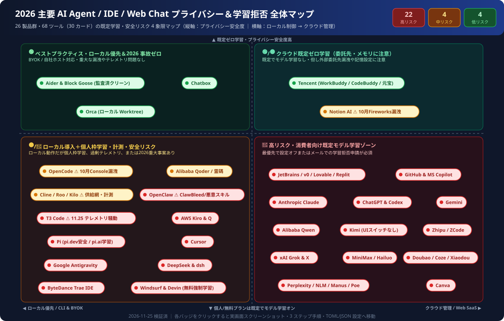

## 🚨 情報漏洩の 90% を防ぐ 6 つの鉄則
1. **個人向けプランの既定モデル学習は標準化**：Claude（2025.08〜）、GitHub Copilot 個人版（2026.04〜）、ChatGPT、Gemini、Grok、Trae、Doubao、Kimi、DeepSeek、ChatGLM、Canva、Perplexity は個人枠が既定で学習オン。**Tencent 系、Notion AI、NotebookLM、Zed、Amp、クリーン OSS Agent** は既定ゼロ学習。
2. **CLI はログイン認証方式で決まる**：Claude Code / Codex / Gemini CLI / Antigravity に個人アカウントでログインすると学習規約が継承される。商用 API / Vertex / Bedrock / Enterprise を使用すること。
3. **メモリ無効化 ≠ 既存記憶の削除**：Claude、Doubao、Kimi、WorkBuddy、Perplexity、Poe、Windsurf はスイッチをオフにしても蓄積済みの記憶が残るため、必ず手動削除する。
4. **`.ignore` の落とし穴**：Claude Code に `.claudeignore` なし（`permissions.deny` を使用）、Codex に `.codexignore` なし、Copilot に `.copilotignore` なし（Web の Content exclusion）、Cline は `.clineignore` 廃止、Amp に `.ampignore` なし。
5. **一時チャット ≠ ゼロデータ保持（ZDR）**：ChatGPT/Claude は安全ログを最長 30 日保持、Gemini は 2026 年に約 2 か月へ延長。完全オフライン保護はローカル Ollama/vLLM 必須。
6. **OSS やゼロ学習でも監査不要ではない（2026 セキュリティ総点検）**：**T3 Code**（11.25 ゼロテレメトリ撤回・認証読取・プロセス走査）、**OpenClaw**（ClawBleed RCE・1,000 件超の悪意スキル・Meta/MS 禁止令）、**OpenCode Console**（10.16 API キー流出）、**Cline/Roo/Kilo**（2 月 npm 2.3.0 供給網侵害等）、**Notion AI**（10 月 Fireworks AI 経由の履歴漏洩）をすべて反映し再分類済み。

## ⚡ 3 分クイック早見表

| リスク | 製品群 | 最短オフ手順 | メモリ対策 | 設定ファイル |
| :---: | :--- | :--- | :--- | :--- |
| 🔴 高リスク | **[Anthropic / Claude シリーズ](#claude)** | 左下プロフィール → Settings → Privacy → Help improve Claude をオフ → CLI: ~/.claude/settings.json | クロス端末メモリ・Auto Memory が既定オン → オフ後に既存メモリを手動削除 | `~/.claude/settings.json` |
| 🔴 高リスク | **[OpenAI / ChatGPT & Codex](#openai)** | Settings → Data controls → Improve the model をオフ → Codex は --with-api-key 利用 → ~/.codex/config.toml を編集 | ChatGPT メモリ既定オン（オフ後に削除必須）；Codex ローカルメモリは既定 false | `~/.codex/config.toml` |
| 🔴 高リスク | **[Google Gemini & Gemini CLI](#gemini)** | myactivity.google.com/product/gemini → AI モデルの学習への協力をオフ → CLI は Vertex AI / 有料 API へ切替 → ~/.gemini/settings.json を編集 | Personal context は既定オン → オフ；自動削除を 3 か月に短縮 | `~/.gemini/settings.json` |
| 🔴 高リスク | **[Google Antigravity スイート](#antigravity)** | Settings → Account → Enable Telemetry をオフ → CLI /config で telemetry をオフ → ./.antigravityignore を配置 | Knowledge Items に独立スイッチなし → 機密作業後に ~/.gemini/antigravity/knowledge/ を清掃 | `~/.gemini/antigravity-cli/settings.json` |
| 🔴 高リスク | **[xAI / Grok シリーズ](#grok)** | grok.com → Data Controls オフ → x.com/settings/grok_settings 全解除 → Build: ~/.grok/config.toml 編集 | Web・X ともにメモリ既定オン → 全チェック解除；Grok Build メモリは既定 false | `~/.grok/config.toml` |
| 🔴 高リスク | **[Microsoft / GitHub Copilot](#copilot)** | github.com/settings/copilot/features → AI model training → Disabled → 公開コード一致 → Blocked → Web で Content exclusion 設定 | Copilot Memory・M365 パーソナライズ既定オン → 機密組織では無効化推奨 | `VS Code settings.json & CLI` |
| 🔴 高リスク | **[AWS Kiro & Amazon Q](#aws_kiro)** | IDE 設定で Telemetry / Share を検索 → Content Collection・Share with AWS 解除 → CLI で telemetry と knowledge をオフ | Kiro Memory は既定オフ；Amazon Q にクラウド個人プロファイルなし | `~/.kiro/settings/cli.json & CLI` |
| 🔴 高リスク | **[Cursor](#cursor)** | Ctrl/Cmd+Shift+J で Cursor Settings → General → Privacy → Privacy Mode (Legacy) をオン → .cursorignore を配置 | 自動 Memories は v2.1+ で正式廃止済み；監査可能な .cursor/rules/*.mdc を利用 | `.cursorignore & ~/.cursor/cli-config.json` |
| 🔴 高リスク | **[Cognition / Windsurf & Devin](#windsurf_devin)** | windsurf.com/settings → ZDR オン → Cascade → Customizations で Memories オフ → app.devin.ai → Data Controls オフ | Windsurf Cascade 自動メモリ既定オン → 無効化し ~/.codeium/windsurf/memories/ を削除 | `Windsurf settings.json & ~/.config/devin/config.json` |
| 🔴 高リスク | **[Canva (Magic Studio)](#canva)** | 右上プロフィール → 設定 → アカウント → プライバシー管理 → AI 学習関連スイッチ 2 項目をオフ → AI パーソナライズをオフ | AI 生成コンテンツのパーソナライズ既定オン → オフ推奨 | なし |
| 🟡 要調整 | **[Notion AI ⚠️ (2026.10 委託先漏洩)](#notion)** | Settings → Notion AI → Share data to improve がオフか確認 → Memory → Use memories をオフ → 対話に API Key・パスワード貼付厳禁 | Use memories 既定オン → オフ推奨；Custom Agents 作成を管理者限定にし、過去貼付キーをローテーション | なし |
| 🟡 要調整 | **[OpenCode ⚠️ (2026.10 Console 漏洩)](#opencode)** | OpenCode Console に API Key を預けない → ~/.config/opencode/opencode.json を編集 → share: "disabled" 固定・Zen 無料禁止 → OPENCODE_DISABLE_* を設定 | クラウドメモリなし；ローカル SQLite (opencode.db) 保存、OPENCODE_DB で分離可能 | `~/.config/opencode/opencode.json` |
| 🔴 高リスク | **[Pi (Coding Agent & pi.ai)](#pi)** | pi.dev: enableInstallTelemetry を false → pi.dev 無痕起動: pi --no-session → pi.ai: Account Settings で学習拒否 | pi.dev は --no-session で JSONL 保存ゼロ；pi.ai は !delete で履歴削除 | `~/.pi/agent/settings.json` |
| 🔴 高リスク | **[T3 Code ⚠️ (2026.11 テレメトリ騒動)](#t3code)** | 2026.11.25 以降の修正版へ更新 → policy.json で telemetry:false 固定 → 環境変数 4 項目（TELEMETRY/OTEL/DNT）設定 → Publish agent activity オフ・Supervised 切替 | ローカル state.sqlite は 11.25 (#42119) まで削除しても残存 → 即時更新必須；Publish agent activity はプロジェクト名・スレッド題名を外部送信しテレメトリ拒否を無視 | `/etc/t3code/policy.json & 必須環境変数 4 項目` |
| 🟢 安全 | **[Orca (stablyai/orca)](#orca)** | Settings → Privacy で匿名統計をオフ → ORCA_TELEMETRY_DISABLED=1 を設定 → 完全終了後に orca-data.json 編集 | クラウドメモリなし；Git Worktree 単位でローカル分離し機密作業後に削除 | `Shell & orca-data.json` |
| 🟢 安全 | **[Chatbox](#chatbox)** | Settings → Privacy でレポート送信オフ → 各プロバイダーの Improve Network Compat をオフ → ローカル Ollama または ZDR 直結 API を利用 | 完全ローカル保存（自動クラウド同期なし）；完全オフラインのローカル RAG 対応 | `%APPDATA%\chatbox\config.json` |
| 🔴 高リスク | **[ByteDance・Trae IDE & Agent CLI](#trae)** | Settings → Account → Privacy Mode をオン → Rules & Memories で自動メモリをオフ → .trae/.ignore を配置 | 自動 Memory がセッション横断で蓄積 → オフ後に ~/.trae(-cn)/memory/ を削除 | `.trae/.ignore & trae_config.yaml` |
| 🔴 高リスク | **[ByteDance・Doubao / Coze / Xiaodou](#doubao)** | 設定 → プライバシーと権限 → モデル改善へのデータ提供を全オフ → 設定 → メモリをオフ＋全削除 → Coze: 一般設定で改善利用をオフ | メモリ既定オン（オフでも履歴残存）；Xiaodou は Doubao 記憶を統合し連携アプリ権限が広範 | `Volcengine ModelArk ゼロ学習 API` |
| 🟢 安全 | **[Tencent・WorkBuddy / CodeBuddy / 元宝](#tencent)** | 元宝：データ管理 → 体験改善計画がオフか確認 → WorkBuddy：記憶生成をオフ＋リセット → CodeBuddy：~/.codebuddy/settings.json 設定 | WorkBuddy は夜間自動メモリ抽出あり → オフ＋リセットし保持期間を 30 日に短縮 | `~/.codebuddy/settings.json` |
| 🟡 要調整 | **[Alibaba・Qoder & 通義霊碼 (Lingma)](#qoder)** | Settings → 一般 → プライバシーモードオン → メモリ管理 → 自動メモリをオフ＋清掃 → CLI: ~/.qoder/settings.json を編集 | グローバル/プロジェクト自動メモリ＋1万ファイル未満の自動インデックス → 機密リポはオフ＋.qoderignore | `~/.qoder/settings.json` |
| 🔴 高リスク | **[Alibaba Qwen・Qwen Code & Qwen Chat](#qwen)** | chat.qwen.ai：privacy@qwen.com へ拒否メール → Web/App メモリオフ・QwenWork USER.md 清掃 → CLI: ~/.qwen/settings.json を編集 | Qwen Code CLI の AutoMemory・AutoDream が既定 true！QwenWork は ~/.qwenworkcn/awareness/ へ記録 | `~/.qwen/settings.json` |
| 🔴 高リスク | **[Zhipu AI / GLM & ZCode](#zhipu)** | ChatGLM：プロフィール → データ管理 → 体験改善・データ利用をオフ → ZCode：メモリオフ維持＋テレメトリ通信遮断 | ZCode ワークスペースメモリは既定オフ；ChatGLM は横断メモリ管理・シークレットモードなし | `ローカルプロキシ遮断ルール & ~/.zcode/AGENTS.md` |
| 🔴 高リスク | **[MiniMax・mcode / Agent / Hailuo](#minimax)** | Agent：Personalization で Memory & Proactive オフ → Memory summary → Manage で全削除 → mcode: config.yaml を default 権限に固定 | MiniMax Agent の Proactive Memory はオフにしても旧項目が残存 → 無効化後にサマリー全削除 | `~/.minimax/config.yaml` |
| 🔴 高リスク | **[Moonshot AI / Kimi シリーズ](#kimi)** | support@moonshot.cn へ学習拒否メール申請 → 設定 → パーソナライズ → 会話メモリをオフ → 「メモリスペース」内の既存項目を削除 → ~/.kimi-code/config.toml を編集 | 自動でメモリスペースへ書込（オフでも消えない）、シークレットモードなし → 無効化＋手動全削除 | `~/.kimi-code/config.toml` |
| 🔴 高リスク | **[DeepSeek & Harness (dsh)](#deepseek)** | Web/App：設定 → データ管理 → Improve the model（体験改善）をオフ → dsh: cordis.patch.yml を DISABLED に設定 → 機密コードは Ollama で OSS 重みを自社ホスト | Web 版に横断長期メモリ・無痕モードなし；dsh はプラグイン型ローカル記憶、OTel 既定は FEEDBACK_ONLY | `~/.dsh/profiles/web/cordis.patch.yml` |
| 🟢 安全 | **[クリーン OSS Agent (Aider・Goose)](#oss_clean)** | Aider: ~/.aider.conf.yml で analytics-disable & gitignore → Goose: 初回プロンプト拒否＋GOOSE_TELEMETRY_OFF=1 → ローカル Ollama または商用 ZDR API を接続 | ブラックボックス型クラウド記憶なし；Aider の平文ログ .aider.chat.history.md は gitignore: true で誤コミット防止 | `~/.aider.conf.yml & Goose 環境変数` |
| 🟡 要調整 | **[Cline / Roo Code / Kilo Code ⚠️](#cline_roo_kilo)** | Cline: npm 2.3.0 回避、telemetryOptOut:true 設定 → Roo Code: Roo Cloud 禁止＋CVE-2025-58372 修正版へ → Kilo Code: テレメトリオフ＋外部通信監視 | ローカル運用ならクラウド記憶なし；Roo Cloud 同期にはログインしないこと | `Cline / Kilo 設定・環境変数` |
| 🔴 高リスク | **[OpenClaw ⚠️ (2026 重大セキュリティ危機)](#openclaw)** | 必ず完全隔離されたコンテナ/VM 内のみで実行 → Trail of Bits 監査後の最新修正版へ強制更新 → 未監査の ClawHub スキル導入厳禁 → 外部バインド禁止・ゲートウェイ認証強制 | ホスト永続メモリと全ユーザー権限を持つ → 商用ソースコードや本番キーがある端末での直接実行は絶対厳禁 | `~/.openclaw/openclaw.json & コンテナ隔離` |
| 🔴 高リスク | **[商用 IDE & クラウド開発 (6 製品)](#comm_ide)** | JetBrains: System Settings → Data Sharing 全解除 → v0 / Lovable / Replit: Model Training オフ＆Private 化 → Zed テレメトリオフ・Amp を visibility: private 固定 | JetBrains は .junie/guidelines.md を使用；Replit 自動生成の replit.md に秘密鍵を書かない | `~/.config/zed/settings.json & ~/.config/amp/settings.json` |
| 🔴 高リスク | **[リサーチ・汎用 Web AI (4 製品)](#web_research)** | Perplexity: Preferences → AI Data Retention オフ＆メモリ削除 → NotebookLM: 既定ゼロ学習（高/低評価を押さない） → Manus: 学習拒否＋非公開・Poe: 完全盾アイコンのみ選択 | Perplexity・Poe はオフでも旧メモリが残存するため手動削除必須；NotebookLM はノート単位で隔離 | なし |

## 📷 製品別ガイド（実画面スクリーンショット＆設定ファイル）

<a id="claude"></a>
### 🔴 高リスク Anthropic / Claude シリーズ
*Claude Code CLI・Claude Desktop/Cowork・Web/App* ｜ [公式ドキュメント](https://code.claude.com/docs/en/data-usage)

- **設定手順**: 左下プロフィール `➔` Settings → Privacy `➔` Help improve Claude をオフ `➔` CLI: ~/.claude/settings.json
- **学習・リスク**: 個人 Free/Pro/Max は 2025.08 より既定オン（最長5年保持）→ 必ずオフ；Team/API は既定オフ
- **メモリ設定**: クロス端末メモリ・Auto Memory が既定オン → オフ後に既存メモリを手動削除
- **⚠️ 注意点**: Claude Code は .claudeignore 非対応（permissions.deny を使用）；環境変数は空文字以外で有効のため '0' 設定厳禁

<details open><summary>📷 実画面スクリーンショット (privacyinternational.org)</summary>

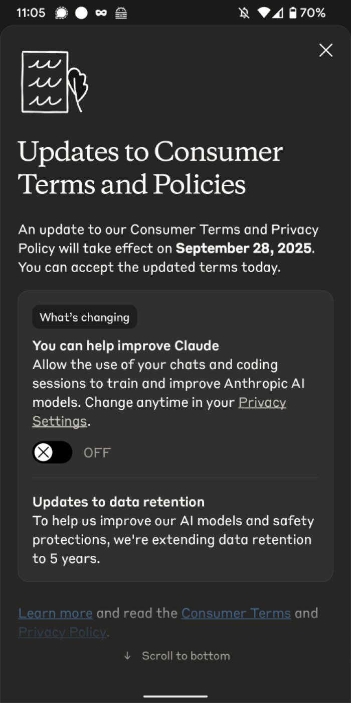

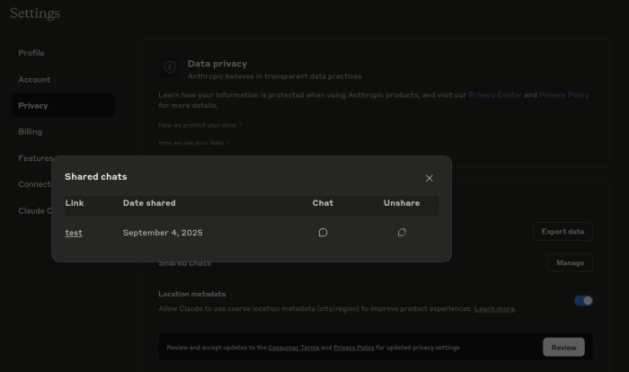

</details>

**⚙️ `~/.claude/settings.json`**
```json
{
  "autoMemoryEnabled": false,
  "cleanupPeriodDays": 0,
  "permissions": { "deny": ["Read(.env*)", "Edit(.env*)", "Read(secrets/**)"] },
  "env": {
    "CLAUDE_CODE_DISABLE_NONESSENTIAL_TRAFFIC": "1",
    "DISABLE_TELEMETRY": "1",
    "CLAUDE_CODE_DISABLE_AUTO_MEMORY": "1"
  }
}
```

<a id="openai"></a>
### 🔴 高リスク OpenAI / ChatGPT & Codex
*Codex CLI・Codex App/Web・ChatGPT Web/App* ｜ [公式ドキュメント](https://developers.openai.com/codex/config-reference)

- **設定手順**: Settings → Data controls `➔` Improve the model をオフ `➔` Codex は --with-api-key 利用 `➔` ~/.codex/config.toml を編集
- **学習・リスク**: 個人 ChatGPT・個人ログイン Codex は既定オン → 必ずオフ；API/Business/Enterprise は既定オフ
- **メモリ設定**: ChatGPT メモリ既定オン（オフ後に削除必須）；Codex ローカルメモリは既定 false
- **⚠️ 注意点**: Codex は .codexignore 非対応；ログインシェル経由の秘密情報漏洩防止に allow_login_shell = false を設定

<details open><summary>📷 実画面スクリーンショット (progresslearning.helpdocs.io)</summary>

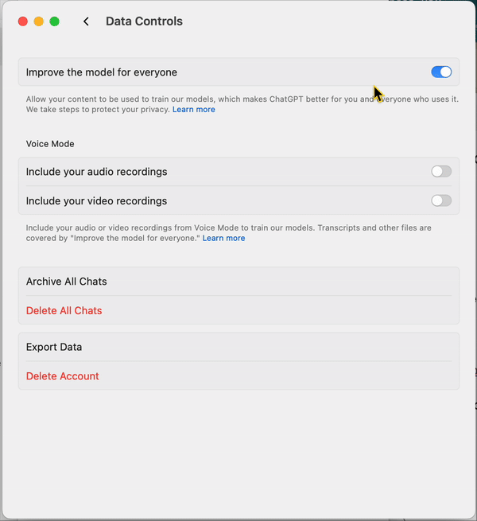

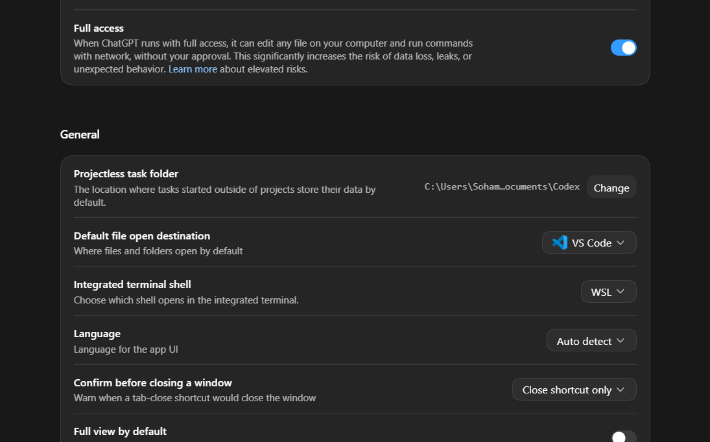

</details>

**⚙️ `~/.codex/config.toml`**
```toml
allow_login_shell = false
[analytics]
enabled = false
[feedback]
enabled = false
[history]
persistence = "none"
[features]
memories = false
```

<a id="gemini"></a>
### 🔴 高リスク Google Gemini & Gemini CLI
*Gemini Web/App・Gemini CLI* ｜ [公式ドキュメント](https://geminicli.com/docs/tos-privacy)

- **設定手順**: myactivity.google.com/product/gemini `➔` AI モデルの学習への協力をオフ `➔` CLI は Vertex AI / 有料 API へ切替 `➔` ~/.gemini/settings.json を編集
- **学習・リスク**: 2026.11 分離後もテキスト学習は既定オン；CLI 個人枠・無料キーも学習対象 → Vertex/有料 API 必須
- **メモリ設定**: Personal context は既定オン → オフ；自動削除を 3 か月に短縮
- **⚠️ 注意点**: 2026 年より一時チャットの安全監査保持が約 2 か月へ延長；CLI の logPrompts は既定 true！

<details open><summary>📷 実画面スクリーンショット (redact.dev)</summary>

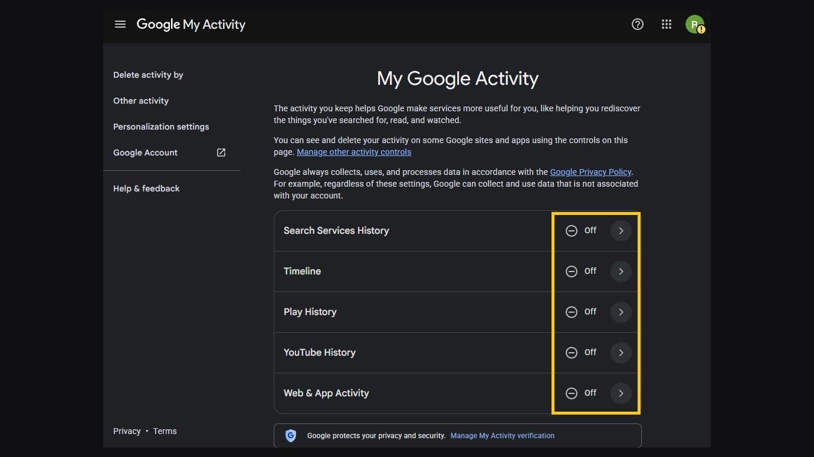

</details>

**⚙️ `~/.gemini/settings.json`**
```json
{
  "privacy": { "usageStatisticsEnabled": false },
  "telemetry": { "enabled": false, "logPrompts": false },
  "experimental": { "autoMemory": false }
}
// ./.geminiignore も作成し、export GOOGLE_GENAI_USE_VERTEXAI=true を設定
```

<a id="antigravity"></a>
### 🔴 高リスク Google Antigravity スイート
*Antigravity App 2.0・IDE・agy CLI* ｜ [公式ドキュメント](https://antigravity.google/docs/settings)

- **設定手順**: Settings → Account `➔` Enable Telemetry をオフ `➔` CLI /config で telemetry をオフ `➔` ./.antigravityignore を配置
- **学習・リスク**: 個人アカウントの Enable Telemetry は既定オン（モデル学習の主スイッチ兼任）→ 必ずオフ；Workspace は既定オフ
- **メモリ設定**: Knowledge Items に独立スイッチなし → 機密作業後に ~/.gemini/antigravity/knowledge/ を清掃
- **⚠️ 注意点**: App/IDE と agy CLI は設定が独立しているため両方でオフ必須；Strict Mode と Sandbox を維持

<details open><summary>📷 実画面スクリーンショット (antigravity.google)</summary>

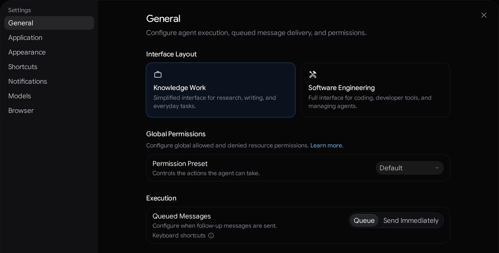

</details>

**⚙️ `~/.gemini/antigravity-cli/settings.json`**
```json
{
  "$schema": "https://antigravity.google/schemas/v1/settings.json",
  "enableTelemetry": false
}
```

<a id="grok"></a>
### 🔴 高リスク xAI / Grok シリーズ
*Grok Build CLI・grok.com・X プラットフォーム Grok Bot* ｜ [公式ドキュメント](https://github.com/xai-org/grok-build)

- **設定手順**: grok.com → Data Controls オフ `➔` x.com/settings/grok_settings 全解除 `➔` Build: ~/.grok/config.toml 編集
- **学習・リスク**: Grok Web・X 投稿/対話とも既定で学習対象 → 両方でオプトアウト必須；Business/API は ZDR 対応
- **メモリ設定**: Web・X ともにメモリ既定オン → 全チェック解除；Grok Build メモリは既定 false
- **⚠️ 注意点**: X と grok.com の設定は別管理のため両方オフ必須；Grok Build は disable_codebase_upload = true 必須

<details open><summary>📷 実画面スクリーンショット (redact.dev)</summary>

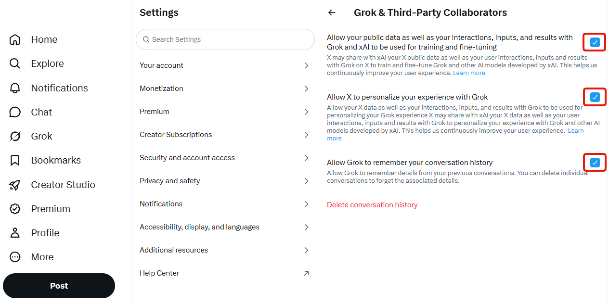

</details>

**⚙️ `~/.grok/config.toml`**
```toml
[features]
telemetry = false
[telemetry]
enabled = false
trace_upload = false
[harness]
disable_codebase_upload = true
coding_data_retention_opt_out = true
```

<a id="copilot"></a>
### 🔴 高リスク Microsoft / GitHub Copilot
*GitHub Copilot・MS Copilot 個人版・M365 法人版* ｜ [公式ドキュメント](https://docs.github.com/en/copilot/managing-copilot/managing-copilot-as-an-individual-subscriber/managing-your-copilot-plan/managing-copilot-policies-as-an-individual-subscriber)

- **設定手順**: github.com/settings/copilot/features `➔` AI model training → Disabled `➔` 公開コード一致 → Blocked `➔` Web で Content exclusion 設定
- **学習・リスク**: GitHub 個人 Free/Pro は 2026.04 より既定で学習オン！MS 個人版もオン；Business/M365 はゼロ学習
- **メモリ設定**: Copilot Memory・M365 パーソナライズ既定オン → 機密組織では無効化推奨
- **⚠️ 注意点**: ローカル .copilotignore 非対応！GitHub Web 側の Content exclusion 設定＋VS Code テレメトリ遮断が必須

<details open><summary>📷 実画面スクリーンショット (redact.dev)</summary>

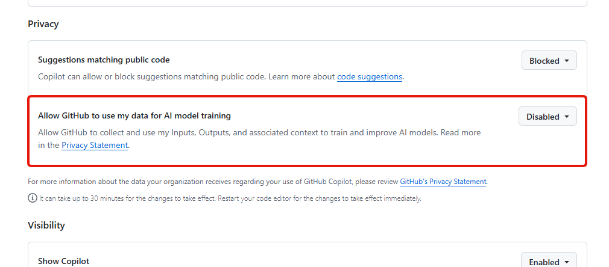

</details>

**⚙️ `VS Code settings.json & CLI`**
```json
// VS Code settings.json
{ "telemetry.telemetryLevel": "off", "github.copilot.enable": { "*": true, "dotenv": false } }
// Terminal: gh config set telemetry disabled && export GH_TELEMETRY=0
```

<a id="aws_kiro"></a>
### 🔴 高リスク AWS Kiro & Amazon Q
*Kiro IDE/CLI・Amazon Q Developer* ｜ [公式ドキュメント](https://kiro.dev/docs/privacy-and-security/data-protection/)

- **設定手順**: IDE 設定で Telemetry / Share を検索 `➔` Content Collection・Share with AWS 解除 `➔` CLI で telemetry と knowledge をオフ
- **学習・リスク**: Kiro Free・Q Builder ID 無料版は既定で改善共有オン → オフ必須；Pro/Enterprise は既定オフ
- **メモリ設定**: Kiro Memory は既定オフ；Amazon Q にクラウド個人プロファイルなし
- **⚠️ 注意点**: Kiro 個人版は共有オフでも不正検知ログを最長 60 日保持；企業は Q Pro＋AWS Organizations Opt-Out 必須

<details open><summary>📷 実画面スクリーンショット (docs.aws.amazon.com)</summary>

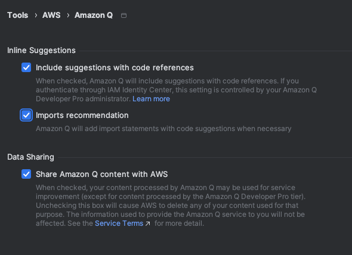

</details>

**⚙️ `~/.kiro/settings/cli.json & CLI`**
```shell
kiro-cli settings telemetry.enabled false
kiro-cli settings chat.enableKnowledge false
q settings telemetry.enabled false
q settings shareCodeWhispererContent false
```

<a id="cursor"></a>
### 🔴 高リスク Cursor
*Cursor IDE・Cursor CLI・Cloud Agents* ｜ [公式ドキュメント](https://cursor.com/security)

- **設定手順**: Ctrl/Cmd+Shift+J で Cursor Settings `➔` General → Privacy `➔` Privacy Mode (Legacy) をオン `➔` .cursorignore を配置
- **学習・リスク**: Free は既定で Share Data → 必ず Privacy Mode (Legacy) オン；Teams/Ent は標準強制
- **メモリ設定**: 自動 Memories は v2.1+ で正式廃止済み；監査可能な .cursor/rules/*.mdc を利用
- **⚠️ 注意点**: 機密リポジトリで Cloud Agents を有効化厳禁（クラウド VM スナップショットが永続化し ZDR が破綻）

**⚙️ `.cursorignore & ~/.cursor/cli-config.json`**
```json
// ~/.cursor/cli-config.json（リポジトリ直下に .cursorignore も配置し .env / *.key / secrets/ を除外）
{ "permissions": { "deny": ["Read(.env*)", "Read(**/*.pem)", "WebFetch(*)"] } }
```

<a id="windsurf_devin"></a>
### 🔴 高リスク Cognition / Windsurf & Devin
*Windsurf IDE (旧 Codeium)・Devin Web & CLI* ｜ [公式ドキュメント](https://docs.windsurf.com/)

- **設定手順**: windsurf.com/settings → ZDR オン `➔` Cascade → Customizations で Memories オフ `➔` app.devin.ai → Data Controls オフ
- **学習・リスク**: 両製品とも Free プランは強制学習（オプトアウト不可）！Pro は手動オプトアウト必須；Teams/Ent は ZDR
- **メモリ設定**: Windsurf Cascade 自動メモリ既定オン → 無効化し ~/.codeium/windsurf/memories/ を削除
- **⚠️ 注意点**: 商用ソースコードを Free プランに投入厳禁；Devin CLI は sandbox.enabled: true 必須

**⚙️ `Windsurf settings.json & ~/.config/devin/config.json`**
```json
// Windsurf User/settings.json（.codeiumignore も併用）
{ "telemetry.telemetryLevel": "off", "codeium.enableTelemetry": false }
// ~/.config/devin/config.json
{ "sandbox": { "enabled": true }, "permissions": { "deny": ["Read(.env*)"] } }
```

<a id="canva"></a>
### 🔴 高リスク Canva (Magic Studio)
*Canva Web / Desktop / Mobile* ｜ [公式ドキュメント](https://www.canva.com/settings/privacy-preferences)

- **設定手順**: 右上プロフィール → 設定 `➔` アカウント → プライバシー管理 `➔` AI 学習関連スイッチ 2 項目をオフ `➔` AI パーソナライズをオフ
- **学習・リスク**: Free/Pro はコンテンツ・利用状況とも既定で学習オン → 両方オフ必須；Teams/Ent/Edu は既定ロックオフ
- **メモリ設定**: AI 生成コンテンツのパーソナライズ既定オン → オフ推奨
- **⚠️ 注意点**: 直リンク：canva.com/settings/privacy-preferences；ネイティブのシークレットモードなし

<details open><summary>📷 実画面スクリーンショット (redact.dev)</summary>

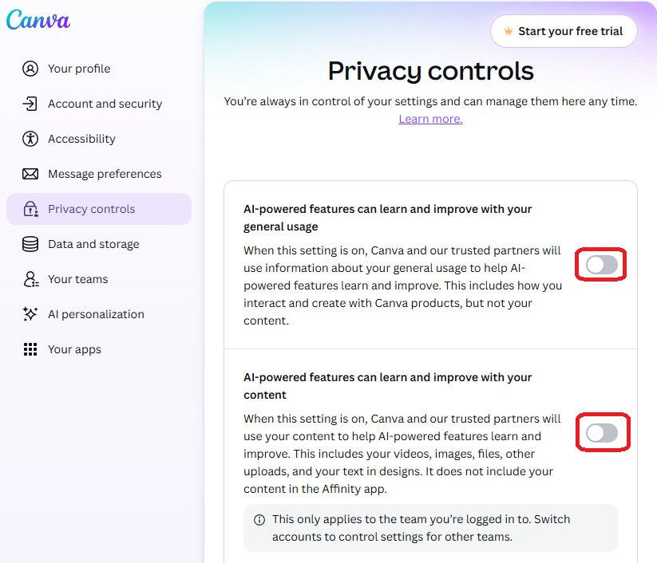

</details>

<a id="notion"></a>
### 🟡 要調整 Notion AI ⚠️ (2026.10 委託先漏洩)
*Notion Web/Desktop/Mobile・ゼロ学習だが外部委託先で漏洩発生* ｜ [公式ドキュメント](https://www.notion.com/help/notion-ai-security-practices)

- **設定手順**: Settings → Notion AI `➔` Share data to improve がオフか確認 `➔` Memory → Use memories をオフ `➔` 対話に API Key・パスワード貼付厳禁
- **学習・リスク**: 全プラン既定ゼロ学習 ✅；⚠️ 但し 2026.10–11 推論委託先 Fireworks AI が侵害され、1% 未満のワークスペースで Notion AI 履歴・貼付キーが漏洩
- **メモリ設定**: Use memories 既定オン → オフ推奨；Custom Agents 作成を管理者限定にし、過去貼付キーをローテーション
- **⚠️ 注意点**: 外部サブプロセッサ侵害は理論上の ZDR を崩す；非 Enterprise 版で AI UI 完全無効化は team@makenotion.com へメール必須

<a id="opencode"></a>
### 🟡 要調整 OpenCode ⚠️ (2026.10 Console 漏洩)
*Anomaly Co. (旧 SST)・ローカル BYOK 専用、ホスト Console 厳禁* ｜ [公式ドキュメント](https://opencode.ai/docs/config)

- **設定手順**: OpenCode Console に API Key を預けない `➔` ~/.config/opencode/opencode.json を編集 `➔` share: "disabled" 固定・Zen 無料禁止 `➔` OPENCODE_DISABLE_* を設定
- **学習・リスク**: ローカル CLI/BYOK はゼロ学習 ✅；⚠️ 2026.10.16 ホスト版 Console 旧基盤が侵害され連携キー約 1.4% が流出（不正課金被害）；Zen 無料枠はデータ収集対象
- **メモリ設定**: クラウドメモリなし；ローカル SQLite (opencode.db) 保存、OPENCODE_DB で分離可能
- **⚠️ 注意点**: Console にキーを登録した履歴がある場合は各プロバイダー側で即座に失効・再発行必須！share は必ず disabled 固定

<details open><summary>📷 実画面スクリーンショット (github.com/anomalyco/opencode)</summary>

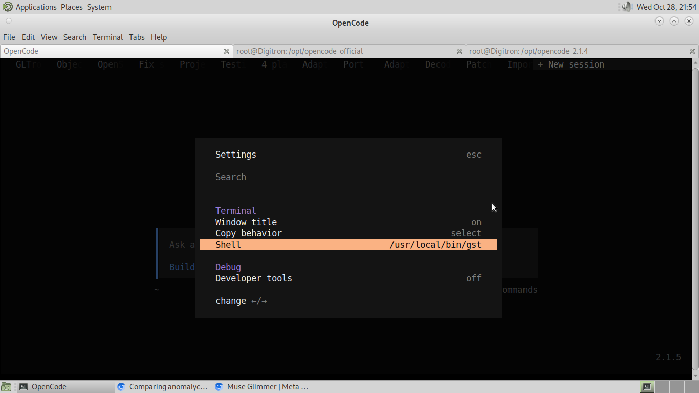

</details>

**⚙️ `~/.config/opencode/opencode.json`**
```json
{
  "share": "disabled",
  "autoupdate": false,
  "snapshot": false,
  "experimental": { "openTelemetry": false },
  "permission": { "read": { "*": "allow", "*.env": "deny", "*.env.*": "deny" }, "webfetch": "deny" }
}
```

<a id="pi"></a>
### 🔴 高リスク Pi (Coding Agent & pi.ai)
*OSS 端末 pi.dev (低リスク) vs 消費者向け pi.ai (高リスク)* ｜ [公式ドキュメント](https://pi.dev)

- **設定手順**: pi.dev: enableInstallTelemetry を false `➔` pi.dev 無痕起動: pi --no-session `➔` pi.ai: Account Settings で学習拒否
- **学習・リスク**: pi.dev は完全ローカル BYOK ゼロ学習 ✅；同名の消費者向け Inflection pi.ai は既定学習＋音声感情推定 ❌
- **メモリ設定**: pi.dev は --no-session で JSONL 保存ゼロ；pi.ai は !delete で履歴削除
- **⚠️ 注意点**: 同名だが完全に別製品！pi.dev は PI_TELEMETRY=0 PI_OFFLINE=1 を設定；pi.ai へソースコード貼付厳禁

**⚙️ `~/.pi/agent/settings.json`**
```json
{ "enableInstallTelemetry": false, "defaultProvider": "anthropic" }
// Shell: export PI_TELEMETRY=0 PI_OFFLINE=1  &&  pi --no-session
```

<a id="t3code"></a>
### 🔴 高リスク T3 Code ⚠️ (2026.11 テレメトリ騒動)
*Ping Labs OSS 制御面・ゼロテレメトリ公約撤回と認証ファイル読取問題* ｜ [公式ドキュメント](https://github.com/pingdotgg/t3code/blob/main/docs/user/telemetry.md)

- **設定手順**: 2026.11.25 以降の修正版へ更新 `➔` policy.json で telemetry:false 固定 `➔` 環境変数 4 項目（TELEMETRY/OTEL/DNT）設定 `➔` Publish agent activity オフ・Supervised 切替
- **学習・リスク**: モデル学習はしないが、公式サイトの「No telemetry」公約を無断削除し PostHog+ingest.t3.codes+Axiom を既定オン！11 月に ~/.claude.json・~/.codex/auth.json 読取ハッシュ(#42299)、全プロセス走査(#42577)、偽削除(#42119)、パス漏洩(#42450)が発覚
- **メモリ設定**: ローカル state.sqlite は 11.25 (#42119) まで削除しても残存 → 即時更新必須；Publish agent activity はプロジェクト名・スレッド題名を外部送信しテレメトリ拒否を無視
- **⚠️ 注意点**: ホスト Web 版に追跡オフ設定なし；モバイル診断 2 項目はサーバポリシー無視；旧 Windows 版は拒否設定無効(#42376)。ingest.t3.codes の遮断と Full Access 回避を推奨

<details open><summary>📷 実画面スクリーンショット (github.com/pingdotgg/t3code)</summary>

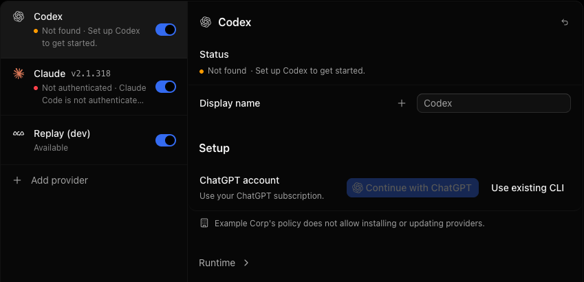

</details>

**⚙️ `/etc/t3code/policy.json & 必須環境変数 4 項目`**
```json
// /etc/t3code/policy.json (Win: C:\ProgramData\T3Code\policy.json)
{
  "schemaVersion": 1,
  "settings": { "enableAgentBrowserAccess": { "value": false, "locked": true } },
  "limits": { "clients": ["desktop", "local-browser"], "telemetry": false }
}
// 環境変数 4 項目すべて設定＋ファイアウォールで ingest.t3.codes 遮断推奨:
// DO_NOT_TRACK=1  T3CODE_TELEMETRY_ENABLED=false  T3CODE_OTEL_SDK_DISABLED=true  OTEL_SDK_DISABLED=true
```

<a id="orca"></a>
### 🟢 安全 Orca (stablyai/orca)
*MIT OSS ローカル BYOA マルチエージェント Worktree* ｜ [公式ドキュメント](https://github.com/stablyai/orca)

- **設定手順**: Settings → Privacy で匿名統計をオフ `➔` ORCA_TELEMETRY_DISABLED=1 を設定 `➔` 完全終了後に orca-data.json 編集
- **学習・リスク**: ローカル BYOA 制御面のためゼロ学習・2026 重大インシデントなし ✅；配布アプリ既定の PostHog 指標のみオフ
- **メモリ設定**: クラウドメモリなし；Git Worktree 単位でローカル分離し機密作業後に削除
- **⚠️ 注意点**: orca-data.json 編集前に Orca を完全終了すること（終了時メモリ上書き防止）；公開 dotfiles へ載せない

<details open><summary>📷 実画面スクリーンショット (github.com/stablyai/orca)</summary>

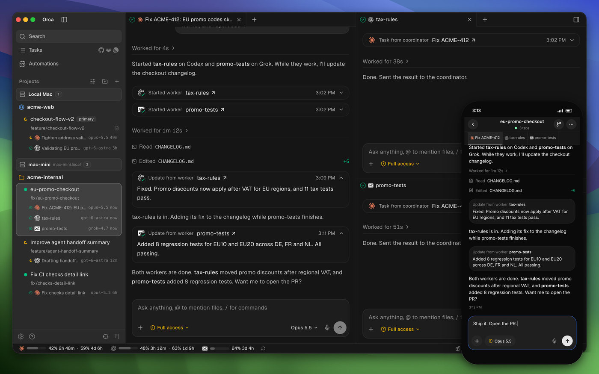

</details>

**⚙️ `Shell & orca-data.json`**
```shell
export ORCA_TELEMETRY_DISABLED=1
export DO_NOT_TRACK=1
# orca-data.json の "agentDefaultEnv" に DISABLE_TELEMETRY="1" を一括注入可能
```

<a id="chatbox"></a>
### 🟢 安全 Chatbox
*ローカル優先 マルチモデル デスクトップ/Web/モバイル* ｜ [公式ドキュメント](https://chatboxai.app)

- **設定手順**: Settings → Privacy でレポート送信オフ `➔` 各プロバイダーの Improve Network Compat をオフ `➔` ローカル Ollama または ZDR 直結 API を利用
- **学習・リスク**: クライアント自体はゼロ学習・2026 重大事故なし ✅；Sentry/Plausible 既定送信のみオフ推奨
- **メモリ設定**: 完全ローカル保存（自動クラウド同期なし）；完全オフラインのローカル RAG 対応
- **⚠️ 注意点**: 各プロバイダーの useProxy（ネットワーク互換性改善）を必ずオフにすること（オンだと BYOK 通信が中継経由になる）

<details open><summary>📷 実画面スクリーンショット (docs.apiyi.com)</summary>

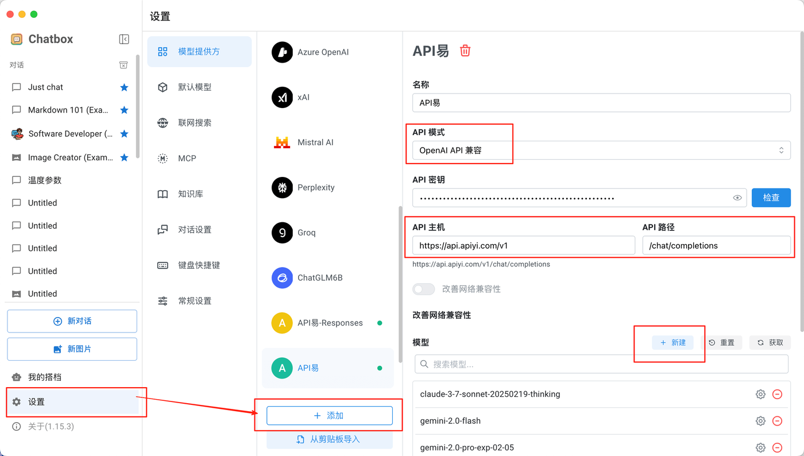

</details>

**⚙️ `%APPDATA%\chatbox\config.json`**
```json
{
  "settings": {
    "allowReportingAndTracking": false,
    "providers": { "openai": { "useProxy": false }, "claude": { "useProxy": false } }
  }
}
```

<a id="trae"></a>
### 🔴 高リスク ByteDance・Trae IDE & Agent CLI
*Trae 国際版/中国版/SOLO・OSS trae-agent* ｜ [公式ドキュメント](https://docs.trae.ai/ide/)

- **設定手順**: Settings → Account `➔` Privacy Mode をオン `➔` Rules & Memories で自動メモリをオフ `➔` .trae/.ignore を配置
- **学習・リスク**: 個人 Free/Pro は既定で Privacy Mode オフ（学習許可）→ 必ずオン；OSS CLI はゼロ学習
- **メモリ設定**: 自動 Memory がセッション横断で蓄積 → オフ後に ~/.trae(-cn)/memory/ を削除
- **⚠️ 注意点**: ログアウトすると Privacy Mode がリセットされる！VS Code テレメトリ設定では Trae 独自の通信は止まらない

<details open><summary>📷 実画面スクリーンショット (ithome.com)</summary>

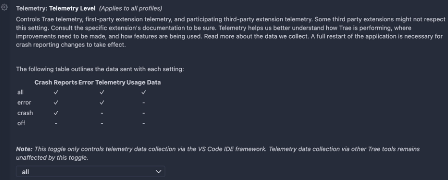

</details>

**⚙️ `.trae/.ignore & trae_config.yaml`**
```yaml
# Trae IDE settings.json: { "telemetry.telemetryLevel": "off" } + .trae/.ignore
# OSS trae-agent (trae_config.yaml):
default_provider: ollama
enable_lakeview: false
```

<a id="doubao"></a>
### 🔴 高リスク ByteDance・Doubao / Coze / Xiaodou
*豆包 (Doubao)・扣子 (Coze)・小豆 Personal Agent (2026.11 β)* ｜ [公式ドキュメント](https://www.volcengine.com/product/ark)

- **設定手順**: 設定 → プライバシーと権限 `➔` モデル改善へのデータ提供を全オフ `➔` 設定 → メモリをオフ＋全削除 `➔` Coze: 一般設定で改善利用をオフ
- **学習・リスク**: 消費者向け 3 製品すべて既定で学習オン ❌；開発者は Volcengine ModelArk 商用 API（ゼロ学習）を利用
- **メモリ設定**: メモリ既定オン（オフでも履歴残存）；Xiaodou は Doubao 記憶を統合し連携アプリ権限が広範
- **⚠️ 注意点**: 3 製品ともシークレットモードなし！会議録音通知や AI 代行通話での機密発言は厳禁

<details open><summary>📷 実画面スクリーンショット (csdn.net)</summary>

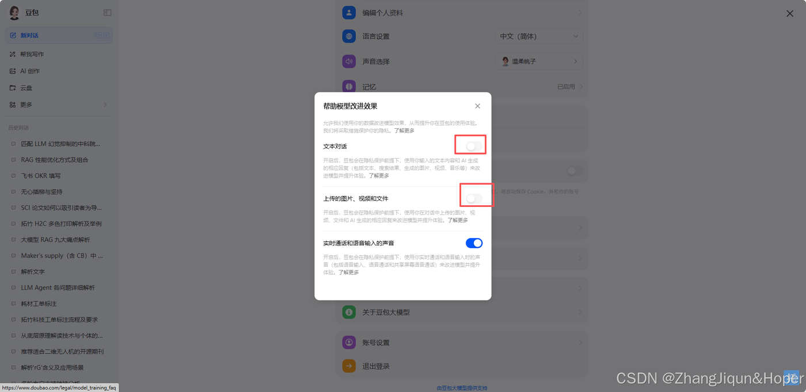

</details>

**⚙️ `Volcengine ModelArk ゼロ学習 API`**
```shell
# 商用 API 規約ではモデル学習対象外・ステートレス推論
export ARK_API_KEY="your-volcengine-ark-api-key"
export ARK_BASE_URL="https://ark.cn-beijing.volces.com/api/v3" 
```

<a id="tencent"></a>
### 🟢 安全 Tencent・WorkBuddy / CodeBuddy / 元宝
*WorkBuddy デスクトップ・CodeBuddy IDE/CLI・騰訊元宝 (Yuanbao)* ｜ [公式ドキュメント](https://www.codebuddy.cn/docs/)

- **設定手順**: 元宝：データ管理 → 体験改善計画がオフか確認 `➔` WorkBuddy：記憶生成をオフ＋リセット `➔` CodeBuddy：~/.codebuddy/settings.json 設定
- **学習・リスク**: 主力 3 製品すべて既定ゼロ学習 ✅（元宝は 2025.03 規約是正以降デフォルトオフを維持、2026 年事故なし）
- **メモリ設定**: WorkBuddy は夜間自動メモリ抽出あり → オフ＋リセットし保持期間を 30 日に短縮
- **⚠️ 注意点**: CodeBuddy CLI は CODEBUDDY_ARTIFACT_ENABLED=false を設定し公開プレビューURL誤発行を防止

<details open><summary>📷 実画面スクリーンショット (ifeng.com)</summary>

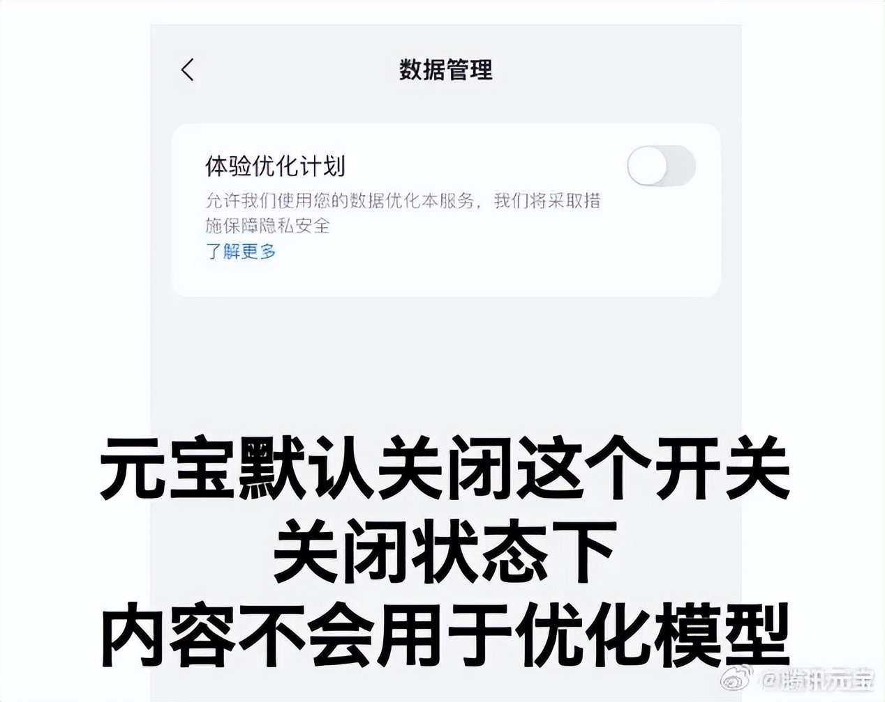

</details>

**⚙️ `~/.codebuddy/settings.json`**
```json
{
  "sandbox": { "enabled": true },
  "permissions": { "deny": ["Read(./.env*)", "Read(~/.ssh/**)"] },
  "env": { "DISABLE_TELEMETRY": "1", "CODEBUDDY_ARTIFACT_ENABLED": "false" }
}
```

<a id="qoder"></a>
### 🟡 要調整 Alibaba・Qoder & 通義霊碼 (Lingma)
*Qoder IDE/CLI・通義霊碼（2026.05 Qoder CN 統合）* ｜ [公式ドキュメント](https://docs.qoder.com/)

- **設定手順**: Settings → 一般 → プライバシーモードオン `➔` メモリ管理 → 自動メモリをオフ＋清掃 `➔` CLI: ~/.qoder/settings.json を編集
- **学習・リスク**: コード補完コンテキストは学習不使用、但し匿名化 Q&A 等は改善利用あり；CLI 統計 2 項目が既定 true → 全オフ
- **メモリ設定**: グローバル/プロジェクト自動メモリ＋1万ファイル未満の自動インデックス → 機密リポはオフ＋.qoderignore
- **⚠️ 注意点**: 回答への高評価/低評価ボタンを押さない（フィードバック収集発火）；QODER_MEMORY=1 は設定しない

<details open><summary>📷 実画面スクリーンショット (cnblogs.com)</summary>

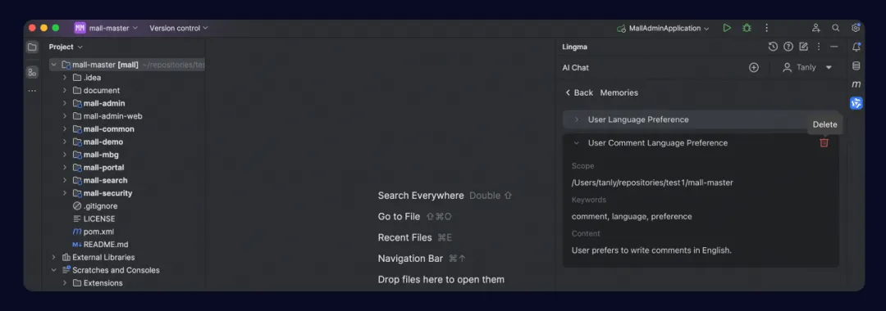

</details>

**⚙️ `~/.qoder/settings.json`**
```json
{
  "privacy": { "usageStatisticsEnabled": false },
  "aiCodeStatistics": { "enabled": false },
  "autoMemoryEnabled": false
}
```

<a id="qwen"></a>
### 🔴 高リスク Alibaba Qwen・Qwen Code & Qwen Chat
*Qwen Code CLI・chat.qwen.ai・通義千問 & QwenWork* ｜ [公式ドキュメント](https://github.com/QwenLM/qwen-code)

- **設定手順**: chat.qwen.ai：privacy@qwen.com へ拒否メール `➔` Web/App メモリオフ・QwenWork USER.md 清掃 `➔` CLI: ~/.qwen/settings.json を編集
- **学習・リスク**: ⚠️ 国際/中国 Web とも画面上の学習拒否スイッチなし！メール申請または Alibaba DashScope 標準 API（ゼロ学習）を使用
- **メモリ設定**: Qwen Code CLI の AutoMemory・AutoDream が既定 true！QwenWork は ~/.qwenworkcn/awareness/ へ記録
- **⚠️ 注意点**: 無料 Qwen OAuth は 2026.04 終了済み；機密コードは標準 DashScope API またはローカル Ollama を利用

<details open><summary>📷 実画面スクリーンショット (github.com/QwenLM/qwen-code)</summary>

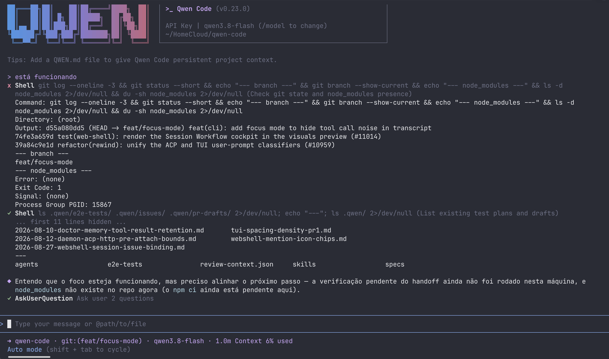

</details>

**⚙️ `~/.qwen/settings.json`**
```json
{
  "privacy": { "usageStatisticsEnabled": false },
  "telemetry": { "enabled": false, "logPrompts": false },
  "memory": { "enableManagedAutoMemory": false, "enableManagedAutoDream": false },
  "general": { "chatRecording": false }
}
```

<a id="zhipu"></a>
### 🔴 高リスク Zhipu AI / GLM & ZCode
*ZCode (Z.ai ADE)・智譜清言 (ChatGLM)・BigModel API* ｜ [公式ドキュメント](https://zcode.z.ai/docs/v2/core-features/memory)

- **設定手順**: ChatGLM：プロフィール → データ管理 `➔` 体験改善・データ利用をオフ `➔` ZCode：メモリオフ維持＋テレメトリ通信遮断
- **学習・リスク**: ChatGLM 個人版は既定オン → オフ必須；国際 Z.ai 開発枠は ZDR 対応、中国 BigModel は個別契約が必要
- **メモリ設定**: ZCode ワークスペースメモリは既定オフ；ChatGLM は横断メモリ管理・シークレットモードなし
- **⚠️ 注意点**: ZCode デスクトップ版は 15 分毎に zcode.z.ai/api/v1/event/report へ固定送信（UI 停止不可）→ プロキシ遮断必須

**⚙️ `ローカルプロキシ遮断ルール & ~/.zcode/AGENTS.md`**
```shell
# ZCode テレメトリ通信のみをプロキシでピンポイント遮断（推論には無影響）:
URL-REGEX,^https://zcode\.z\.ai/api/v1/event/report,REJECT
# または OpenCode から国際版 Z.ai ZDR エンドポイントへ直結:
export ZAI_API_BASE_URL="https://api.z.ai/api/coding/paas/v4" 
```

<a id="minimax"></a>
### 🔴 高リスク MiniMax・mcode / Agent / Hailuo
*MiniMax Code (mcode)・MiniMax Agent・海螺 AI (Hailuo)* ｜ [公式ドキュメント](https://github.com/MiniMax-AI/minimax-code)

- **設定手順**: Agent：Personalization で Memory & Proactive オフ `➔` Memory summary → Manage で全削除 `➔` mcode: config.yaml を default 権限に固定
- **学習・リスク**: mcode CLI 3 系統テレメトリは既定全オフ ✅；⚠️ Hailuo/Agent/公開 API はセルフ拒否・ZDR 非対応 ❌
- **メモリ設定**: MiniMax Agent の Proactive Memory はオフにしても旧項目が残存 → 無効化後にサマリー全削除
- **⚠️ 注意点**: 機密コードや個人情報は公開 MiniMax クラウドへ投入厳禁；企業 DPA 契約または OSS 重みの自社ホストを利用

<details open><summary>📷 実画面スクリーンショット (github.com/MiniMax-AI/minimax-code)</summary>

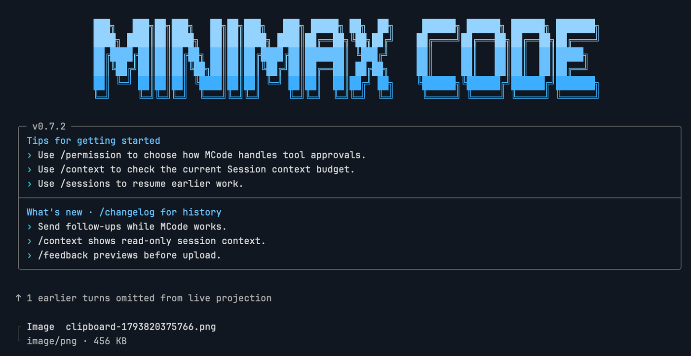

</details>

**⚙️ `~/.minimax/config.yaml`**
```yaml
permissionMode: default
telemetry: { enabled: false, metrics: false, diagnostics: false }
# Shell: export MCODE_DISABLE_TELEMETRY=1 DO_NOT_TRACK=1
```

<a id="kimi"></a>
### 🔴 高リスク Moonshot AI / Kimi シリーズ
*Kimi Code CLI & 拡張・Kimi Web/App* ｜ [公式ドキュメント](https://code.kimi.com/kimi-code/docs/configuration/config-overrides)

- **設定手順**: support@moonshot.cn へ学習拒否メール申請 `➔` 設定 → パーソナライズ → 会話メモリをオフ `➔` 「メモリスペース」内の既存項目を削除 `➔` ~/.kimi-code/config.toml を編集
- **学習・リスク**: ⚠️ 個人版・Coding Plan は既定学習かつ画面スイッチなし（メール手動登録・5–7日反映）；Business はゼロ学習
- **メモリ設定**: 自動でメモリスペースへ書込（オフでも消えない）、シークレットモードなし → 無効化＋手動全削除
- **⚠️ 注意点**: Kimi Code CLI はテレメトリ既定 true かつ WebSearch 既定有効！TOML で両方明示無効化が必須

<details open><summary>📷 実画面スクリーンショット (kimi.com)</summary>

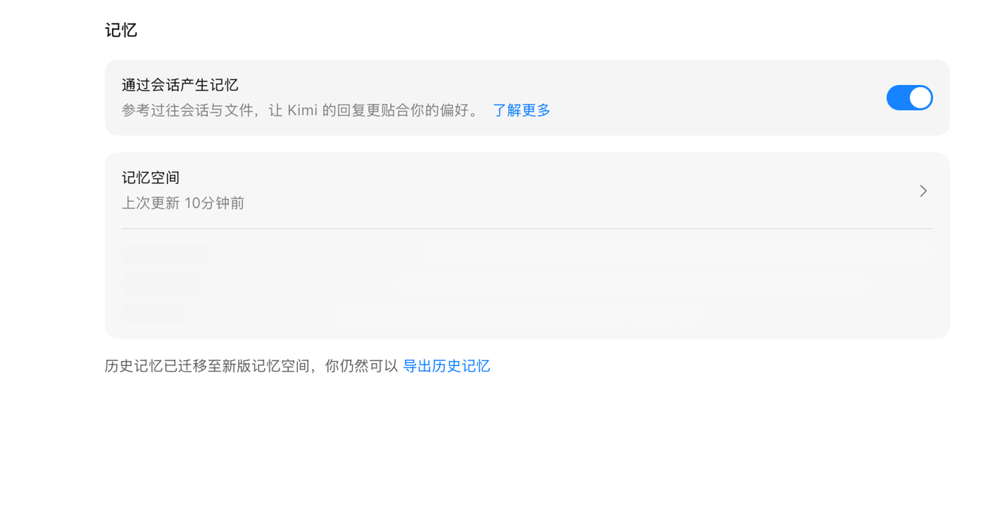

</details>

**⚙️ `~/.kimi-code/config.toml`**
```toml
default_permission_mode = "manual"
telemetry = false
[memory]
auto_memory_enabled = false
[tools]
disabled = ["WebSearch", "FetchURL"]
```

<a id="deepseek"></a>
### 🔴 高リスク DeepSeek & Harness (dsh)
*DeepSeek Harness (dsh OSS)・chat.deepseek.com・API* ｜ [公式ドキュメント](https://github.com/deepseek-ai/deepseek-harness)

- **設定手順**: Web/App：設定 → データ管理 `➔` Improve the model（体験改善）をオフ `➔` dsh: cordis.patch.yml を DISABLED に設定 `➔` 機密コードは Ollama で OSS 重みを自社ホスト
- **学習・リスク**: Web/App 個人版は既定オン → オフ必須；公式 API に ZDR・オプトアウトなし；OSS dsh 実行環境はゼロ学習 ✅
- **メモリ設定**: Web 版に横断長期メモリ・無痕モードなし；dsh はプラグイン型ローカル記憶、OTel 既定は FEEDBACK_ONLY
- **⚠️ 注意点**: api.deepseek.com はディスク KV-Cache 既定オン・ZDR 非対応！高機密用途は dsh＋ローカル自社ホスト必須

**⚙️ `~/.dsh/profiles/web/cordis.patch.yml`**
```yaml
- id: session-telemetry-otel
  name: '@deepseek-ai/dsh-session-telemetry-otel'
  config: { mode: DISABLED }
# Shell: export DSH_TELEMETRY_DISABLED=1 DSH_TELEMETRY_MODE=DISABLED
```

<a id="oss_clean"></a>
### 🟢 安全 クリーン OSS Agent (Aider・Goose)
*Aider・Block Goose（2026 事故ゼロ・明示同意型テレメトリ）* ｜ [公式ドキュメント](https://block.github.io/goose/)

- **設定手順**: Aider: ~/.aider.conf.yml で analytics-disable & gitignore `➔` Goose: 初回プロンプト拒否＋GOOSE_TELEMETRY_OFF=1 `➔` ローカル Ollama または商用 ZDR API を接続
- **学習・リスク**: 両製品とも完全ローカル BYOK ゼロ学習 ✅；Goose は初回起動で明示的に許可を確認；2026 年の重大侵害・騒動ゼロ
- **メモリ設定**: ブラックボックス型クラウド記憶なし；Aider の平文ログ .aider.chat.history.md は gitignore: true で誤コミット防止
- **⚠️ 注意点**: 接続する外部 MCP サーバーの権限監査は必須；Goose は GOOSE_TELEMETRY_OFF=1 と GOOSE_TELEMETRY_ENABLED=false を併用

**⚙️ `~/.aider.conf.yml & Goose 環境変数`**
```yaml
# Aider (~/.aider.conf.yml):
analytics-disable: true
gitignore: true
# Block Goose (~/.zshrc & ~/.config/goose/config.yaml):
# export GOOSE_TELEMETRY_OFF=1 GOOSE_TELEMETRY_ENABLED=false
```

<a id="cline_roo_kilo"></a>
### 🟡 要調整 Cline / Roo Code / Kilo Code ⚠️
*VS Code OSS 3 大拡張・2026 サプライチェーン＆テレメトリ問題* ｜ [公式ドキュメント](https://docs.cline.bot)

- **設定手順**: Cline: npm 2.3.0 回避、telemetryOptOut:true 設定 `➔` Roo Code: Roo Cloud 禁止＋CVE-2025-58372 修正版へ `➔` Kilo Code: テレメトリオフ＋外部通信監視
- **学習・リスク**: 本体はゼロ学習 ✅；⚠️ 2026 実績：Cline は 2 月に Clinejection 攻撃で npm cline@2.3.0 が 8 時間乗っ取り（VS Code 拡張は無事）；Roo は設定無視送信報告；Kilo はオフライン時外部通信指摘
- **メモリ設定**: ローカル運用ならクラウド記憶なし；Roo Cloud 同期にはログインしないこと
- **⚠️ 注意点**: Cline は .clineignore 廃止（PreToolUse Hook へ移行）；Roo は .code-workspace 注入(CVE-2025-58372)歴あり、自動承認オフ必須

<details open><summary>📷 実画面スクリーンショット (github.com/cline/cline)</summary>

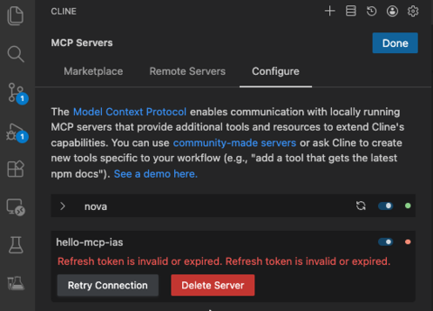

</details>

**⚙️ `Cline / Kilo 設定・環境変数`**
```json
// Cline (~/.cline/data/settings/global-settings.json): { "telemetryOptOut": true }
// Kilo CLI: export KILO_TELEMETRY_LEVEL=off  （機密リポでは送信ファイアウォール許可リスト併用推奨）
```

<a id="openclaw"></a>
### 🔴 高リスク OpenClaw ⚠️ (2026 重大セキュリティ危機)
*旧 Clawdbot/Moltbot・ClawBleed RCE / 悪意スキル / 大手禁止令* ｜ [公式ドキュメント](https://openclaw.ai)

- **設定手順**: 必ず完全隔離されたコンテナ/VM 内のみで実行 `➔` Trail of Bits 監査後の最新修正版へ強制更新 `➔` 未監査の ClawHub スキル導入厳禁 `➔` 外部バインド禁止・ゲートウェイ認証強制
- **学習・リスク**: ローカル実行のため学習はしないが、2026 年最大級の安全危機が発生：CVE-2026-25253 (ClawBleed ワンクリック RCE)、ClawHavoc (1,000 件超の窃取スキル)、Claw Chain 脱出、数万件の公開露出で Meta・Microsoft が社内禁止！
- **メモリ設定**: ホスト永続メモリと全ユーザー権限を持つ → 商用ソースコードや本番キーがある端末での直接実行は絶対厳禁
- **⚠️ 注意点**: Trail of Bits 監査と既定認証強化後も、機密開発端末ではコンテナ分離＋ClawHub 外部プラグイン禁止を徹底

**⚙️ `~/.openclaw/openclaw.json & コンテナ隔離`**
```json
// ~/.openclaw/openclaw.json（ホスト秘密情報のない Docker/VM 内のみで実行し、公開ポート露出厳禁）
{ "update": { "checkOnStart": false }, "telemetry": { "enabled": false }, "gateway": { "bind": "127.0.0.1", "requireAuth": true } }
```

<a id="comm_ide"></a>
### 🔴 高リスク 商用 IDE & クラウド開発 (6 製品)
*JetBrains AI/Junie・Zed・Amp・v0・Lovable・Replit* ｜ [公式ドキュメント](https://www.jetbrains.com/help/ai-assistant/data-sharing.html)

- **設定手順**: JetBrains: System Settings → Data Sharing 全解除 `➔` v0 / Lovable / Replit: Model Training オフ＆Private 化 `➔` Zed テレメトリオフ・Amp を visibility: private 固定
- **学習・リスク**: Zed・Amp・JB 商用版は既定ゼロ学習 ✅；⚠️ JB 無料版および v0/Lovable/Replit 個人枠は既定で学習オン ❌
- **メモリ設定**: JetBrains は .junie/guidelines.md を使用；Replit 自動生成の replit.md に秘密鍵を書かない
- **⚠️ 注意点**: JetBrains 機密リポには空ファイル .noai を配置；Amp は .ampignore 非対応；Junie の Brave Mode は無効維持

<details open><summary>📷 実画面スクリーンショット (jetbrains.com)</summary>

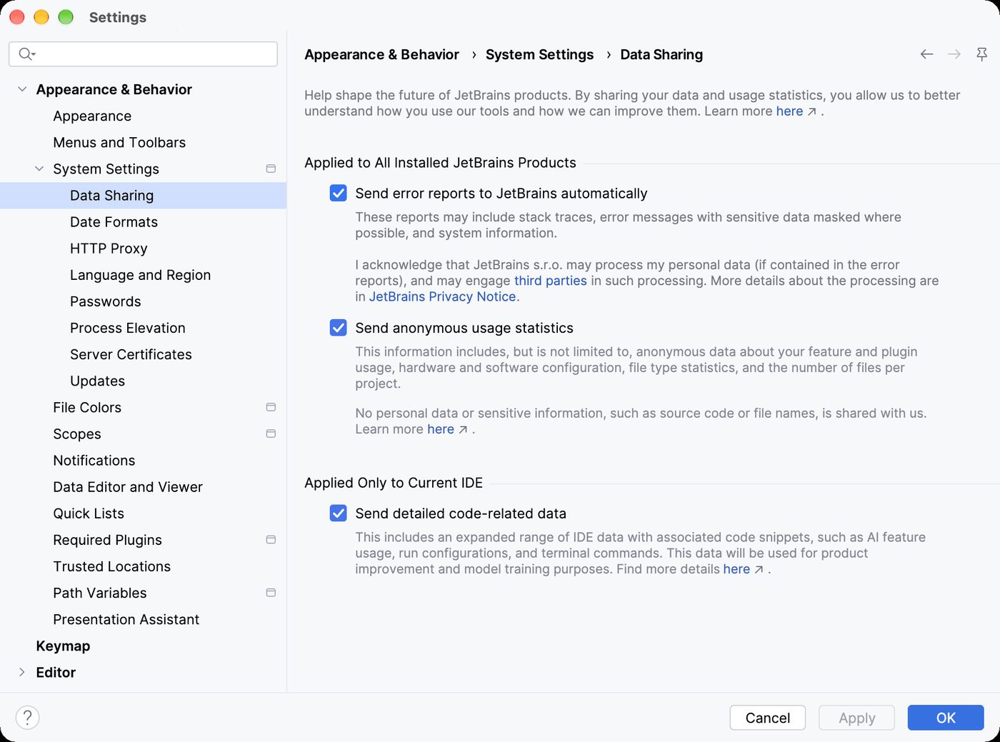

</details>

**⚙️ `~/.config/zed/settings.json & ~/.config/amp/settings.json`**
```json
// Zed: { "telemetry": { "diagnostics": false, "metrics": false } }
// Amp: { "amp.defaultVisibility": { "github.com/your-org/*": "private" } }
```

<a id="web_research"></a>
### 🔴 高リスク リサーチ・汎用 Web AI (4 製品)
*Perplexity・NotebookLM・Manus・Poe* ｜ [公式ドキュメント](https://www.perplexity.ai/hub)

- **設定手順**: Perplexity: Preferences → AI Data Retention オフ＆メモリ削除 `➔` NotebookLM: 既定ゼロ学習（高/低評価を押さない） `➔` Manus: 学習拒否＋非公開・Poe: 完全盾アイコンのみ選択
- **学習・リスク**: NotebookLM 既定ゼロ学習 ✅；Perplexity 個人枠は既定オン ❌；Poe 半盾ボットは第三者学習の可能性あり
- **メモリ設定**: Perplexity・Poe はオフでも旧メモリが残存するため手動削除必須；NotebookLM はノート単位で隔離
- **⚠️ 注意点**: NotebookLM 個人版で 👍/👎 フィードバックを押すと最長 3 年の人手レビュー対象になる！Perplexity Sonar API は ZDR 対応

## 🔧 ワンクリック反テレメトリ環境変数スクリプト（macOS / Linux）
```bash
export DO_NOT_TRACK=1
export CLAUDE_CODE_DISABLE_NONESSENTIAL_TRAFFIC="1" DISABLE_TELEMETRY="1" CLAUDE_CODE_DISABLE_AUTO_MEMORY="1"
export GEMINI_TELEMETRY_ENABLED="false" GEMINI_TELEMETRY_LOG_PROMPTS="false"
export GROK_TELEMETRY_ENABLED=0 GROK_TRACE_UPLOAD=0 GH_TELEMETRY=0
export OPENCODE_DISABLE_AUTOUPDATE=1 OPENCODE_DISABLE_SHARE=1 OPENCODE_DISABLE_MODELS_FETCH=1
export PI_TELEMETRY=0 PI_OFFLINE=1 T3CODE_TELEMETRY_ENABLED=false T3CODE_OTEL_SDK_DISABLED=true OTEL_SDK_DISABLED=true ORCA_TELEMETRY_DISABLED=1
export CODEBUDDY_CODE_ENABLE_TELEMETRY=0 CODEBUDDY_ARTIFACT_ENABLED=false
export QWEN_USAGE_STATISTICS_ENABLED=false QWEN_TELEMETRY_ENABLED=false
export MCODE_DISABLE_TELEMETRY=1 KIMI_DISABLE_TELEMETRY=1 KIMI_DISABLE_AUTO_MEMORY=1
export DSH_TELEMETRY_DISABLED=1 DSH_TELEMETRY_MODE=DISABLED
export AIDER_ANALYTICS_DISABLE=true GOOSE_TELEMETRY_OFF=1 GOOSE_TELEMETRY_ENABLED=false KILO_TELEMETRY_LEVEL=off OPENCLAW_NO_AUTO_UPDATE=1
```

## 🔍 既存ガイドとの網羅性比較（なぜ本プロジェクトが必要か）

| 既存記事・OSS プロジェクト | 対象範囲 | 主な制約 | 実画面画像 |
| :--- | :--- | :--- | :---: |
| [EFF — Opt Out of AI Tools Made by Big Tech](https://www.eff.org/pages/i-want-opt-out-ai-tools-or-training-made-big-tech) | 欧米大手消費者向けのみ（4–5 社） | Coding Agent・IDE・TOML/JSON・中国製 AI 非対応 | なし |
| [AIPolicyLog — AI Data Opt-Out Cheat Sheet](https://aipolicylog.com/guides/ai-data-opt-out-cheat-sheet/) | 英語 Web チャットのみ（6–8 製品） | IDE/CLI 設定・中国エコシステム・スクリーンショットなし | なし |
| [Redact.dev Blog（単体オプトアウト記事群）](https://redact.dev/blog/opt-out-github-ai-training) | 個別記事に分散（Copilot/Grok/Canva 等） | 横断一覧・CLI 設定ファイル・中国系ツール欠如 | 一部あり |
| [DeleteMe — AI Privacy Settings Guides](https://joindeleteme.com/ai-privacy-settings/cursor-ai-privacy-settings-guide/) | 製品別ページに分散（Cursor/DeepSeek 等） | 2026 新世代 Agent CLI や多言語対応なし | 一部あり |
| [Engadget / GhostVault / MEGA Blog](https://www.engadget.com/2268598/how-to-stop-ai-companies-training-your-data/) | 一般向け解説（チャット 4–6 製品） | 文章中心で開発エージェント・設定ファイル非対応 | ごく少数 |
| [GitHub: hamarshehmhmd/optout (★0)](https://github.com/hamarshehmhmd/optout) | 初期 CLI 検査スクリプト（4 製品のみ） | Claude Code/Cursor/Copilot/VS Code のみ、図解なし | なし |
| [GitHub: pyamsoft/auto-ai-optout (★3)](https://github.com/pyamsoft/auto-ai-optout) | ブラウザ拡張（一部 Web のみ） | IDE・CLI・ローカル設定ファイル非対応 | なし |
| [中国語圏の個別ブログ記事（cnblogs 等）](https://blog.binlin.wang/posts/gpt-data-privacy.20260625) | 単一製品メモ（GPT や Copilot のみ） | 横断比較・設定テンプレ・日英多言語版なし | 単体のみ |
| **本プロジェクト (AI Privacy Switches 2026)** | **26 製品群・68 ツール（欧米＋中国＋IDE＋CLI＋Web）** | **日中英 SVG マップ＋実画面 23 枚＋対話 Web/MD＋設定集＋日本語 Excel/PPT** | **✅ 23 枚検証済** |

## 🤝 実画面スクリーンショット提供のお願い（PR 歓迎）

本プロジェクトは**フェイク画面ゼロ**を徹底しています。ログイン必須画面のマスク済み実画面 PNG は [CONTRIBUTING.md](./CONTRIBUTING.md) を参考に PR をお寄せください。