# 🛡️ AI Agent / IDE / Web Chat Privacy, Memory & Anti-Training Guide (2026)

[](https://xialuyu5-oss.github.io/ai-privacy-switches/?lang=en) [](./README.zh-CN.md) [](./LICENSE) [](./CONTRIBUTING.md)

> **Live Interactive Web App (ZH/EN + Search + Script Builder):** https://xialuyu5-oss.github.io/ai-privacy-switches/?lang=en (or open [`index.html`](./index.html) offline)
> **Streamlined Office Downloads (with all 23 real screenshots):** [📊 Excel Quick Guide (.xlsx)](./exports/AI_Agent_隐私记忆与防训练开关全手册_2026.xlsx) ｜ [📽️ Presentation Deck (.pptx, 33 slides)](./exports/AI_Agent_隐私记忆与防训练开关全手册_2026.pptx)
>
> **3-second scannable opt-out guide — zero fluff.** Covers **26 product families · 68 AI tools (28 actionable cards) · 23 verified real product UI screenshots · copy-paste TOML/JSON/Env hardening configs** (Verified: Nov 25, 2026).

## 🗺️ Privacy & Anti-Training Landscape (26 Families)

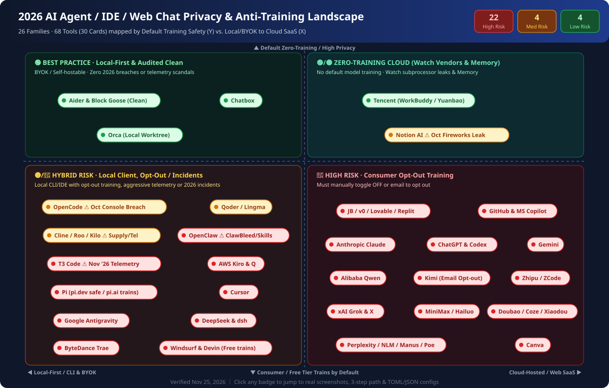

## 🚨 5 Rules That Save You 90% of Privacy Leaks
1. **Consumer tiers train by default**: Claude (since Aug 2025), GitHub Copilot Free/Pro (since Apr 2026), ChatGPT, Gemini, Grok, Trae, Doubao, Kimi, DeepSeek, ChatGLM, Canva, and Perplexity all opt personal users IN. **Notion AI, NotebookLM, Tencent Suite, Zed, Amp, and local OSS Agents** default to zero training.
2. **Auth method rules your CLI**: Logging into Claude Code / Codex / Gemini CLI / Antigravity with a personal consumer account still inherits consumer training — use Commercial API / Vertex / Bedrock / Enterprise.
3. **Disabling Memory ≠ Deleting Memory**: Claude, Doubao, Kimi, WorkBuddy, Perplexity, Poe, and Windsurf keep previously extracted memories until you manually wipe them.
4. **Watch the `.ignore` illusion**: No `.claudeignore` (use `permissions.deny`), no `.codexignore`, no `.copilotignore` (use Web Content Exclusion), Cline deprecated `.clineignore` (use `PreToolUse` Hook), no `.ampignore`.
5. **Incognito ≠ Zero Data Retention (ZDR)**: ChatGPT/Claude keep safety logs up to 30 days; Google Gemini extended it to ~2 months in 2026. For strict zero-egress, self-host with Ollama/vLLM.

## ⚡ 3-Minute Quick Reference Table

| Risk | Product Family | Fastest Opt-Out Path | Memory Action | Config File? |
| :---: | :--- | :--- | :--- | :--- |
| 🔴 Opt-Out | **[Anthropic / Claude Suite](#claude)** | Profile Icon → Settings → Privacy → Help improve Claude: OFF → CLI: ~/.claude/settings.json | Cross-surface & Auto Memory ON → Turn OFF + manually delete old entries | `~/.claude/settings.json` |
| 🔴 Opt-Out | **[OpenAI / ChatGPT & Codex](#openai)** | Settings → Data controls → Improve the model: OFF → Codex: --with-api-key → Edit ~/.codex/config.toml | ChatGPT Memory ON (turn OFF + clear); Codex local memories default false | `~/.codex/config.toml` |
| 🔴 Opt-Out | **[Google Gemini & Gemini CLI](#gemini)** | myactivity.google.com/product/gemini → Help train AI models: OFF → CLI: Vertex AI / Billed API → Edit ~/.gemini/settings.json | Personal context ON → Turn OFF; set Auto-delete to 3 months | `~/.gemini/settings.json` |
| 🔴 Opt-Out | **[Google Antigravity Suite](#antigravity)** | Settings → Account → Enable Telemetry: OFF → CLI /config → telemetry OFF → Add ./.antigravityignore | Knowledge Items has no toggle → Clean ~/.gemini/antigravity/knowledge/ after sensitive tasks | `~/.gemini/antigravity-cli/settings.json` |
| 🔴 Opt-Out | **[xAI / Grok Suite](#grok)** | grok.com → Data Controls OFF → x.com/settings/grok_settings uncheck → Build: ~/.grok/config.toml | Web & X Memory ON → Uncheck all; Grok Build memory defaults false | `~/.grok/config.toml` |
| 🔴 Opt-Out | **[Microsoft / GitHub Copilot](#copilot)** | github.com/settings/copilot/features → AI model training: Disabled → Public code matching: Blocked → Set Content exclusion | Copilot Memory & M365 Enhanced Personalization ON → Disable for sensitive orgs | `VS Code settings.json & CLI` |
| 🔴 Opt-Out | **[AWS Kiro & Amazon Q](#aws_kiro)** | IDE Settings → Telemetry / Share → Uncheck Content Collection / Share → CLI: disable telemetry & knowledge | Kiro Memory OFF by default; Amazon Q has no cloud personal memory | `~/.kiro/settings/cli.json & CLI` |
| 🔴 Opt-Out | **[Cursor](#cursor)** | Ctrl/Cmd+Shift+J → Cursor Settings → General → Privacy → Privacy Mode (Legacy): ON → Add .cursorignore | Auto Memories deprecated & removed in v2.1+; use auditable .cursor/rules/*.mdc | `.cursorignore & ~/.cursor/cli-config.json` |
| 🔴 Opt-Out | **[Cognition / Windsurf & Devin](#windsurf_devin)** | windsurf.com/settings → ZDR ON → Cascade → Customizations → Memories OFF → app.devin.ai → Data Controls OFF | Windsurf Cascade Auto-Memories ON → Disable & clear ~/.codeium/windsurf/memories/ | `Windsurf settings.json & ~/.config/devin/config.json` |
| 🔴 Opt-Out | **[Canva (Magic Studio)](#canva)** | Profile → Settings → Your account → Privacy controls → 2x AI-powered learning: OFF → AI personalization: OFF | AI-generated content personalization ON → Turn OFF | None |
| 🟢 Safe | **[Notion AI](#notion)** | Settings → Notion AI → Keep Share data to improve OFF → Memory → Use memories: OFF → AI Web Search: OFF | Use memories ON by default → Disable; restrict Custom Agents to admins | None |
| 🟡 Tune | **[OpenCode](#opencode)** | Edit ~/.config/opencode/opencode.json → Set share: "disabled" → Avoid Zen Free (use BYOK) → Export OPENCODE_DISABLE_* | No cloud memory; local SQLite (opencode.db) — isolate via OPENCODE_DB | `~/.config/opencode/opencode.json` |
| 🔴 Opt-Out | **[Pi (Coding Agent & pi.ai)](#pi)** | pi.dev: enableInstallTelemetry false → pi.dev incognito: pi --no-session → pi.ai: Account Settings opt-out | pi.dev supports --no-session (zero disk JSONL); pi.ai use !delete | `~/.pi/agent/settings.json` |
| 🟡 Tune | **[T3 Code](#t3code)** | Create /etc/t3code/policy.json → Lock limits.telemetry: false → Export T3CODE_TELEMETRY_ENABLED=false → Harden underlying Codex/Claude | Local state.sqlite (92d default) → Shorten to ≤14d, disable Linked Environments | `/etc/t3code/policy.json (Win: C:\ProgramData\T3Code\policy.json)` |
| 🟢 Safe | **[Orca (stablyai/orca)](#orca)** | Settings → Privacy → Usage data OFF → Export ORCA_TELEMETRY_DISABLED=1 → Quit Orca → set agentDefaultEnv | No cloud memory; isolated local Git Worktrees, delete after sensitive tasks | `Shell & orca-data.json` |
| 🟢 Safe | **[Chatbox](#chatbox)** | Settings → Privacy → Reporting OFF → Provider → Improve Network Compat: OFF → Use Local Ollama or direct ZDR API | 100% local storage (no auto cloud sync); supports offline local RAG | `%APPDATA%\chatbox\config.json` |
| 🔴 Opt-Out | **[ByteDance · Trae IDE & CLI](#trae)** | Settings → Account → Privacy Mode: ON → Rules & Memories → Memory: OFF → Add .trae/.ignore | Auto Memory ON → Turn OFF & delete ~/.trae(-cn)/memory/ | `.trae/.ignore & trae_config.yaml` |
| 🔴 Opt-Out | **[ByteDance · Doubao / Coze / Xiaodou](#doubao)** | Settings → Privacy & Permissions → Disable Model Improvement (all) → Settings → Memory: OFF + Clear → Coze: General → Improve OFF | Memory ON (toggling off keeps history); Xiaodou shares Doubao brain + broad app permissions | `火山方舟 ModelArk 零训练 API` |
| 🟢 Safe | **[Tencent · WorkBuddy / CodeBuddy / Yuanbao](#tencent)** | Yuanbao: Data Mgmt → Experience Plan OFF → WorkBuddy: Disable & Reset Memory → CodeBuddy: ~/.codebuddy/settings.json | WorkBuddy auto-generates nightly memory → Turn OFF + Reset; set retention to 30 days | `~/.codebuddy/settings.json` |
| 🟡 Tune | **[Alibaba · Qoder & Tongyi Lingma](#qoder)** | Settings → General → Privacy Mode ON → Memory → Disable & clear → CLI: ~/.qoder/settings.json | Auto Global/Project memory + auto-index (<10k files) → Disable & add .qoderignore | `~/.qoder/settings.json` |
| 🔴 Opt-Out | **[Alibaba Qwen · Qwen Code & Chat](#qwen)** | chat.qwen.ai: email privacy@qwen.com → Web/App Memory OFF; clean USER.md → CLI: ~/.qwen/settings.json | Qwen Code AutoMemory & AutoDream default true! Clean ~/.qwenworkcn/awareness/ | `~/.qwen/settings.json` |
| 🔴 Opt-Out | **[Zhipu AI / GLM & ZCode](#zhipu)** | ChatGLM: Profile → Data Mgmt → Experience Optimization: OFF → ZCode: Memory OFF + block telemetry URL | ZCode Workspace Memory OFF by default; ChatGLM has no cross-chat memory/incognito | `本地代理拦截规则 & ~/.zcode/AGENTS.md` |
| 🔴 Opt-Out | **[MiniMax · mcode / Agent / Hailuo](#minimax)** | Agent: Personalization → Memory OFF → Memory summary → Manage → Clear → mcode: config.yaml permissionMode: default | Agent Proactive Memory keeps old items when off → Disable & clear summary | `~/.minimax/config.yaml` |
| 🔴 Opt-Out | **[Moonshot AI / Kimi Suite](#kimi)** | Email support@moonshot.cn to opt out → Settings → Memory toggle: OFF → Clear Memory Space files → Edit ~/.kimi-code/config.toml | Auto-writes to Memory Space (persists when off), no Incognito → Disable & wipe Memory Space | `~/.kimi-code/config.toml` |
| 🔴 Opt-Out | **[DeepSeek & Harness (dsh)](#deepseek)** | Web/App: Settings → Data controls → Improve the model: OFF → dsh: cordis.patch.yml DISABLED → Self-host weights via Ollama | No cross-chat Memory or Incognito on Web; dsh OTel defaults to FEEDBACK_ONLY | `~/.dsh/profiles/web/cordis.patch.yml` |
| 🟢 Safe | **[OSS Coding Agent Cluster (6 Tools)](#oss_agents)** | All 6 local BYOK zero-training ✅ → Disable Cline/Kilo telemetry → Aider: analytics-disable & gitignore → Goose memory OFF · OpenClaw update OFF | No hidden cloud memory; ignore Aider's plaintext .aider.chat.history.md in Git | `多工具配置文件汇总` |
| 🔴 Opt-Out | **[Commercial IDEs & Cloud Builders (6 Tools)](#comm_ide)** | JetBrains: Data Sharing → uncheck all → v0 / Lovable / Replit: Training OFF + Private → Zed telemetry OFF · Amp private | JetBrains uses .junie/guidelines.md; never put secrets in Replit's replit.md | `~/.config/zed/settings.json & ~/.config/amp/settings.json` |
| 🔴 Opt-Out | **[Research & General Web AI (4 Tools)](#web_research)** | Perplexity: AI Data Retention OFF + Clear Memory → NotebookLM: Zero training (never click feedback) → Manus: Opt-out + Private · Poe: Solid-shield only | Perplexity/Poe keep old memory when toggled off; NotebookLM isolates per notebook | None |

## 📷 Per-Tool Guides (Real Product Screenshots & Config Snippets)

<a id="claude"></a>
### 🔴 Opt-Out Anthropic / Claude Suite
*Claude Code CLI · Claude Desktop/Cowork · Web/App* ｜ [官方文档 / Docs](https://code.claude.com/docs/en/data-usage)

- **Path**：Profile Icon `➔` Settings → Privacy `➔` Help improve Claude: OFF `➔` CLI: ~/.claude/settings.json
- **Training**：Consumer Free/Pro/Max ON by default (5yr retention) → Turn OFF; Team/API OFF
- **Memory**：Cross-surface & Auto Memory ON → Turn OFF + manually delete old entries
- **⚠️ Gotcha**：No .claudeignore (use permissions.deny); env flags trigger if non-empty (don't set '0')

<details open><summary>📷 Real Product Screenshot（privacyinternational.org）</summary>

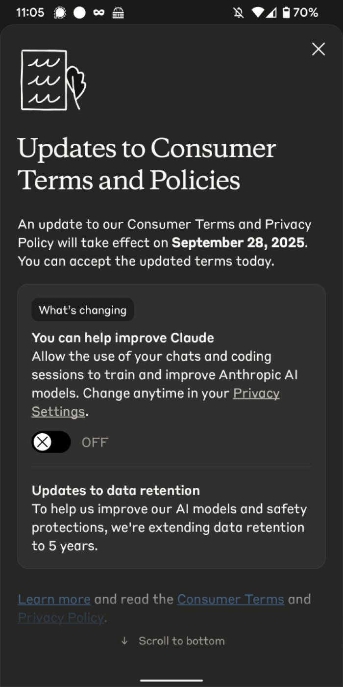

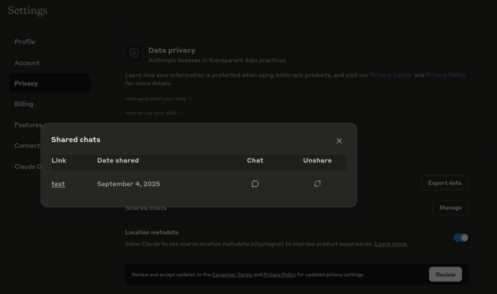

</details>

**⚙️ `~/.claude/settings.json`**
```json
{
  "autoMemoryEnabled": false,
  "cleanupPeriodDays": 0,
  "permissions": { "deny": ["Read(.env*)", "Edit(.env*)", "Read(secrets/**)"] },
  "env": {
    "CLAUDE_CODE_DISABLE_NONESSENTIAL_TRAFFIC": "1",
    "DISABLE_TELEMETRY": "1",
    "CLAUDE_CODE_DISABLE_AUTO_MEMORY": "1"
  }
}
```

<a id="openai"></a>
### 🔴 Opt-Out OpenAI / ChatGPT & Codex
*Codex CLI · Codex App/Web · ChatGPT Web/App* ｜ [官方文档 / Docs](https://developers.openai.com/codex/config-reference)

- **Path**：Settings → Data controls `➔` Improve the model: OFF `➔` Codex: --with-api-key `➔` Edit ~/.codex/config.toml
- **Training**：Personal ChatGPT & Codex login ON → Turn OFF; API/Business/Enterprise OFF
- **Memory**：ChatGPT Memory ON (turn OFF + clear); Codex local memories default false
- **⚠️ Gotcha**：No .codexignore; set allow_login_shell = false to stop login shell leaking secrets

<details open><summary>📷 Real Product Screenshot（progresslearning.helpdocs.io）</summary>

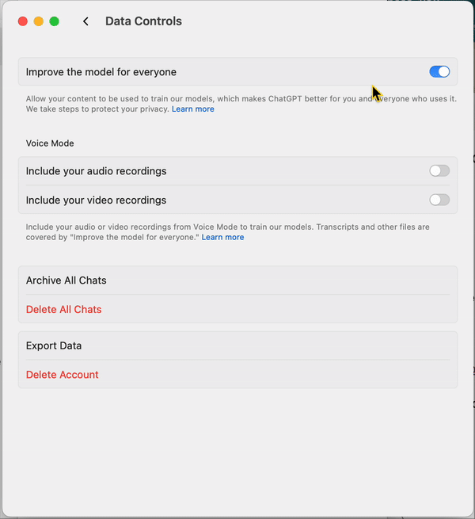

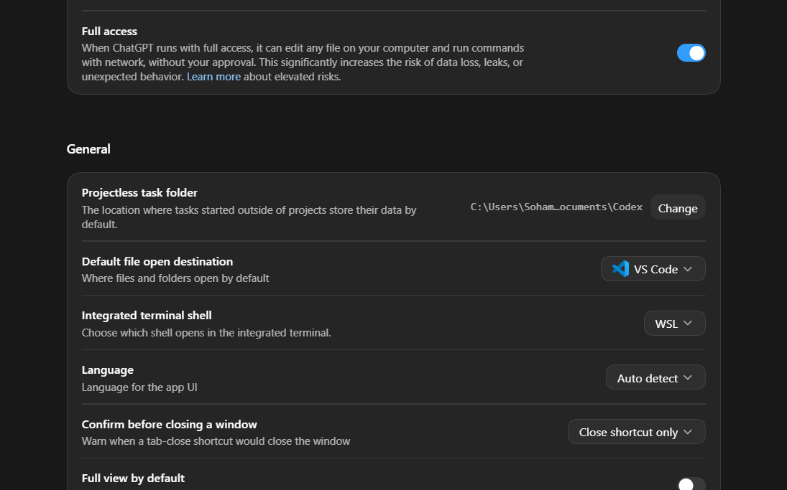

</details>

**⚙️ `~/.codex/config.toml`**
```toml
allow_login_shell = false
[analytics]
enabled = false
[feedback]
enabled = false
[history]
persistence = "none"
[features]
memories = false
```

<a id="gemini"></a>
### 🔴 Opt-Out Google Gemini & Gemini CLI
*Gemini Web/App · Gemini CLI* ｜ [官方文档 / Docs](https://geminicli.com/docs/tos-privacy)

- **Path**：myactivity.google.com/product/gemini `➔` Help train AI models: OFF `➔` CLI: Vertex AI / Billed API `➔` Edit ~/.gemini/settings.json
- **Training**：Text/files training ON by default (Nov 2026); CLI personal/free key trains → Use Vertex/Paid
- **Memory**：Personal context ON → Turn OFF; set Auto-delete to 3 months
- **⚠️ Gotcha**：Temporary chat safety retention extended to ~2 months (2026); CLI logPrompts defaults true!

<details open><summary>📷 Real Product Screenshot（redact.dev）</summary>

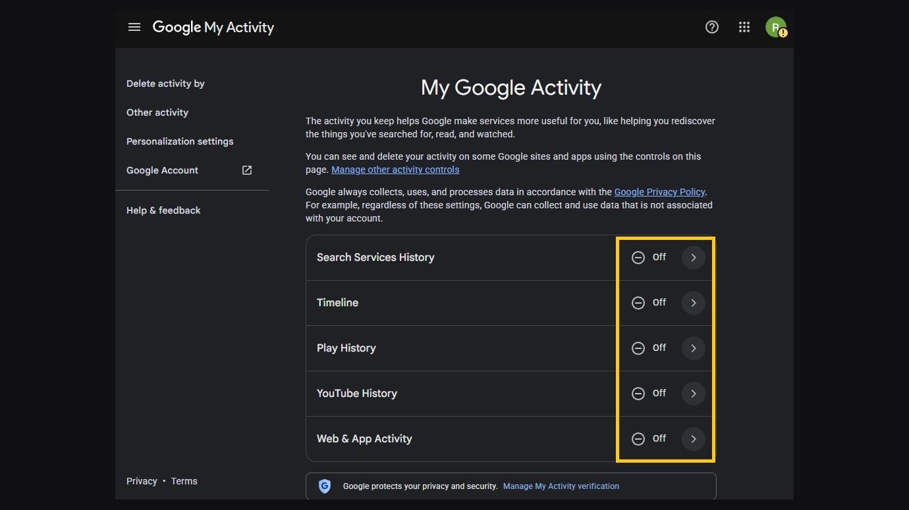

</details>

**⚙️ `~/.gemini/settings.json`**
```json
{
  "privacy": { "usageStatisticsEnabled": false },
  "telemetry": { "enabled": false, "logPrompts": false },
  "experimental": { "autoMemory": false }
}
// 同时创建 ./.geminiignore，并设 export GOOGLE_GENAI_USE_VERTEXAI=true
```

<a id="antigravity"></a>
### 🔴 Opt-Out Google Antigravity Suite
*Antigravity App 2.0 · IDE · agy CLI* ｜ [官方文档 / Docs](https://antigravity.google/docs/settings)

- **Path**：Settings → Account `➔` Enable Telemetry: OFF `➔` CLI /config → telemetry OFF `➔` Add ./.antigravityignore
- **Training**：Personal Enable Telemetry ON (also controls model training!) → Turn OFF; Workspace OFF
- **Memory**：Knowledge Items has no toggle → Clean ~/.gemini/antigravity/knowledge/ after sensitive tasks
- **⚠️ Gotcha**：App/IDE and agy CLI configs are separate — disable telemetry in both; keep Sandbox ON

<details open><summary>📷 Real Product Screenshot（antigravity.google）</summary>

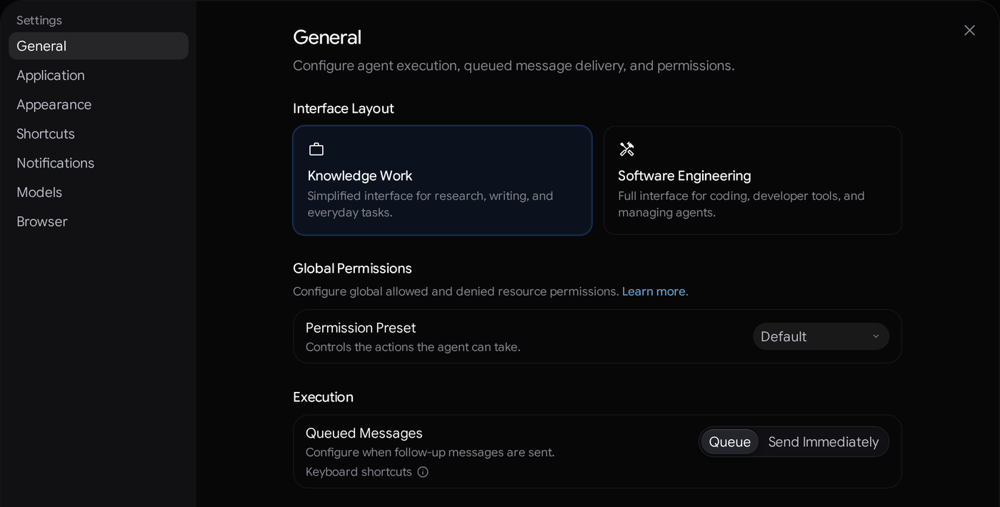

</details>

**⚙️ `~/.gemini/antigravity-cli/settings.json`**
```json
{
  "$schema": "https://antigravity.google/schemas/v1/settings.json",
  "enableTelemetry": false
}
```

<a id="grok"></a>
### 🔴 Opt-Out xAI / Grok Suite
*Grok Build CLI · grok.com · X Platform Grok Bot* ｜ [官方文档 / Docs](https://github.com/xai-org/grok-build)

- **Path**：grok.com → Data Controls OFF `➔` x.com/settings/grok_settings uncheck `➔` Build: ~/.grok/config.toml
- **Training**：Grok Web & X posts/chats train by default → Opt out in both; Business/API supports ZDR
- **Memory**：Web & X Memory ON → Uncheck all; Grok Build memory defaults false
- **⚠️ Gotcha**：X and grok.com have separate toggles; set disable_codebase_upload = true in Grok Build

<details open><summary>📷 Real Product Screenshot（redact.dev）</summary>

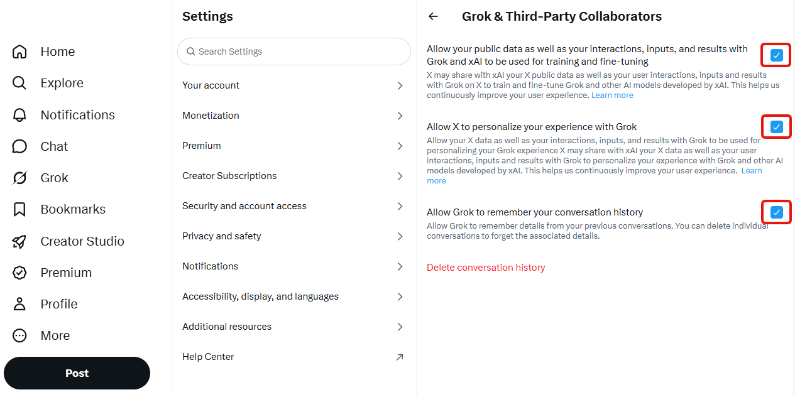

</details>

**⚙️ `~/.grok/config.toml`**
```toml
[features]
telemetry = false
[telemetry]
enabled = false
trace_upload = false
[harness]
disable_codebase_upload = true
coding_data_retention_opt_out = true
```

<a id="copilot"></a>
### 🔴 Opt-Out Microsoft / GitHub Copilot
*GitHub Copilot · MS Copilot Personal · M365 Enterprise* ｜ [官方文档 / Docs](https://docs.github.com/en/copilot/managing-copilot/managing-copilot-as-an-individual-subscriber/managing-your-copilot-plan/managing-copilot-policies-as-an-individual-subscriber)

- **Path**：github.com/settings/copilot/features `➔` AI model training: Disabled `➔` Public code matching: Blocked `➔` Set Content exclusion
- **Training**：GitHub Free/Pro ON by default (since Apr 2026)! MS Personal ON; Business/M365 OFF
- **Memory**：Copilot Memory & M365 Enhanced Personalization ON → Disable for sensitive orgs
- **⚠️ Gotcha**：No local .copilotignore! Configure Content exclusion on GitHub Web + VS Code telemetry off

<details open><summary>📷 Real Product Screenshot（redact.dev）</summary>

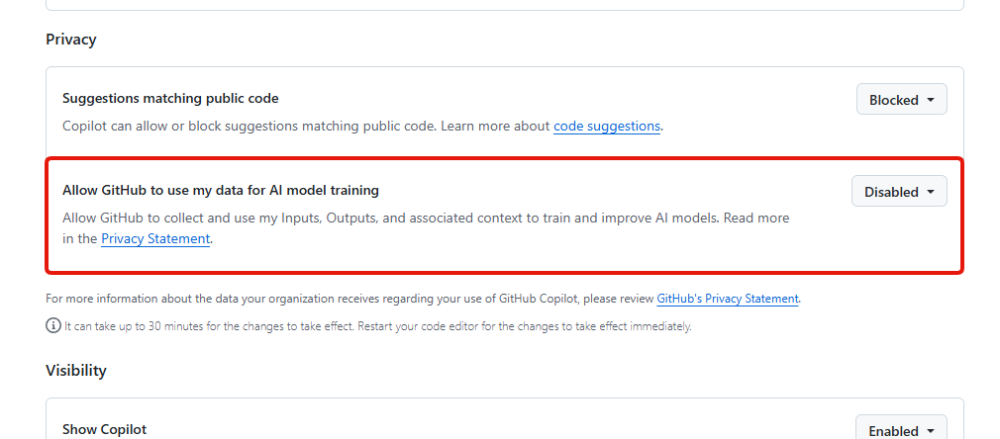

</details>

**⚙️ `VS Code settings.json & CLI`**
```json
// VS Code settings.json
{ "telemetry.telemetryLevel": "off", "github.copilot.enable": { "*": true, "dotenv": false } }
// Terminal: gh config set telemetry disabled && export GH_TELEMETRY=0
```

<a id="aws_kiro"></a>
### 🔴 Opt-Out AWS Kiro & Amazon Q
*Kiro IDE & CLI · Amazon Q Developer* ｜ [官方文档 / Docs](https://kiro.dev/docs/privacy-and-security/data-protection/)

- **Path**：IDE Settings → Telemetry / Share `➔` Uncheck Content Collection / Share `➔` CLI: disable telemetry & knowledge
- **Training**：Kiro Free & Q Builder ID Free share content by default → Disable; Pro/Enterprise OFF
- **Memory**：Kiro Memory OFF by default; Amazon Q has no cloud personal memory
- **⚠️ Gotcha**：Kiro personal still keeps abuse logs up to 60d; enterprise should use Pro + Org Opt-Out

<details open><summary>📷 Real Product Screenshot（docs.aws.amazon.com）</summary>

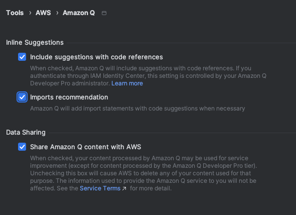

</details>

**⚙️ `~/.kiro/settings/cli.json & CLI`**
```shell
kiro-cli settings telemetry.enabled false
kiro-cli settings chat.enableKnowledge false
q settings telemetry.enabled false
q settings shareCodeWhispererContent false
```

<a id="cursor"></a>
### 🔴 Opt-Out Cursor
*Cursor IDE · Cursor CLI · Cloud Agents* ｜ [官方文档 / Docs](https://cursor.com/security)

- **Path**：Ctrl/Cmd+Shift+J → Cursor Settings `➔` General → Privacy `➔` Privacy Mode (Legacy): ON `➔` Add .cursorignore
- **Training**：Free defaults to Share Data → Enable Privacy Mode (Legacy); Teams/Ent enforced
- **Memory**：Auto Memories deprecated & removed in v2.1+; use auditable .cursor/rules/*.mdc
- **⚠️ Gotcha**：Disable Cloud Agents for sensitive repos (persists VM snapshots & breaks ZDR)

**⚙️ `.cursorignore & ~/.cursor/cli-config.json`**
```json
// ~/.cursor/cli-config.json（另在项目根目录建 .cursorignore 屏蔽 .env / *.key / secrets/）
{ "permissions": { "deny": ["Read(.env*)", "Read(**/*.pem)", "WebFetch(*)"] } }
```

<a id="windsurf_devin"></a>
### 🔴 Opt-Out Cognition / Windsurf & Devin
*Windsurf IDE (Codeium) · Devin Web & CLI* ｜ [官方文档 / Docs](https://docs.windsurf.com/)

- **Path**：windsurf.com/settings → ZDR ON `➔` Cascade → Customizations → Memories OFF `➔` app.devin.ai → Data Controls OFF
- **Training**：Free forces training on both (no opt-out)! Pro requires manual opt-out; Teams/Ent ZDR
- **Memory**：Windsurf Cascade Auto-Memories ON → Disable & clear ~/.codeium/windsurf/memories/
- **⚠️ Gotcha**：Never put proprietary code on Free tier; enable sandbox.enabled: true in Devin CLI

**⚙️ `Windsurf settings.json & ~/.config/devin/config.json`**
```json
// Windsurf User/settings.json（同时配 .codeiumignore）
{ "telemetry.telemetryLevel": "off", "codeium.enableTelemetry": false }
// ~/.config/devin/config.json
{ "sandbox": { "enabled": true }, "permissions": { "deny": ["Read(.env*)"] } }
```

<a id="canva"></a>
### 🔴 Opt-Out Canva (Magic Studio)
*Canva Web / Desktop / Mobile* ｜ [官方文档 / Docs](https://www.canva.com/settings/privacy-preferences)

- **Path**：Profile → Settings `➔` Your account → Privacy controls `➔` 2x AI-powered learning: OFF `➔` AI personalization: OFF
- **Training**：Free/Pro content & usage learning ON → Turn both OFF; Teams/Ent/Edu locked OFF
- **Memory**：AI-generated content personalization ON → Turn OFF
- **⚠️ Gotcha**：Direct URL: canva.com/settings/privacy-preferences; no incognito mode

<details open><summary>📷 Real Product Screenshot（redact.dev）</summary>

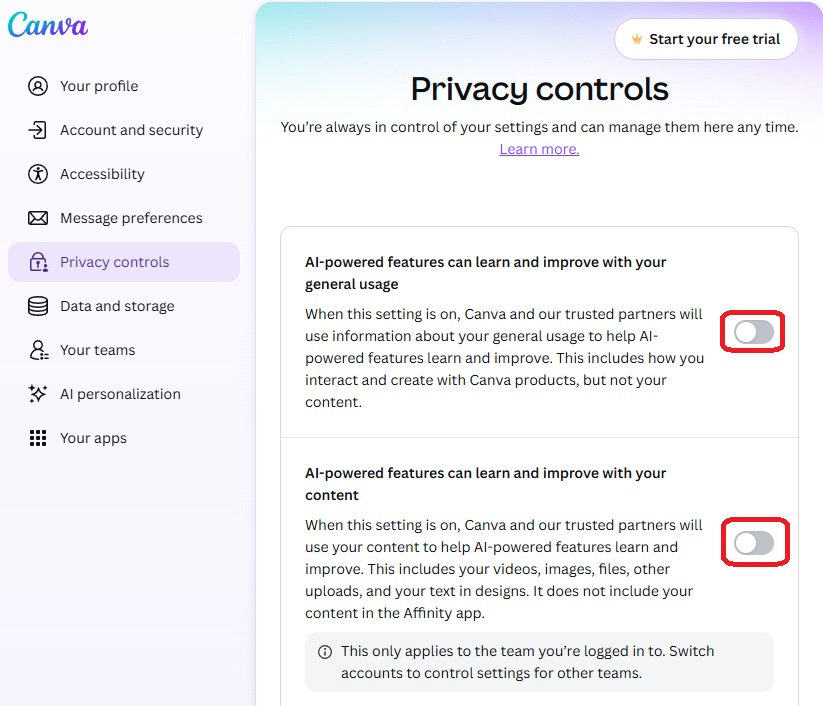

</details>

<a id="notion"></a>
### 🟢 Safe Notion AI
*Notion Web / Desktop / Mobile* ｜ [官方文档 / Docs](https://www.notion.com/help/notion-ai-security-practices)

- **Path**：Settings → Notion AI `➔` Keep Share data to improve OFF `➔` Memory → Use memories: OFF `➔` AI Web Search: OFF
- **Training**：All plans (incl. Free) exclude model training by default ✅; Enterprise ZDR
- **Memory**：Use memories ON by default → Disable; restrict Custom Agents to admins
- **⚠️ Gotcha**：Non-Enterprise has no UI kill-switch; email team@makenotion.com to disable AI UI

<a id="opencode"></a>
### 🟡 Tune OpenCode
*Anomaly Co. (ex-SST) CLI & Desktop* ｜ [官方文档 / Docs](https://opencode.ai/docs/config)

- **Path**：Edit ~/.config/opencode/opencode.json `➔` Set share: "disabled" `➔` Avoid Zen Free (use BYOK) `➔` Export OPENCODE_DISABLE_*
- **Training**：Local/BYOK/Paid Zen do not train; ⚠️ Zen Free promo models allow upstream collection!
- **Memory**：No cloud memory; local SQLite (opencode.db) — isolate via OPENCODE_DB
- **⚠️ Gotcha**：share defaults to 'manual' (/share publishes to opncd.ai)! Lock share: 'disabled'

<details open><summary>📷 Real Product Screenshot（github.com/anomalyco/opencode）</summary>

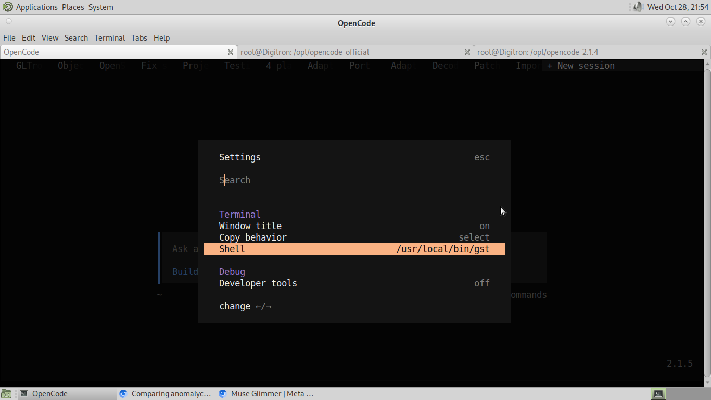

</details>

**⚙️ `~/.config/opencode/opencode.json`**
```json
{
  "share": "disabled",
  "autoupdate": false,
  "snapshot": false,
  "experimental": { "openTelemetry": false },
  "permission": { "read": { "*": "allow", "*.env": "deny", "*.env.*": "deny" }, "webfetch": "deny" }
}
```

<a id="pi"></a>
### 🔴 Opt-Out Pi (Coding Agent & pi.ai)
*OSS CLI pi.dev (Low Risk) vs Consumer pi.ai (High Risk)* ｜ [官方文档 / Docs](https://pi.dev)

- **Path**：pi.dev: enableInstallTelemetry false `➔` pi.dev incognito: pi --no-session `➔` pi.ai: Account Settings opt-out
- **Training**：pi.dev local BYOK zero-training ✅; Inflection pi.ai trains + voice emotion inference ❌
- **Memory**：pi.dev supports --no-session (zero disk JSONL); pi.ai use !delete
- **⚠️ Gotcha**：Two unrelated products! Set PI_TELEMETRY=0 PI_OFFLINE=1 on pi.dev; never paste code in pi.ai

**⚙️ `~/.pi/agent/settings.json`**
```json
{ "enableInstallTelemetry": false, "defaultProvider": "anthropic" }
// Shell: export PI_TELEMETRY=0 PI_OFFLINE=1  &&  pi --no-session
```

<a id="t3code"></a>
### 🟡 Tune T3 Code
*Ping Labs OSS Multi-Agent Coding GUI* ｜ [官方文档 / Docs](https://github.com/pingdotgg/t3code)

- **Path**：Create /etc/t3code/policy.json `➔` Lock limits.telemetry: false `➔` Export T3CODE_TELEMETRY_ENABLED=false `➔` Harden underlying Codex/Claude
- **Training**：Does not train (inherits Codex/Claude); ⚠️ PostHog/Axiom telemetry ON by default!
- **Memory**：Local state.sqlite (92d default) → Shorten to ≤14d, disable Linked Environments
- **⚠️ Gotcha**：Restart background t3 server on Windows after env changes; verify with `t3 policy show`

<details open><summary>📷 Real Product Screenshot（github.com/pingdotgg/t3code）</summary>

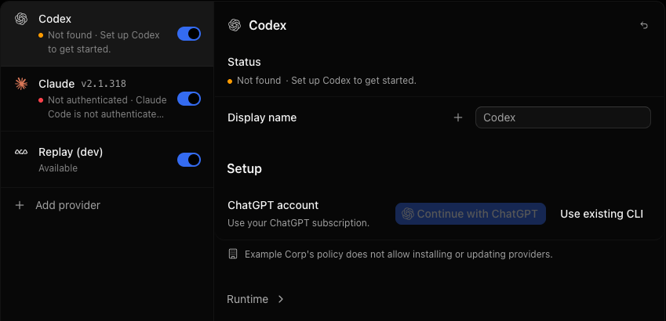

</details>

**⚙️ `/etc/t3code/policy.json (Win: C:\ProgramData\T3Code\policy.json)`**
```json
{
  "schemaVersion": 1,
  "settings": { "enableAgentBrowserAccess": { "value": false, "locked": true } },
  "limits": { "clients": ["desktop", "local-browser"], "telemetry": false }
}
```

<a id="orca"></a>
### 🟢 Safe Orca (stablyai/orca)
*MIT OSS Local BYOA Multi-Agent Workbench* ｜ [官方文档 / Docs](https://github.com/stablyai/orca)

- **Path**：Settings → Privacy → Usage data OFF `➔` Export ORCA_TELEMETRY_DISABLED=1 `➔` Quit Orca → set agentDefaultEnv
- **Training**：Local BYOA zero-training ✅; packaged app sends PostHog metrics by default → Disable
- **Memory**：No cloud memory; isolated local Git Worktrees, delete after sensitive tasks
- **⚠️ Gotcha**：Fully quit Orca before editing orca-data.json (in-memory overwrite on exit)

<details open><summary>📷 Real Product Screenshot（github.com/stablyai/orca）</summary>

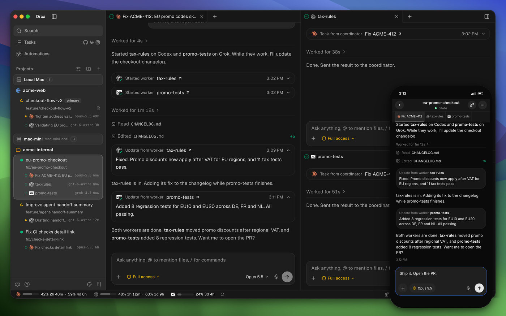

</details>

**⚙️ `Shell & orca-data.json`**
```shell
export ORCA_TELEMETRY_DISABLED=1
export DO_NOT_TRACK=1
# 可在 orca-data.json -> "agentDefaultEnv" 统一给子 Agent 注入 DISABLE_TELEMETRY="1" 
```

<a id="chatbox"></a>
### 🟢 Safe Chatbox
*Local-First Multi-Model Client* ｜ [官方文档 / Docs](https://chatboxai.app)

- **Path**：Settings → Privacy → Reporting OFF `➔` Provider → Improve Network Compat: OFF `➔` Use Local Ollama or direct ZDR API
- **Training**：Client never trains ✅; hosted declares no storage/training; ⚠️ Sentry/Plausible ON
- **Memory**：100% local storage (no auto cloud sync); supports offline local RAG
- **⚠️ Gotcha**：Always turn OFF useProxy (Improve Network Compatibility) so BYOK stays direct!

<details open><summary>📷 Real Product Screenshot（docs.apiyi.com）</summary>

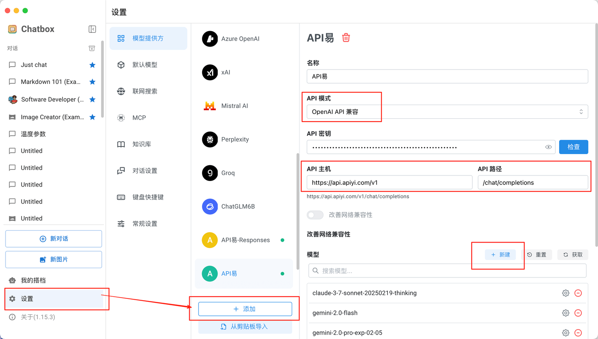

</details>

**⚙️ `%APPDATA%\chatbox\config.json`**
```json
{
  "settings": {
    "allowReportingAndTracking": false,
    "providers": { "openai": { "useProxy": false }, "claude": { "useProxy": false } }
  }
}
```

<a id="trae"></a>
### 🔴 Opt-Out ByteDance · Trae IDE & CLI
*Trae Global/CN/SOLO · OSS trae-agent CLI* ｜ [官方文档 / Docs](https://docs.trae.ai/ide/)

- **Path**：Settings → Account `➔` Privacy Mode: ON `➔` Rules & Memories → Memory: OFF `➔` Add .trae/.ignore
- **Training**：Personal Free/Pro Privacy Mode OFF by default → Turn ON; OSS CLI zero-training
- **Memory**：Auto Memory ON → Turn OFF & delete ~/.trae(-cn)/memory/
- **⚠️ Gotcha**：Privacy Mode resets on logout! VS Code telemetry toggle doesn't stop Trae's own heartbeat

<details open><summary>📷 Real Product Screenshot（ithome.com）</summary>

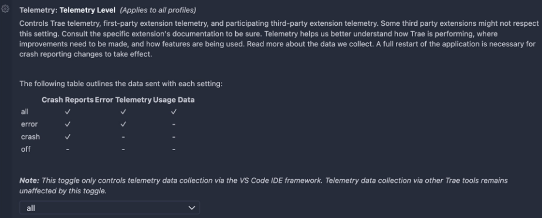

</details>

**⚙️ `.trae/.ignore & trae_config.yaml`**
```yaml
# Trae IDE settings.json: { "telemetry.telemetryLevel": "off" } + .trae/.ignore
# 开源 trae-agent (trae_config.yaml):
default_provider: ollama
enable_lakeview: false
```

<a id="doubao"></a>
### 🔴 Opt-Out ByteDance · Doubao / Coze / Xiaodou
*Doubao · Coze · Xiaodou Personal Agent (Nov 2026 Beta)* ｜ [官方文档 / Docs](https://www.volcengine.com/product/ark)

- **Path**：Settings → Privacy & Permissions `➔` Disable Model Improvement (all) `➔` Settings → Memory: OFF + Clear `➔` Coze: General → Improve OFF
- **Training**：All 3 consumer apps train by default ❌; devs use Volcengine ModelArk API (zero-training)
- **Memory**：Memory ON (toggling off keeps history); Xiaodou shares Doubao brain + broad app permissions
- **⚠️ Gotcha**：No native Incognito mode; restrict Xiaodou Connected Apps & avoid sensitive AI phone calls

<details open><summary>📷 Real Product Screenshot（csdn.net）</summary>

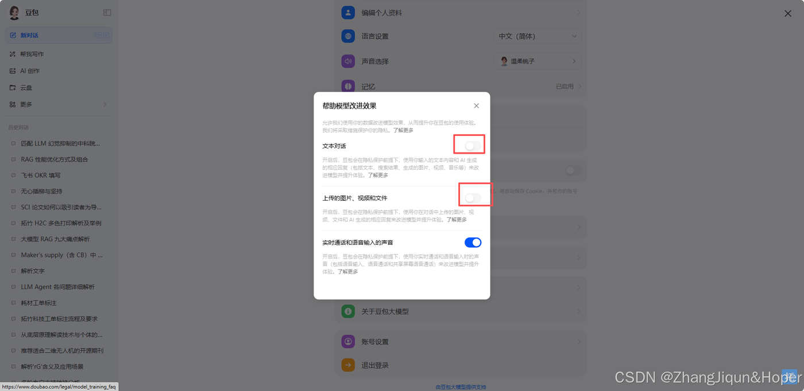

</details>

**⚙️ `火山方舟 ModelArk 零训练 API`**
```shell
# 商用条款默认不训练、推理会话无痕
export ARK_API_KEY="your-volcengine-ark-api-key"
export ARK_BASE_URL="https://ark.cn-beijing.volces.com/api/v3" 
```

<a id="tencent"></a>
### 🟢 Safe Tencent · WorkBuddy / CodeBuddy / Yuanbao
*WorkBuddy Desktop · CodeBuddy IDE/CLI · Yuanbao* ｜ [官方文档 / Docs](https://www.codebuddy.cn/docs/)

- **Path**：Yuanbao: Data Mgmt → Experience Plan OFF `➔` WorkBuddy: Disable & Reset Memory `➔` CodeBuddy: ~/.codebuddy/settings.json
- **Training**：All 3 products exclude model training by default ✅ (Yuanbao defaulted OFF since Mar 2025)
- **Memory**：WorkBuddy auto-generates nightly memory → Turn OFF + Reset; set retention to 30 days
- **⚠️ Gotcha**：Set CODEBUDDY_ARTIFACT_ENABLED=false in CodeBuddy CLI to block public share links

<details open><summary>📷 Real Product Screenshot（ifeng.com）</summary>

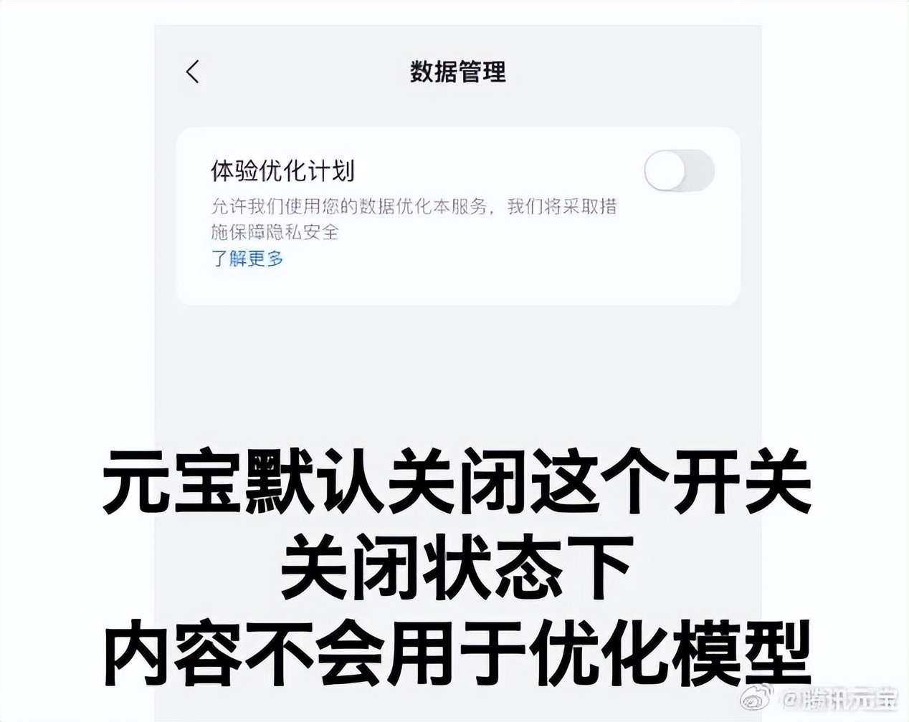

</details>

**⚙️ `~/.codebuddy/settings.json`**
```json
{
  "sandbox": { "enabled": true },
  "permissions": { "deny": ["Read(./.env*)", "Read(~/.ssh/**)"] },
  "env": { "DISABLE_TELEMETRY": "1", "CODEBUDDY_ARTIFACT_ENABLED": "false" }
}
```

<a id="qoder"></a>
### 🟡 Tune Alibaba · Qoder & Tongyi Lingma
*Qoder IDE/CLI · Tongyi Lingma (Qoder CN)* ｜ [官方文档 / Docs](https://docs.qoder.com/)

- **Path**：Settings → General → Privacy Mode ON `➔` Memory → Disable & clear `➔` CLI: ~/.qoder/settings.json
- **Training**：Code context excluded, de-identified chats may improve service; CLI stats default true → OFF
- **Memory**：Auto Global/Project memory + auto-index (<10k files) → Disable & add .qoderignore
- **⚠️ Gotcha**：Never click thumbs up/down (triggers feedback collection); don't set QODER_MEMORY=1

<details open><summary>📷 Real Product Screenshot（cnblogs.com）</summary>

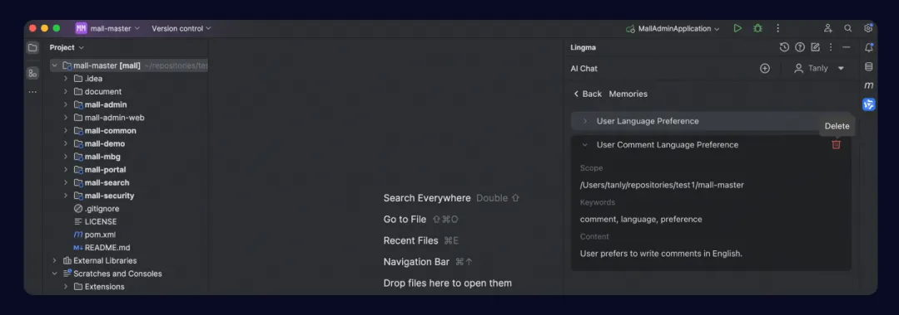

</details>

**⚙️ `~/.qoder/settings.json`**
```json
{
  "privacy": { "usageStatisticsEnabled": false },
  "aiCodeStatistics": { "enabled": false },
  "autoMemoryEnabled": false
}
```

<a id="qwen"></a>
### 🔴 Opt-Out Alibaba Qwen · Qwen Code & Chat
*Qwen Code CLI · chat.qwen.ai · QwenWork* ｜ [官方文档 / Docs](https://github.com/QwenLM/qwen-code)

- **Path**：chat.qwen.ai: email privacy@qwen.com `➔` Web/App Memory OFF; clean USER.md `➔` CLI: ~/.qwen/settings.json
- **Training**：⚠️ No UI opt-out toggle on Web! Email privacy@qwen.com or use DashScope Standard API
- **Memory**：Qwen Code AutoMemory & AutoDream default true! Clean ~/.qwenworkcn/awareness/
- **⚠️ Gotcha**：Free Qwen OAuth retired Apr 2026; use Standard DashScope API or local Ollama

<details open><summary>📷 Real Product Screenshot（github.com/QwenLM/qwen-code）</summary>

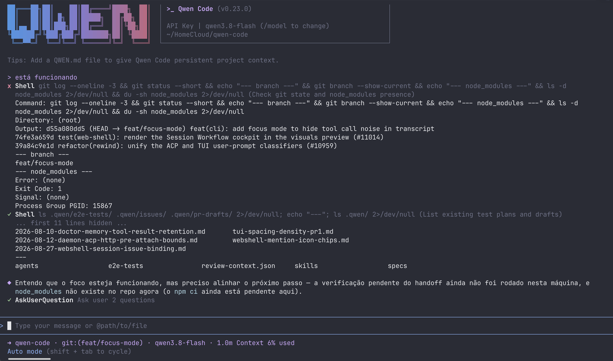

</details>

**⚙️ `~/.qwen/settings.json`**
```json
{
  "privacy": { "usageStatisticsEnabled": false },
  "telemetry": { "enabled": false, "logPrompts": false },
  "memory": { "enableManagedAutoMemory": false, "enableManagedAutoDream": false },
  "general": { "chatRecording": false }
}
```

<a id="zhipu"></a>
### 🔴 Opt-Out Zhipu AI / GLM & ZCode
*ZCode (Z.ai ADE) · ChatGLM · BigModel API* ｜ [官方文档 / Docs](https://zcode.z.ai/docs/v2/core-features/memory)

- **Path**：ChatGLM: Profile → Data Mgmt `➔` Experience Optimization: OFF `➔` ZCode: Memory OFF + block telemetry URL
- **Training**：ChatGLM consumer ON → Turn OFF; Z.ai dev API offers ZDR, CN BigModel needs contract
- **Memory**：ZCode Workspace Memory OFF by default; ChatGLM has no cross-chat memory/incognito
- **⚠️ Gotcha**：ZCode desktop hardcodes 15m telemetry pings (no UI toggle) — block via proxy or use OpenCode

**⚙️ `本地代理拦截规则 & ~/.zcode/AGENTS.md`**
```shell
# 代理精准阻断 ZCode 遥测（不影响模型推理）：
URL-REGEX,^https://zcode\.z\.ai/api/v1/event/report,REJECT
# 或在 OpenCode 中直接接入国际 Z.ai ZDR 端点：
export ZAI_API_BASE_URL="https://api.z.ai/api/coding/paas/v4" 
```

<a id="minimax"></a>
### 🔴 Opt-Out MiniMax · mcode / Agent / Hailuo
*MiniMax Code (mcode) · MiniMax Agent · Hailuo AI* ｜ [官方文档 / Docs](https://github.com/MiniMax-AI/minimax-code)

- **Path**：Agent: Personalization → Memory OFF `➔` Memory summary → Manage → Clear `➔` mcode: config.yaml permissionMode: default
- **Training**：mcode CLI telemetry all OFF by default ✅; ⚠️ Hailuo/Agent/public API lack opt-out & ZDR ❌
- **Memory**：Agent Proactive Memory keeps old items when off → Disable & clear summary
- **⚠️ Gotcha**：Never send proprietary code to public MiniMax cloud; use enterprise DPA or self-hosted weights

<details open><summary>📷 Real Product Screenshot（github.com/MiniMax-AI/minimax-code）</summary>

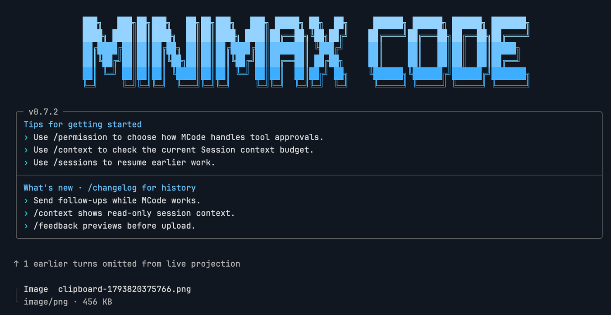

</details>

**⚙️ `~/.minimax/config.yaml`**
```yaml
permissionMode: default
telemetry: { enabled: false, metrics: false, diagnostics: false }
# Shell: export MCODE_DISABLE_TELEMETRY=1 DO_NOT_TRACK=1
```

<a id="kimi"></a>
### 🔴 Opt-Out Moonshot AI / Kimi Suite
*Kimi Code CLI & Ext · Kimi Web/App* ｜ [官方文档 / Docs](https://code.kimi.com/kimi-code/docs/configuration/config-overrides)

- **Path**：Email support@moonshot.cn to opt out `➔` Settings → Memory toggle: OFF `➔` Clear Memory Space files `➔` Edit ~/.kimi-code/config.toml
- **Training**：⚠️ Personal/Coding Plan trains with NO UI toggle (email support@moonshot.cn); Business OFF
- **Memory**：Auto-writes to Memory Space (persists when off), no Incognito → Disable & wipe Memory Space
- **⚠️ Gotcha**：Kimi Code telemetry defaults true & WebSearch enabled — disable both in config.toml

<details open><summary>📷 Real Product Screenshot（kimi.com）</summary>

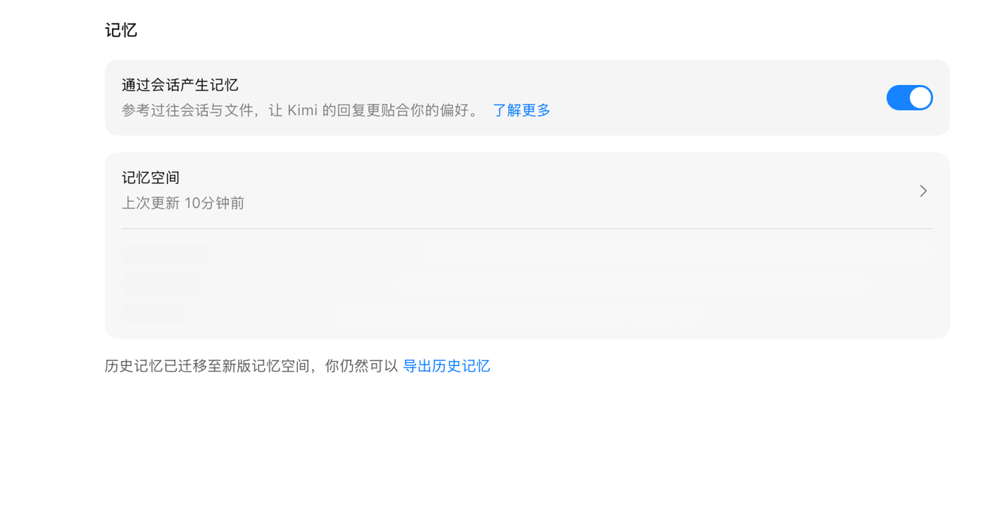

</details>

**⚙️ `~/.kimi-code/config.toml`**
```toml
default_permission_mode = "manual"
telemetry = false
[memory]
auto_memory_enabled = false
[tools]
disabled = ["WebSearch", "FetchURL"]
```

<a id="deepseek"></a>
### 🔴 Opt-Out DeepSeek & Harness (dsh)
*DeepSeek Harness (dsh OSS) · chat.deepseek.com · API* ｜ [官方文档 / Docs](https://github.com/deepseek-ai/deepseek-harness)

- **Path**：Web/App: Settings → Data controls `➔` Improve the model: OFF `➔` dsh: cordis.patch.yml DISABLED `➔` Self-host weights via Ollama
- **Training**：Web/App ON → Turn OFF; 1st-party API lacks ZDR/opt-out; OSS dsh runtime never trains ✅
- **Memory**：No cross-chat Memory or Incognito on Web; dsh OTel defaults to FEEDBACK_ONLY
- **⚠️ Gotcha**：api.deepseek.com enables disk KV-Cache with no ZDR — self-host open weights for sensitive code

**⚙️ `~/.dsh/profiles/web/cordis.patch.yml`**
```yaml
- id: session-telemetry-otel
  name: '@deepseek-ai/dsh-session-telemetry-otel'
  config: { mode: DISABLED }
# Shell: export DSH_TELEMETRY_DISABLED=1 DSH_TELEMETRY_MODE=DISABLED
```

<a id="oss_agents"></a>
### 🟢 Safe OSS Coding Agent Cluster (6 Tools)
*Cline · Roo Code · Kilo Code · Aider · Goose · OpenClaw* ｜ [官方文档 / Docs](https://docs.cline.bot)

- **Path**：All 6 local BYOK zero-training ✅ `➔` Disable Cline/Kilo telemetry `➔` Aider: analytics-disable & gitignore `➔` Goose memory OFF · OpenClaw update OFF
- **Training**：All 6 clients perform zero model training ✅ (depends solely on your BYOK / Ollama)
- **Memory**：No hidden cloud memory; ignore Aider's plaintext .aider.chat.history.md in Git
- **⚠️ Gotcha**：Cline deprecated .clineignore (use PreToolUse Hook); avoid Roo Cloud sync

<details open><summary>📷 Real Product Screenshot（github.com/cline/cline）</summary>

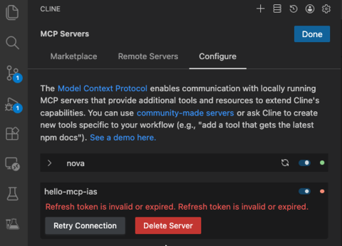

</details>

**⚙️ `多工具配置文件汇总`**
```yaml
# Aider (~/.aider.conf.yml): analytics-disable: true | gitignore: true
# Goose (~/.config/goose/config.yaml): GOOSE_TELEMETRY_ENABLED: false
# Cline (~/.cline/data/settings/global-settings.json): { "telemetryOptOut": true }
# OpenClaw (~/.openclaw/openclaw.json): update.checkOnStart=false, telemetry.enabled=false
```

<a id="comm_ide"></a>
### 🔴 Opt-Out Commercial IDEs & Cloud Builders (6 Tools)
*JetBrains AI/Junie · Zed · Amp · v0 · Lovable · Replit* ｜ [官方文档 / Docs](https://www.jetbrains.com/help/ai-assistant/data-sharing.html)

- **Path**：JetBrains: Data Sharing → uncheck all `➔` v0 / Lovable / Replit: Training OFF + Private `➔` Zed telemetry OFF · Amp private
- **Training**：Zed/Amp/JB Paid zero-training ✅; ⚠️ JB Free & v0/Lovable/Replit personal train by default ❌
- **Memory**：JetBrains uses .junie/guidelines.md; never put secrets in Replit's replit.md
- **⚠️ Gotcha**：Drop empty .noai in JetBrains repos; Amp has no .ampignore; avoid Junie Brave Mode

<details open><summary>📷 Real Product Screenshot（jetbrains.com）</summary>

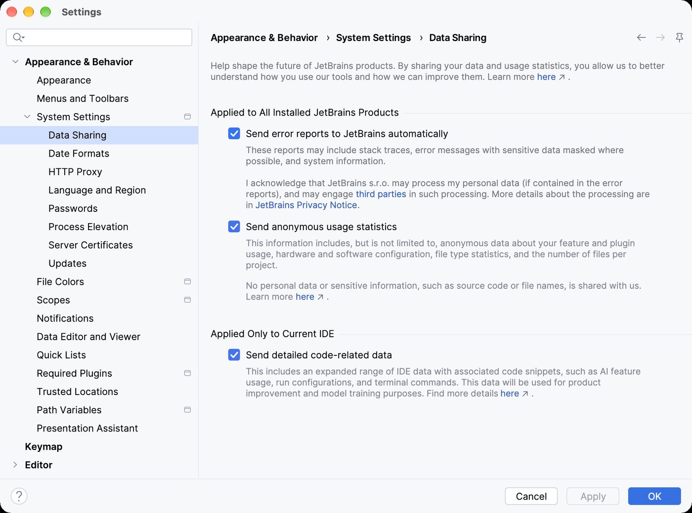

</details>

**⚙️ `~/.config/zed/settings.json & ~/.config/amp/settings.json`**
```json
// Zed: { "telemetry": { "diagnostics": false, "metrics": false } }
// Amp: { "amp.defaultVisibility": { "github.com/your-org/*": "private" } }
```

<a id="web_research"></a>
### 🔴 Opt-Out Research & General Web AI (4 Tools)
*Perplexity · NotebookLM · Manus · Poe* ｜ [官方文档 / Docs](https://www.perplexity.ai/hub)

- **Path**：Perplexity: AI Data Retention OFF + Clear Memory `➔` NotebookLM: Zero training (never click feedback) `➔` Manus: Opt-out + Private · Poe: Solid-shield only
- **Training**：NotebookLM zero-training ✅; Perplexity consumer ON ❌; Poe half-shield bots may train
- **Memory**：Perplexity/Poe keep old memory when toggled off; NotebookLM isolates per notebook
- **⚠️ Gotcha**：NotebookLM thumbs up/down triggers up to 3yr human review! Perplexity Sonar API is ZDR

## 🔧 One-Click Anti-Telemetry Environment Script (macOS / Linux)
```bash
export DO_NOT_TRACK=1
export CLAUDE_CODE_DISABLE_NONESSENTIAL_TRAFFIC="1" DISABLE_TELEMETRY="1" CLAUDE_CODE_DISABLE_AUTO_MEMORY="1"
export GEMINI_TELEMETRY_ENABLED="false" GEMINI_TELEMETRY_LOG_PROMPTS="false"
export GROK_TELEMETRY_ENABLED=0 GROK_TRACE_UPLOAD=0 GH_TELEMETRY=0
export OPENCODE_DISABLE_AUTOUPDATE=1 OPENCODE_DISABLE_SHARE=1 OPENCODE_DISABLE_MODELS_FETCH=1
export PI_TELEMETRY=0 PI_OFFLINE=1 T3CODE_TELEMETRY_ENABLED=false ORCA_TELEMETRY_DISABLED=1
export CODEBUDDY_CODE_ENABLE_TELEMETRY=0 CODEBUDDY_ARTIFACT_ENABLED=false
export QWEN_USAGE_STATISTICS_ENABLED=false QWEN_TELEMETRY_ENABLED=false
export MCODE_DISABLE_TELEMETRY=1 KIMI_DISABLE_TELEMETRY=1 KIMI_DISABLE_AUTO_MEMORY=1
export DSH_TELEMETRY_DISABLED=1 DSH_TELEMETRY_MODE=DISABLED
export AIDER_ANALYTICS_DISABLE=true GOOSE_TELEMETRY_ENABLED=false KILO_TELEMETRY_LEVEL=off OPENCLAW_NO_AUTO_UPDATE=1
```

## 🔍 Existing Guides & Prior Art Comparison

| Existing Resource | Coverage | Limitation | Real Screenshots? |
| :--- | :--- | :--- | :---: |
| [EFF — Opt Out of AI Tools Made by Big Tech](https://www.eff.org/pages/i-want-opt-out-ai-tools-or-training-made-big-tech) | US consumer Big Tech only (4–5 vendors) | No Coding Agents, IDEs, TOML/JSON, or CN ecosystem | 无 / No |
| [AIPolicyLog — AI Data Opt-Out Cheat Sheet](https://aipolicylog.com/guides/ai-data-opt-out-cheat-sheet/) | English Web Chats only (6–8 tools) | No IDEs/CLIs, no config files, no CN tools, no screenshots | 无 / No |
| [Redact.dev Blog (Single-Tool Opt-Out Guides)](https://redact.dev/blog/opt-out-github-ai-training) | Fragmented single-tool posts | Good UI captures, but no unified matrix, CLI configs, or CN tools | 部分有 / Partial |
| [DeleteMe — AI Privacy Settings Guides](https://joindeleteme.com/ai-privacy-settings/cursor-ai-privacy-settings-guide/) | Individual tool pages | Missing 2026 CLI Agents (Codex/Antigravity/Kiro/Qoder) & bilingual view | 部分有 / Partial |
| [Engadget / GhostVault / MEGA Blog](https://www.engadget.com/2268598/how-to-stop-ai-companies-training-your-data/) | Consumer media explainers (4–6 bots) | Text-heavy consumer overview; zero dev agents or config files | 极少 / Few |
| [GitHub: hamarshehmhmd/optout (★0)](https://github.com/hamarshehmhmd/optout) | Early CLI scanner (4 tools only) | Only checks 4 tools; no Web/CN coverage or visual guide | 无 / No |
| [GitHub: pyamsoft/auto-ai-optout (★3)](https://github.com/pyamsoft/auto-ai-optout) | Browser extension (few sites) | Web-only; cannot configure IDEs, CLIs, or TOML/JSON | 无 / No |
| [中文社区零散帖（博客园 / binlin.wang）](https://blog.binlin.wang/posts/gpt-data-privacy.20260625) | Single-tool Chinese blog posts | Isolated notes; no cross-vendor matrix, configs, or English edition | 单工具 / Single |
| **This Project (AI Privacy Switches 2026)** | **26 Families · 68 Tools (US + CN + IDE + CLI + Web)** | **SVG Map + 23 Real Screenshots + Bilingual HTML/MD + Copy-Paste Configs + Excel/PPT** | **✅ 23 Verified** |

## 🤝 Contributing Real Screenshots (PRs Welcome)

We strictly use **zero fake UI mockups**. 7 login-walled cards (Cursor, Windsurf/Devin, Notion AI, Pi, Zhipu/ChatGLM, DeepSeek Web, Perplexity/Manus/Poe) welcome redacted real UI screenshots via PR — see [CONTRIBUTING.md](./CONTRIBUTING.md).