# 🛡️ AI Agent / IDE / Web Chat 隐私、记忆与防训练开关速查手册（2026 版）

[](https://xialuyu5-oss.github.io/ai-privacy-switches/) [](./README.md) [](./LICENSE) [](./CONTRIBUTING.md)

> **在线交互网页版（中英切换 + 筛选 + 一键生成脚本）：** https://xialuyu5-oss.github.io/ai-privacy-switches/ （本地直接打开 [`index.html`](./index.html)）
> **极简办公下载版（含全部 23 张产品真实截图）：** [📊 下载 Excel 速查手册](./exports/AI_Agent_隐私记忆与防训练开关全手册_2026.xlsx) ｜ [📽️ 下载 PPT 演示版（35 页）](./exports/AI_Agent_隐私记忆与防训练开关全手册_2026.pptx)
>
> **3 秒看懂怎么关，拒绝长篇大论！** 覆盖 **26 大产品家族 · 68 款工具（30 张实操卡片）· 23 张真实产品界面截图 · 全部必改 TOML/JSON/环境变量**（数据核实基准日：2026-11-25）。

## 🗺️ 一图看懂 26 家 AI 工具默认训练风险全景

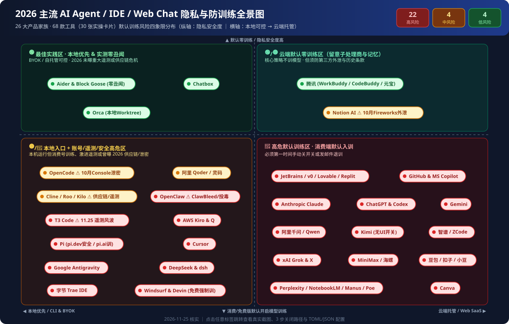

## 🚨 6 条一眼记住的防泄密铁律
1. **消费版默认训练是常态**：Claude（2025.08起）、GitHub Copilot 个人版（2026.04起）、ChatGPT、Gemini、Grok、Trae、豆包、Kimi、DeepSeek、智谱清言、Canva、Perplexity 消费/免费版全部默认开训练；**腾讯系（WorkBuddy/CodeBuddy/元宝）、Notion AI、NotebookLM、Zed、Amp 及本地开源 Agent** 默认不训练。
2. **CLI 看认证方式**：Claude Code / Codex / Gemini CLI / Antigravity 用个人消费号登录照样训练，商业 API / Vertex / Enterprise 才默认零训练。
3. **关记忆 ≠ 删旧记忆**：Claude、豆包、Kimi（记忆空间）、WorkBuddy、Perplexity、Poe、Windsurf 关完开关后**必须再手动清空**。
4. **`.ignore` 并非处处有效**：Claude Code 无 `.claudeignore`、Codex 无 `.codexignore`、Copilot 无 `.copilotignore`、Cline 已弃用 `.clineignore`、Amp 无 `.ampignore`。
5. **无痕 ≠ 零留存（ZDR）**：ChatGPT/Claude 无痕留≤30天安全日志，Gemini 2026 已延至约 2 个月；真正零出网请用本地 Ollama/vLLM。
6. **开源 / 零训练 ≠ 天然免审计（2026 安全复盘）**：**T3 Code**（11.25 违背零遥测/偷读认证哈希/扫描进程）、**OpenClaw**（ClawBleed 一键 RCE/ClawHavoc 千余恶意技能/遭 Meta 与微软禁令）、**OpenCode Console**（10.16 托管 Key 泄密）、**Cline/Roo/Kilo**（2 月 npm 2.3.0 供应链投毒与遥测争议）及 **Notion AI**（10 月第三方 Fireworks AI 聊天记录外泄）均已按 2026-11 实测事实重新降级分栏。

## ⚡ 3 分钟极速速查表（一表看完怎么关）

| 状态 | 产品家族 | 极简关闭路径 | 记忆怎么设 | 需改配置文件？ |
| :---: | :--- | :--- | :--- | :--- |
| 🔴 必关 | **[Anthropic / Claude 系列](#claude)** | 左下角头像 → Settings → Privacy → 关闭 Help improve Claude → CLI: ~/.claude/settings.json | 跨端记忆 & Auto Memory 默认开 → 关闭并手动清空旧记忆 | `~/.claude/settings.json` |
| 🔴 必关 | **[OpenAI / ChatGPT & Codex](#openai)** | Settings → Data controls → 关闭 Improve the model → Codex 用 --with-api-key → 编辑 ~/.codex/config.toml | ChatGPT 记忆默认开(需关并清空)；Codex 本地记忆默认 false | `~/.codex/config.toml` |
| 🔴 必关 | **[Google Gemini & Gemini CLI](#gemini)** | myactivity.google.com/product/gemini → 关闭 Help train AI models → CLI 改用 Vertex AI / 付费 API → 编辑 ~/.gemini/settings.json | Personal context 默认开 → 关闭；Auto-delete 调至 3 个月 | `~/.gemini/settings.json` |
| 🔴 必关 | **[Google Antigravity 全家桶](#antigravity)** | Settings → Account → 关闭 Enable Telemetry → CLI 运行 /config 关 telemetry → 配 ./.antigravityignore | Knowledge Items 无独立开关 → 涉密后清理 ~/.gemini/antigravity/knowledge/ | `~/.gemini/antigravity-cli/settings.json` |
| 🔴 必关 | **[xAI / Grok 系列](#grok)** | grok.com → Data Controls 关训练 → x.com/settings/grok_settings 全取消 → Build 改 ~/.grok/config.toml | Web & X 记忆默认开 → 取消勾选；Grok Build 记忆默认 false | `~/.grok/config.toml` |
| 🔴 必关 | **[Microsoft / GitHub Copilot](#copilot)** | github.com/settings/copilot/features → AI model training → Disabled → 公开代码匹配 → Blocked → 配 Web Content exclusion | Copilot Memory & M365 增强个性化默认开 → 敏感组织关闭 | `VS Code settings.json & CLI` |
| 🔴 必关 | **[AWS Kiro & Amazon Q](#aws_kiro)** | IDE Settings 搜 Telemetry / Share Content → 取消勾选 Content Collection & Share with AWS → CLI 关 telemetry 与 knowledge | Kiro Memory 默认关闭；Q 无云端个人画像 | `~/.kiro/settings/cli.json & CLI` |
| 🔴 必关 | **[Cursor](#cursor)** | Ctrl/Cmd+Shift+J 打开 Cursor Settings → General → Privacy → 开启 Privacy Mode (Legacy) → 配置 .cursorignore | 原生自动 Memories 已在 v2.1+ 正式弃用移除，改用静态 .cursor/rules/*.mdc | `.cursorignore & ~/.cursor/cli-config.json` |
| 🔴 必关 | **[Cognition / Windsurf & Devin](#windsurf_devin)** | windsurf.com/settings → Privacy 开 ZDR → Cascade → Customizations 关 Memories → app.devin.ai → Data Controls 关训练 | Windsurf Cascade Auto-Memories 默认开 → 关闭并清 ~/.codeium/windsurf/memories/ | `Windsurf settings.json & ~/.config/devin/config.json` |
| 🔴 必关 | **[Canva (Magic Studio)](#canva)** | 右上角头像 → Settings → Your account → Privacy controls → 关闭 2 项 AI learn 开关 → 关闭 AI personalization | AI-generated content 个性化默认开 → 关闭 | 无 |
| 🟡 需调 | **[Notion AI ⚠️ (10月子处理商外泄)](#notion)** | Settings → Notion AI → 确认 Share data to improve 为关 → Memory → 关闭 Use memories → 绝不在对话粘贴 API Key / 密码 | Use memories 默认开 → 关闭；限制 Custom Agents 仅管理员可建，并排查是否曾粘贴密钥 | 无 |
| 🟡 需调 | **[OpenCode ⚠️ (10月Console泄密)](#opencode)** | 严禁在 OpenCode Console 托管 Key → 编辑 ~/.config/opencode/opencode.json → 锁死 share: "disabled" & 禁 Zen 免费 → 导出 OPENCODE_DISABLE_* | 无云端记忆；历史存本地 SQLite (opencode.db)，可用 OPENCODE_DB 临时隔离 | `~/.config/opencode/opencode.json` |
| 🔴 必关 | **[Pi (Coding Agent & pi.ai)](#pi)** | pi.dev: ~/.pi/agent/settings.json 关统计 → pi.dev 无痕启动: pi --no-session → pi.ai: Account Settings 退出训练 | pi.dev 原生支持 --no-session 不写 JSONL；pi.ai 用 !delete 删记录 | `~/.pi/agent/settings.json` |
| 🔴 必关 | **[T3 Code ⚠️ (2026.11 遥测风波)](#t3code)** | 升至 ≥2026.11.25 补丁版 → 配 policy.json 锁 telemetry:false → 导出 T3CODE_TELEMETRY/OTEL + DNT → 关 Publish agent activity & 切 Supervised | 本地 state.sqlite（旧版删除为假删除，11.25 #42119 才真删）→ 立即升级并缩短留存；关 Sharing & access → Publish agent activity（否则外发项目/会话标题且不受退遥测控制） | `/etc/t3code/policy.json & 环境变量（必配 4 项）` |
| 🟢 安全 | **[Orca (stablyai/orca)](#orca)** | Settings → Privacy 关匿名统计 → 导出 ORCA_TELEMETRY_DISABLED=1 → 退出后改 orca-data.json 透传子变量 | 无云端记忆；独立 Git Worktree 本地隔离，用完即删 | `Shell & orca-data.json` |
| 🟢 安全 | **[Chatbox](#chatbox)** | Settings → Privacy 关匿名报告追踪 → Model Provider 关 Improve Network Compatibility → 优先用本地 Ollama 或直连 ZDR API | 纯本地存储无云同步；支持全离线本地 Embedding RAG 知识库 | `%APPDATA%\chatbox\config.json` |
| 🔴 必关 | **[字节 · Trae IDE & Agent CLI](#trae)** | Settings → Account → 开启 Privacy Mode (隐私模式) → Rules & Memories 关自动记忆 → 配置 .trae/.ignore | 自动 Memory 跨会话沉淀 → 关闭并清 ~/.trae(-cn)/memory/ | `.trae/.ignore & trae_config.yaml` |
| 🔴 必关 | **[字节 · 豆包 / 扣子 / 小豆](#doubao)** | 豆包/小豆: 设置 → 隐私与权限 → 全关“帮助模型改进效果” → 设置 → 记忆 关闭并清空 → 扣子: 通用设置关改进效果 | 豆包/小豆记忆默认开(关不删旧)；小豆一键导入豆包大脑且“连接应用”权限面极广 | `火山方舟 ModelArk 零训练 API` |
| 🟢 安全 | **[腾讯 · WorkBuddy / CodeBuddy / 元宝](#tencent)** | 元宝: 设置 → 数据管理 → 确认“体验优化计划”关闭 → WorkBuddy: 记忆与进化关生成记忆+重置 → CodeBuddy: ~/.codebuddy/settings.json | WorkBuddy“生成对话记忆”每晚自动提取 → 关闭+重置，留存期调至 30 天 | `~/.codebuddy/settings.json` |
| 🟡 需调 | **[阿里 · Qoder & 通义灵码](#qoder)** | Settings (⌘⇧,) → 常规 → 开启隐私模式 → 记忆管理 → 关闭自动记忆并清理 → CLI 改 ~/.qoder/settings.json | 支持全局/工程自动记忆；<1万文件仓默认后台自动索引 → 高敏仓关索引配 .qoderignore | `~/.qoder/settings.json` |
| 🔴 必关 | **[阿里千问 · Qwen Code & 千问](#qwen)** | chat.qwen.ai: 邮件 privacy@qwen.com 退训 → Web/App 关长期记忆；清 QwenWork USER.md → CLI 编辑 ~/.qwen/settings.json | Qwen Code CLI 的 AutoMemory & AutoDream 默认 true！千问办公写 ~/.qwenworkcn/awareness/ | `~/.qwen/settings.json` |
| 🔴 必关 | **[智谱 / GLM & ZCode](#zhipu)** | 智谱清言: 个人中心 → 数据管理 → 关闭“数据用于优化体验/数据使用” → ZCode: 保持工作区记忆 OFF + 代理拦遥测 | ZCode 工作区记忆默认 OFF；清言暂无跨会话自动记忆面板、无无痕模式 | `本地代理拦截规则 & ~/.zcode/AGENTS.md` |
| 🔴 必关 | **[MiniMax · mcode / Agent / 海螺](#minimax)** | Agent: Settings → Personalization 关 Memory & Proactive → Memory summary → Manage 清空 → mcode: ~/.minimax/config.yaml 锁 default | MiniMax Agent 支持 Proactive Memory（关不删旧）→ 关闭并清空摘要，会话用 /memory | `~/.minimax/config.yaml` |
| 🔴 必关 | **[月之暗面 / Kimi 系列](#kimi)** | 发邮件 support@moonshot.cn 申请退训 → 设置 → 个性化 → 关“通过会话产生记忆” → 进“记忆空间”清空旧条目 → 编辑 ~/.kimi-code/config.toml | 自动整理写入“记忆空间”（关不删旧），无原生无痕对话 → 关记忆+清空记忆空间 | `~/.kimi-code/config.toml` |
| 🔴 必关 | **[DeepSeek & Harness (dsh)](#deepseek)** | Web/App: 设置 → 数据管理 → 关“数据用于优化体验 / Improve the model” → dsh: cordis.patch.yml 设 DISABLED → 高敏源码用本地自托管 Ollama | C 端无跨会话长期记忆、无无痕模式；dsh 为插件化本地记忆，OTel 默认 FEEDBACK_ONLY | `~/.dsh/profiles/web/cordis.patch.yml` |
| 🟢 安全 | **[纯净开源 Agent (Aider · Goose)](#oss_clean)** | Aider: ~/.aider.conf.yml 设 analytics-disable & gitignore → Goose: 首次拒绝遥测 + 设 GOOSE_TELEMETRY_OFF=1 → 配合本地 Ollama 或商用 ZDR API | 无黑盒云端画像；Aider 明文写 .aider.chat.history.md 务必配 gitignore: true 防误提交 | `~/.aider.conf.yml & Goose Env` |
| 🟡 需调 | **[Cline / Roo Code / Kilo Code ⚠️](#cline_roo_kilo)** | Cline: 避开旧版 npm 2.3.0，配 telemetryOptOut:true → Roo Code: 禁登录 Roo Cloud + 升补丁防工作区 RCE → Kilo Code: 关遥测并监控出网流量 | 无黑盒云端记忆；Roo Code 切勿登录 Roo Cloud 同步会话 | `Cline / Kilo 配置与环境变量` |
| 🔴 必关 | **[OpenClaw ⚠️ (2026 多起高危安全危机)](#openclaw)** | 仅在强隔离容器/虚拟机内运行 → 强制升至 Trail of Bits 审计后新版 → 严禁安装未经审计的 ClawHub 技能 → 关公网暴露与自动更新检查 | 具备宿主机持久记忆与全权限执行能力 → 绝不可直接在存有公司源码/密钥的宿主机裸跑 | `~/.openclaw/openclaw.json & 容器隔离` |
| 🔴 必关 | **[商业 IDE & 云端构建 (6 款)](#comm_ide)** | JetBrains: System Settings → Data Sharing 全取消 → v0 / Lovable / Replit 关 Model Training & 设 Private → Zed 关遥测 · Amp 锁 visibility: private | JetBrains 用 .junie/guidelines.md；Replit 自动写 replit.md 切勿放密钥 | `~/.config/zed/settings.json & ~/.config/amp/settings.json` |
| 🔴 必关 | **[研究与通用 Web AI (4 款)](#web_research)** | Perplexity: Preferences → 关 AI Data Retention & 清 Memory → NotebookLM: 默认零训(绝不点赞/踩) → Manus: 退训+禁公开 · Poe: 只选全实心盾 Bot | Perplexity/Poe 关开关不删旧记忆须手动清；NotebookLM 按笔记本硬隔离 | 无 |

## 📷 分产品实操卡片（含产品真实界面截图 & 配置文件）

<a id="claude"></a>
### 🔴 必关 Anthropic / Claude 系列
*Claude Code CLI · Claude Desktop/Cowork · Web/App* ｜ [官方文档 / Docs](https://code.claude.com/docs/en/data-usage)

- **关闭路径**：左下角头像 `➔` Settings → Privacy `➔` 关闭 Help improve Claude `➔` CLI: ~/.claude/settings.json
- **模型训练**：个人 Pro/Max 自 2025.08 起默认开(留5年) → 必关；Team/API 默认关
- **记忆设置**：跨端记忆 & Auto Memory 默认开 → 关闭并手动清空旧记忆
- **⚠️ 避坑**：Claude Code 不支持 .claudeignore（须用 permissions.deny）；环境变量存在即生效勿设 0

<details open><summary>📷 产品真实界面截图（privacyinternational.org）</summary>

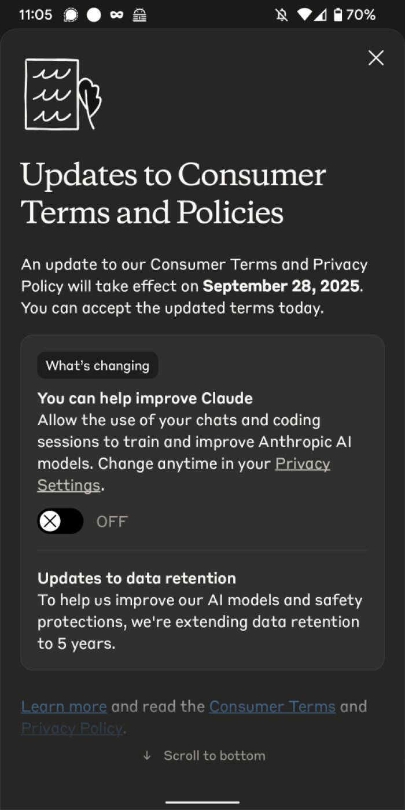

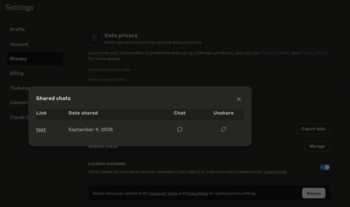

</details>

**⚙️ `~/.claude/settings.json`**
```json
{
  "autoMemoryEnabled": false,
  "cleanupPeriodDays": 0,
  "permissions": { "deny": ["Read(.env*)", "Edit(.env*)", "Read(secrets/**)"] },
  "env": {
    "CLAUDE_CODE_DISABLE_NONESSENTIAL_TRAFFIC": "1",
    "DISABLE_TELEMETRY": "1",
    "CLAUDE_CODE_DISABLE_AUTO_MEMORY": "1"
  }
}
```

<a id="openai"></a>
### 🔴 必关 OpenAI / ChatGPT & Codex
*Codex CLI · Codex App/Web · ChatGPT Web/App* ｜ [官方文档 / Docs](https://developers.openai.com/codex/config-reference)

- **关闭路径**：Settings → Data controls `➔` 关闭 Improve the model `➔` Codex 用 --with-api-key `➔` 编辑 ~/.codex/config.toml
- **模型训练**：个人号(含登录 Codex)默认开 → 必关；API / Business 默认关
- **记忆设置**：ChatGPT 记忆默认开(需关并清空)；Codex 本地记忆默认 false
- **⚠️ 避坑**：Codex 不支持 .codexignore；必设 allow_login_shell = false 防 Shell 重注密钥

<details open><summary>📷 产品真实界面截图（progresslearning.helpdocs.io）</summary>

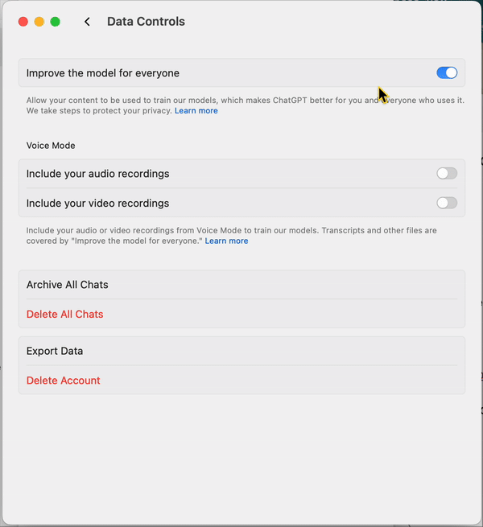

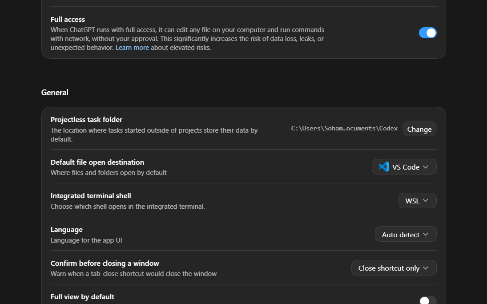

</details>

**⚙️ `~/.codex/config.toml`**
```toml
allow_login_shell = false
[analytics]
enabled = false
[feedback]
enabled = false
[history]
persistence = "none"
[features]
memories = false
```

<a id="gemini"></a>
### 🔴 必关 Google Gemini & Gemini CLI
*Gemini Web/App · Gemini CLI* ｜ [官方文档 / Docs](https://geminicli.com/docs/tos-privacy)

- **关闭路径**：myactivity.google.com/product/gemini `➔` 关闭 Help train AI models `➔` CLI 改用 Vertex AI / 付费 API `➔` 编辑 ~/.gemini/settings.json
- **模型训练**：2026.11 拆分后文本默认开；CLI 个人号与免费 API 默认训练 → 切 Vertex/付费
- **记忆设置**：Personal context 默认开 → 关闭；Auto-delete 调至 3 个月
- **⚠️ 避坑**：Gemini 2026 将临时对话后台安全留存延至约 2 个月；CLI 的 logPrompts 默认 true!

<details open><summary>📷 产品真实界面截图（redact.dev）</summary>

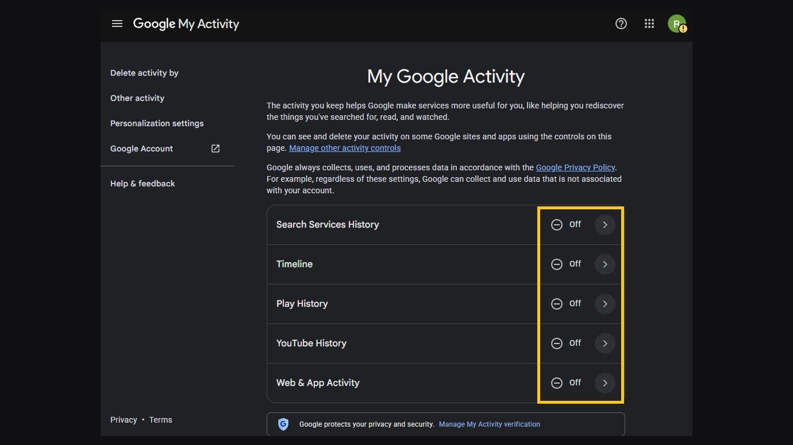

</details>

**⚙️ `~/.gemini/settings.json`**
```json
{
  "privacy": { "usageStatisticsEnabled": false },
  "telemetry": { "enabled": false, "logPrompts": false },
  "experimental": { "autoMemory": false }
}
// 同时创建 ./.geminiignore，并设 export GOOGLE_GENAI_USE_VERTEXAI=true
```

<a id="antigravity"></a>
### 🔴 必关 Google Antigravity 全家桶
*Antigravity App 2.0 · IDE · agy CLI* ｜ [官方文档 / Docs](https://antigravity.google/docs/settings)

- **关闭路径**：Settings → Account `➔` 关闭 Enable Telemetry `➔` CLI 运行 /config 关 telemetry `➔` 配 ./.antigravityignore
- **模型训练**：个人号 Enable Telemetry 默认开(即训练主开关) → 必关；Workspace 默认不训
- **记忆设置**：Knowledge Items 无独立开关 → 涉密后清理 ~/.gemini/antigravity/knowledge/
- **⚠️ 避坑**：App/IDE 与 agy CLI 配置完全独立，两端必须分别关闭；保持 Strict Mode & Sandbox 开启

<details open><summary>📷 产品真实界面截图（antigravity.google）</summary>

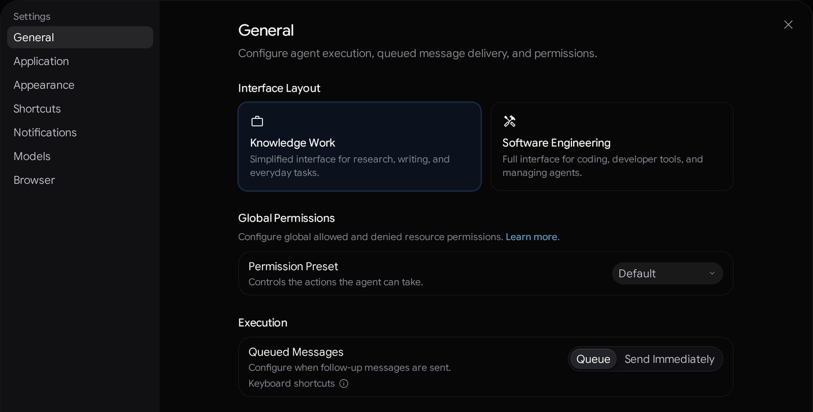

</details>

**⚙️ `~/.gemini/antigravity-cli/settings.json`**
```json
{
  "$schema": "https://antigravity.google/schemas/v1/settings.json",
  "enableTelemetry": false
}
```

<a id="grok"></a>
### 🔴 必关 xAI / Grok 系列
*Grok Build CLI · grok.com · X 平台 Grok Bot* ｜ [官方文档 / Docs](https://github.com/xai-org/grok-build)

- **关闭路径**：grok.com → Data Controls 关训练 `➔` x.com/settings/grok_settings 全取消 `➔` Build 改 ~/.grok/config.toml
- **模型训练**：Grok Web & X 帖子/交互默认训练 → 双端必关；Business/API 可启 ZDR
- **记忆设置**：Web & X 记忆默认开 → 取消勾选；Grok Build 记忆默认 false
- **⚠️ 避坑**：X 与 grok.com 开关分离须分别关；Grok Build 必设 disable_codebase_upload = true

<details open><summary>📷 产品真实界面截图（redact.dev）</summary>

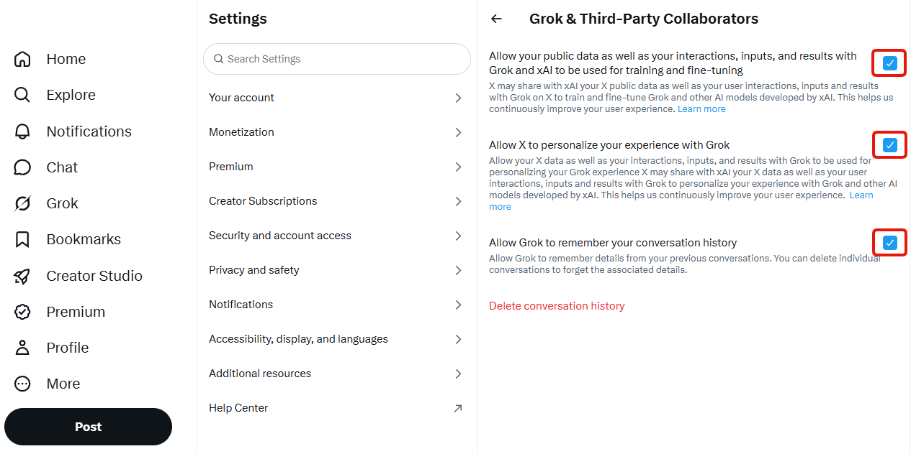

</details>

**⚙️ `~/.grok/config.toml`**
```toml
[features]
telemetry = false
[telemetry]
enabled = false
trace_upload = false
[harness]
disable_codebase_upload = true
coding_data_retention_opt_out = true
```

<a id="copilot"></a>
### 🔴 必关 Microsoft / GitHub Copilot
*GitHub Copilot · MS Copilot 个人版 · M365 企业版* ｜ [官方文档 / Docs](https://docs.github.com/en/copilot/managing-copilot/managing-copilot-as-an-individual-subscriber/managing-your-copilot-plan/managing-copilot-policies-as-an-individual-subscriber)

- **关闭路径**：github.com/settings/copilot/features `➔` AI model training → Disabled `➔` 公开代码匹配 → Blocked `➔` 配 Web Content exclusion
- **模型训练**：GitHub 个人版 2026.04 起默认开训! MS 个人默认开；Business/M365 零训练
- **记忆设置**：Copilot Memory & M365 增强个性化默认开 → 敏感组织关闭
- **⚠️ 避坑**：原生不支持 .copilotignore！必须在 GitHub 网页配 Content exclusion 并关 VS Code 遥测

<details open><summary>📷 产品真实界面截图（redact.dev）</summary>

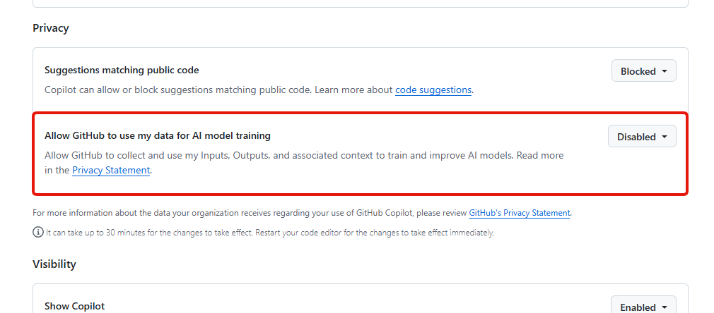

</details>

**⚙️ `VS Code settings.json & CLI`**
```json
// VS Code settings.json
{ "telemetry.telemetryLevel": "off", "github.copilot.enable": { "*": true, "dotenv": false } }
// Terminal: gh config set telemetry disabled && export GH_TELEMETRY=0
```

<a id="aws_kiro"></a>
### 🔴 必关 AWS Kiro & Amazon Q
*Kiro IDE & CLI · Amazon Q Developer* ｜ [官方文档 / Docs](https://kiro.dev/docs/privacy-and-security/data-protection/)

- **关闭路径**：IDE Settings 搜 Telemetry / Share Content `➔` 取消勾选 Content Collection & Share with AWS `➔` CLI 关 telemetry 与 knowledge
- **模型训练**：Kiro Free & Q Builder ID 免费版默认共享用于改进 → 必关；Pro/Enterprise 默认关
- **记忆设置**：Kiro Memory 默认关闭；Q 无云端个人画像
- **⚠️ 避坑**：Kiro 个人版即使关共享仍有最长 60 天防滥用留存；企业用 Q Pro + AWS Organizations Opt-Out

<details open><summary>📷 产品真实界面截图（docs.aws.amazon.com）</summary>

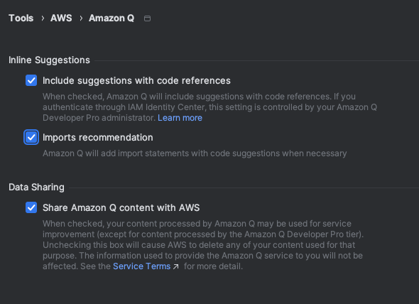

</details>

**⚙️ `~/.kiro/settings/cli.json & CLI`**
```shell
kiro-cli settings telemetry.enabled false
kiro-cli settings chat.enableKnowledge false
q settings telemetry.enabled false
q settings shareCodeWhispererContent false
```

<a id="cursor"></a>
### 🔴 必关 Cursor
*Cursor IDE · Cursor CLI · Cloud Agents* ｜ [官方文档 / Docs](https://cursor.com/security)

- **关闭路径**：Ctrl/Cmd+Shift+J 打开 Cursor Settings `➔` General → Privacy `➔` 开启 Privacy Mode (Legacy) `➔` 配置 .cursorignore
- **模型训练**：Free 默认 Share Data → 务必开 Privacy Mode (Legacy)；Teams/Ent 默认锁定
- **记忆设置**：原生自动 Memories 已在 v2.1+ 正式弃用移除，改用静态 .cursor/rules/*.mdc
- **⚠️ 避坑**：高敏仓库严禁开启 Cloud Agents（会在云端 VM 持久化快照，破坏无状态 ZDR）

**⚙️ `.cursorignore & ~/.cursor/cli-config.json`**
```json
// ~/.cursor/cli-config.json（另在项目根目录建 .cursorignore 屏蔽 .env / *.key / secrets/）
{ "permissions": { "deny": ["Read(.env*)", "Read(**/*.pem)", "WebFetch(*)"] } }
```

<a id="windsurf_devin"></a>
### 🔴 必关 Cognition / Windsurf & Devin
*Windsurf IDE (原 Codeium) · Devin Web & CLI* ｜ [官方文档 / Docs](https://docs.windsurf.com/)

- **关闭路径**：windsurf.com/settings → Privacy 开 ZDR `➔` Cascade → Customizations 关 Memories `➔` app.devin.ai → Data Controls 关训练
- **模型训练**：两者 Free 均强制训练不可退！Pro 默认收集须手退；Teams/Ent 默认 ZDR
- **记忆设置**：Windsurf Cascade Auto-Memories 默认开 → 关闭并清 ~/.codeium/windsurf/memories/
- **⚠️ 避坑**：商业源码切勿用 Windsurf/Devin 免费档；Devin CLI 必开 sandbox.enabled: true

**⚙️ `Windsurf settings.json & ~/.config/devin/config.json`**
```json
// Windsurf User/settings.json（同时配 .codeiumignore）
{ "telemetry.telemetryLevel": "off", "codeium.enableTelemetry": false }
// ~/.config/devin/config.json
{ "sandbox": { "enabled": true }, "permissions": { "deny": ["Read(.env*)"] } }
```

<a id="canva"></a>
### 🔴 必关 Canva (Magic Studio)
*Canva Web / Desktop / Mobile* ｜ [官方文档 / Docs](https://www.canva.com/settings/privacy-preferences)

- **关闭路径**：右上角头像 → Settings `➔` Your account → Privacy controls `➔` 关闭 2 项 AI learn 开关 `➔` 关闭 AI personalization
- **模型训练**：Free/Pro 内容与使用训练均默认 ON → 必关；Teams/Ent/Edu 默认关闭锁定
- **记忆设置**：AI-generated content 个性化默认开 → 关闭
- **⚠️ 避坑**：直达 URL: canva.com/settings/privacy-preferences；无原生无痕对话

<details open><summary>📷 产品真实界面截图（redact.dev）</summary>

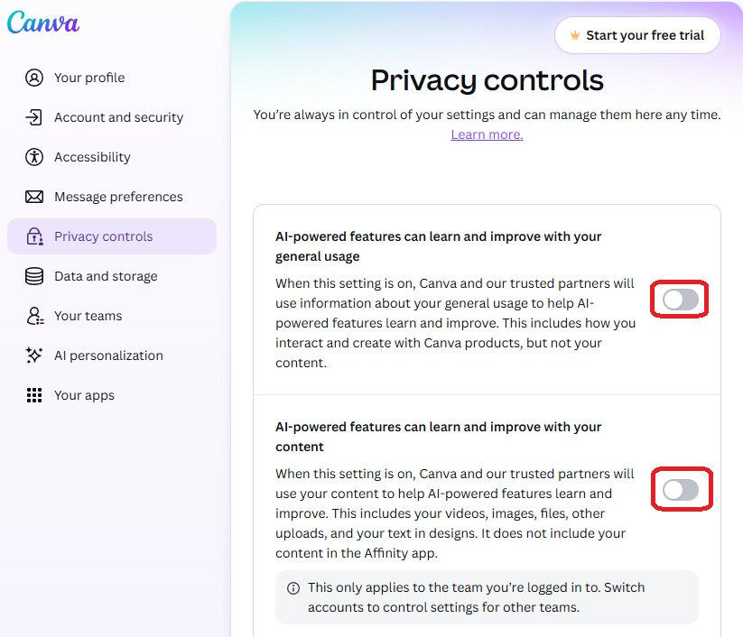

</details>

<a id="notion"></a>
### 🟡 需调 Notion AI ⚠️ (10月子处理商外泄)
*Notion Web / Desktop / Mobile · 仍零训练但曾遭第三方外泄* ｜ [官方文档 / Docs](https://www.notion.com/help/notion-ai-security-practices)

- **关闭路径**：Settings → Notion AI `➔` 确认 Share data to improve 为关 `➔` Memory → 关闭 Use memories `➔` 绝不在对话粘贴 API Key / 密码
- **模型训练**：全计划默认绝不训练 ✅；⚠️ 但 2026.10–11 第三方推理商 Fireworks AI 遭入侵，外泄 <1% 工作区的 Notion AI 聊天记录与粘贴的密钥（Insights 已下线停用）
- **记忆设置**：Use memories 默认开 → 关闭；限制 Custom Agents 仅管理员可建，并排查是否曾粘贴密钥
- **⚠️ 避坑**：第三方云子处理商同样打破“理论无留存”预期；非企业版彻底停用 AI 须邮件 team@makenotion.com

<a id="opencode"></a>
### 🟡 需调 OpenCode ⚠️ (10月Console泄密)
*Anomaly Co. (原 SST) · 仅限本地 BYOK，严禁托管 Console* ｜ [官方文档 / Docs](https://opencode.ai/docs/config)

- **关闭路径**：严禁在 OpenCode Console 托管 Key `➔` 编辑 ~/.config/opencode/opencode.json `➔` 锁死 share: "disabled" & 禁 Zen 免费 `➔` 导出 OPENCODE_DISABLE_*
- **模型训练**：本地 CLI/BYOK 本体零训练 ✅；⚠️ 2026.10.16 托管 Console 旧系统遭入侵外泄约 1.4% 绑定 Key（盗刷数百至上千美元）；Zen 免费模型允许收集；曾遭质疑 PostHog/Honeycomb 遥测
- **记忆设置**：无云端记忆；历史存本地 SQLite (opencode.db)，可用 OPENCODE_DB 临时隔离
- **⚠️ 避坑**：曾用过 Console 托管 Key 必须回 OpenAI/Anthropic/Google 后台立即吊销轮换！share 必锁 disabled 防公网链接

<details open><summary>📷 产品真实界面截图（github.com/anomalyco/opencode）</summary>

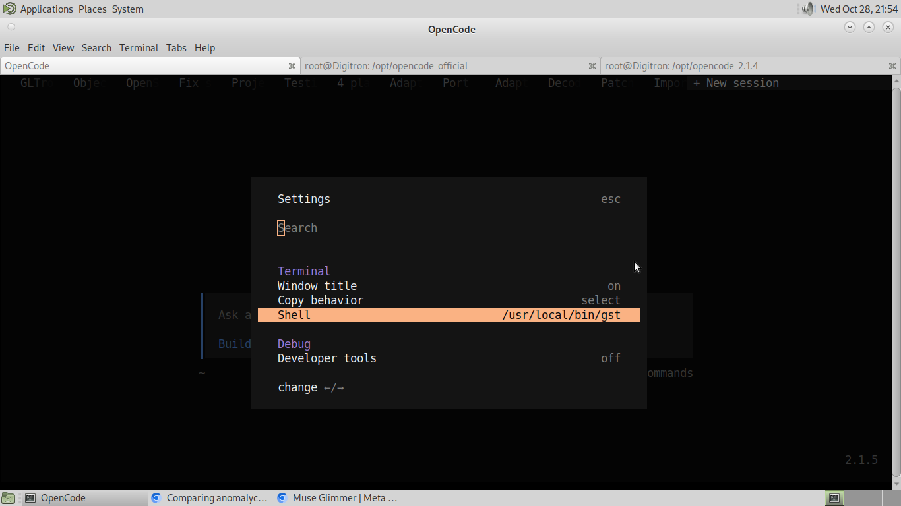

</details>

**⚙️ `~/.config/opencode/opencode.json`**
```json
{
  "share": "disabled",
  "autoupdate": false,
  "snapshot": false,
  "experimental": { "openTelemetry": false },
  "permission": { "read": { "*": "allow", "*.env": "deny", "*.env.*": "deny" }, "webfetch": "deny" }
}
```

<a id="pi"></a>
### 🔴 必关 Pi (Coding Agent & pi.ai)
*开源终端 pi.dev (低风险) vs 消费端 pi.ai (高风险)* ｜ [官方文档 / Docs](https://pi.dev)

- **关闭路径**：pi.dev: ~/.pi/agent/settings.json 关统计 `➔` pi.dev 无痕启动: pi --no-session `➔` pi.ai: Account Settings 退出训练
- **模型训练**：pi.dev 纯本地 BYOK 零训练 ✅；同名消费端 Inflection pi.ai 默认训练+情绪推断 ❌
- **记忆设置**：pi.dev 原生支持 --no-session 不写 JSONL；pi.ai 用 !delete 删记录
- **⚠️ 避坑**：两者同名完全无关！pi.dev 设 PI_TELEMETRY=0 PI_OFFLINE=1；绝不向 pi.ai 贴源码

**⚙️ `~/.pi/agent/settings.json`**
```json
{ "enableInstallTelemetry": false, "defaultProvider": "anthropic" }
// Shell: export PI_TELEMETRY=0 PI_OFFLINE=1  &&  pi --no-session
```

<a id="t3code"></a>
### 🔴 必关 T3 Code ⚠️ (2026.11 遥测风波)
*Ping Labs 开源控制面 · 曾违背零遥测承诺并越界读认证/进程* ｜ [官方文档 / Docs](https://github.com/pingdotgg/t3code/blob/main/docs/user/telemetry.md)

- **关闭路径**：升至 ≥2026.11.25 补丁版 `➔` 配 policy.json 锁 telemetry:false `➔` 导出 T3CODE_TELEMETRY/OTEL + DNT `➔` 关 Publish agent activity & 切 Supervised
- **模型训练**：本体不训代码，但静默删“零遥测”承诺且默认发 PostHog+ingest.t3.codes+Axiom！2026.11 爆出偷读 ~/.claude.json & ~/.codex/auth.json 哈希(#42299已删)、全机扫描进程命令行(#42577)、假删会话(#42119)与路径泄漏(#42450)
- **记忆设置**：本地 state.sqlite（旧版删除为假删除，11.25 #42119 才真删）→ 立即升级并缩短留存；关 Sharing & access → Publish agent activity（否则外发项目/会话标题且不受退遥测控制）
- **⚠️ 避坑**：托管网页端无追踪关闭开关；移动端两项诊断(崩溃+连接追踪)无视服务端策略；Windows 旧版退遥测失效(#42376)；建议防火墙封 ingest.t3.codes 且禁默认 Full Access

<details open><summary>📷 产品真实界面截图（github.com/pingdotgg/t3code）</summary>

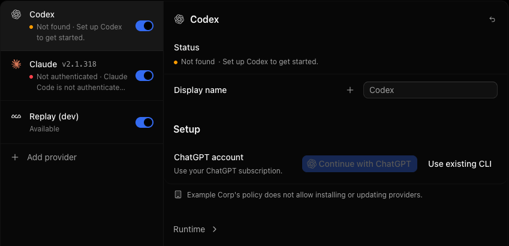

</details>

**⚙️ `/etc/t3code/policy.json & 环境变量（必配 4 项）`**
```json
// /etc/t3code/policy.json (Win: C:\ProgramData\T3Code\policy.json)
{
  "schemaVersion": 1,
  "settings": { "enableAgentBrowserAccess": { "value": false, "locked": true } },
  "limits": { "clients": ["desktop", "local-browser"], "telemetry": false }
}
// Shell / User Env (4项全设 + 建议防火墙屏蔽 ingest.t3.codes):
// DO_NOT_TRACK=1  T3CODE_TELEMETRY_ENABLED=false  T3CODE_OTEL_SDK_DISABLED=true  OTEL_SDK_DISABLED=true
```

<a id="orca"></a>
### 🟢 安全 Orca (stablyai/orca)
*开源本地 BYOA 多 Agent Worktree 工作台* ｜ [官方文档 / Docs](https://github.com/stablyai/orca)

- **关闭路径**：Settings → Privacy 关匿名统计 `➔` 导出 ORCA_TELEMETRY_DISABLED=1 `➔` 退出后改 orca-data.json 透传子变量
- **模型训练**：BYOA 纯本地编排绝不训练 ✅；打包桌面版默认开 PostHog 匿名指标 → 关闭
- **记忆设置**：无云端记忆；独立 Git Worktree 本地隔离，用完即删
- **⚠️ 避坑**：修改 orca-data.json 前务必彻底退出 Orca（否则退出时内存覆写）；勿传公开 dotfiles

<details open><summary>📷 产品真实界面截图（github.com/stablyai/orca）</summary>

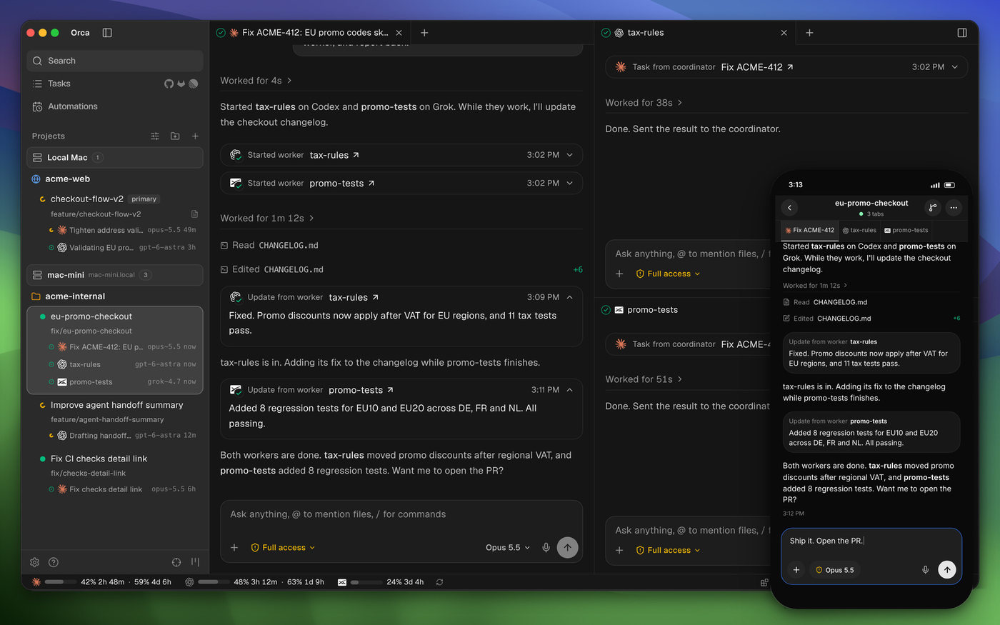

</details>

**⚙️ `Shell & orca-data.json`**
```shell
export ORCA_TELEMETRY_DISABLED=1
export DO_NOT_TRACK=1
# 可在 orca-data.json -> "agentDefaultEnv" 统一给子 Agent 注入 DISABLE_TELEMETRY="1" 
```

<a id="chatbox"></a>
### 🟢 安全 Chatbox
*多模型桌面/Web/移动客户端* ｜ [官方文档 / Docs](https://chatboxai.app)

- **关闭路径**：Settings → Privacy 关匿名报告追踪 `➔` Model Provider 关 Improve Network Compatibility `➔` 优先用本地 Ollama 或直连 ZDR API
- **模型训练**：客户端不训练 ✅；托管服务声明不存不训；⚠️ Plausible/Sentry 上报默认开
- **记忆设置**：纯本地存储无云同步；支持全离线本地 Embedding RAG 知识库
- **⚠️ 避坑**：必关各 Provider 的 useProxy（改善网络兼容性），否则 BYOK 请求绕经第三方中转!

<details open><summary>📷 产品真实界面截图（docs.apiyi.com）</summary>

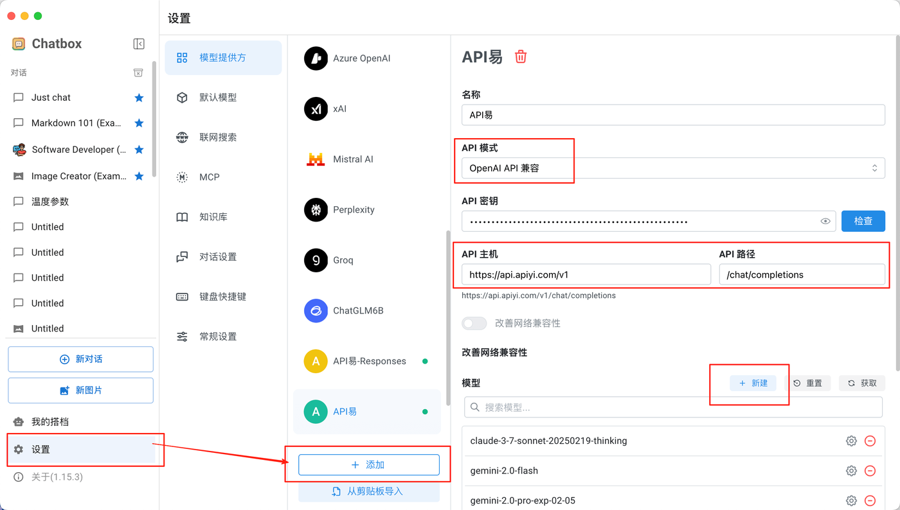

</details>

**⚙️ `%APPDATA%\chatbox\config.json`**
```json
{
  "settings": {
    "allowReportingAndTracking": false,
    "providers": { "openai": { "useProxy": false }, "claude": { "useProxy": false } }
  }
}
```

<a id="trae"></a>
### 🔴 必关 字节 · Trae IDE & Agent CLI
*Trae 国际版/国内版/SOLO · 开源 trae-agent* ｜ [官方文档 / Docs](https://docs.trae.ai/ide/)

- **关闭路径**：Settings → Account `➔` 开启 Privacy Mode (隐私模式) `➔` Rules & Memories 关自动记忆 `➔` 配置 .trae/.ignore
- **模型训练**：个人 Free/Pro 默认关 Privacy Mode(允许对话/片段训练) → 必开；开源 CLI 零训练
- **记忆设置**：自动 Memory 跨会话沉淀 → 关闭并清 ~/.trae(-cn)/memory/
- **⚠️ 避坑**：Privacy Mode 退出登录即失效！VS Code 遥测关不掉字节自有心跳；开源 CLI 必套 Docker

<details open><summary>📷 产品真实界面截图（ithome.com）</summary>

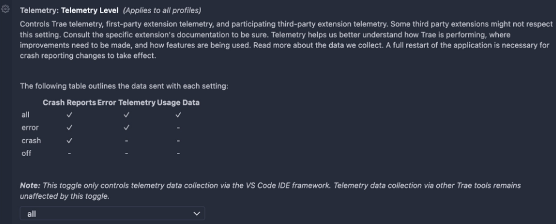

</details>

**⚙️ `.trae/.ignore & trae_config.yaml`**
```yaml
# Trae IDE settings.json: { "telemetry.telemetryLevel": "off" } + .trae/.ignore
# 开源 trae-agent (trae_config.yaml):
default_provider: ollama
enable_lakeview: false
```

<a id="doubao"></a>
### 🔴 必关 字节 · 豆包 / 扣子 / 小豆
*豆包 · 扣子 Coze · 小豆 Personal Agent (2026.11公测)* ｜ [官方文档 / Docs](https://www.volcengine.com/product/ark)

- **关闭路径**：豆包/小豆: 设置 → 隐私与权限 `➔` 全关“帮助模型改进效果” `➔` 设置 → 记忆 关闭并清空 `➔` 扣子: 通用设置关改进效果
- **模型训练**：三款消费端全部默认开启优化训练 ❌；开发者改用火山方舟 ModelArk API(零训练无痕)
- **记忆设置**：豆包/小豆记忆默认开(关不删旧)；小豆一键导入豆包大脑且“连接应用”权限面极广
- **⚠️ 避坑**：三者均无一键无痕开关！豆包桌面关会议录音提醒；小豆“代打电话”全程录音勿谈机密

<details open><summary>📷 产品真实界面截图（csdn.net）</summary>

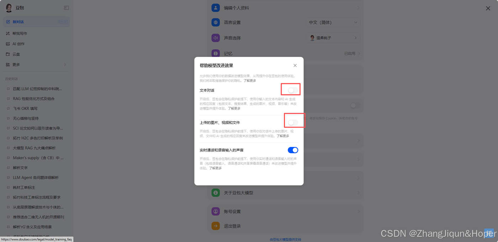

</details>

**⚙️ `火山方舟 ModelArk 零训练 API`**
```shell
# 商用条款默认不训练、推理会话无痕
export ARK_API_KEY="your-volcengine-ark-api-key"
export ARK_BASE_URL="https://ark.cn-beijing.volces.com/api/v3" 
```

<a id="tencent"></a>
### 🟢 安全 腾讯 · WorkBuddy / CodeBuddy / 元宝
*WorkBuddy 桌面 Agent · CodeBuddy IDE/CLI · 腾讯元宝* ｜ [官方文档 / Docs](https://www.codebuddy.cn/docs/)

- **关闭路径**：元宝: 设置 → 数据管理 → 确认“体验优化计划”关闭 `➔` WorkBuddy: 记忆与进化关生成记忆+重置 `➔` CodeBuddy: ~/.codebuddy/settings.json
- **模型训练**：三大主力全系默认不用于模型训练 ✅（元宝 2025.03 整改默认关，Web/PC 有无痕）
- **记忆设置**：WorkBuddy“生成对话记忆”每晚自动提取 → 关闭+重置，留存期调至 30 天
- **⚠️ 避坑**：CodeBuddy CLI 务必设 CODEBUDDY_ARTIFACT_ENABLED=false 防误发公网分享链

<details open><summary>📷 产品真实界面截图（ifeng.com）</summary>

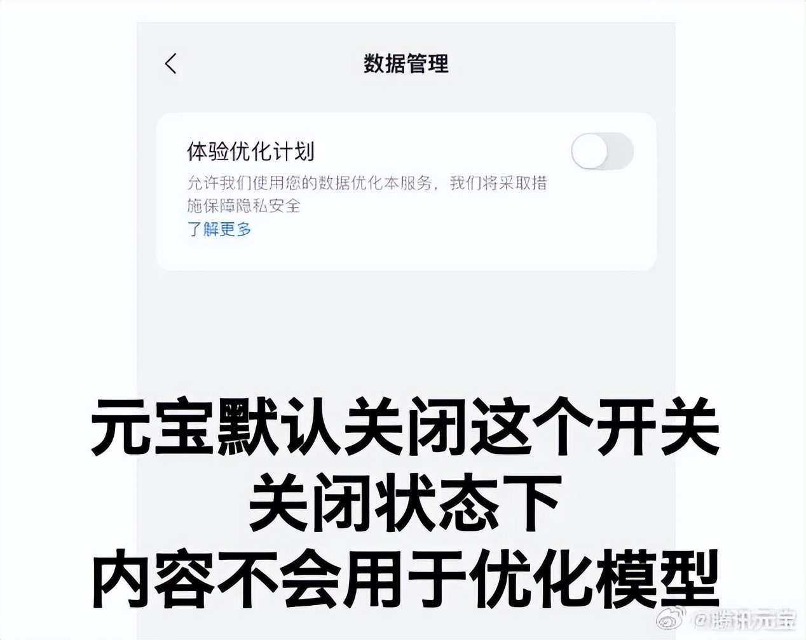

</details>

**⚙️ `~/.codebuddy/settings.json`**
```json
{
  "sandbox": { "enabled": true },
  "permissions": { "deny": ["Read(./.env*)", "Read(~/.ssh/**)"] },
  "env": { "DISABLE_TELEMETRY": "1", "CODEBUDDY_ARTIFACT_ENABLED": "false" }
}
```

<a id="qoder"></a>
### 🟡 需调 阿里 · Qoder & 通义灵码
*Qoder IDE/CLI · 通义灵码 (2026.05升级 Qoder CN)* ｜ [官方文档 / Docs](https://docs.qoder.com/)

- **关闭路径**：Settings (⌘⇧,) → 常规 → 开启隐私模式 `➔` 记忆管理 → 关闭自动记忆并清理 `➔` CLI 改 ~/.qoder/settings.json
- **模型训练**：源码上下文声明不训，但去标识化交互可优化；CLI 两项统计默认 true → 全关
- **记忆设置**：支持全局/工程自动记忆；<1万文件仓默认后台自动索引 → 高敏仓关索引配 .qoderignore
- **⚠️ 避坑**：绝不点击回答点赞/点踩（会触发匿名反馈采集）；切勿设 QODER_MEMORY=1

<details open><summary>📷 产品真实界面截图（cnblogs.com）</summary>

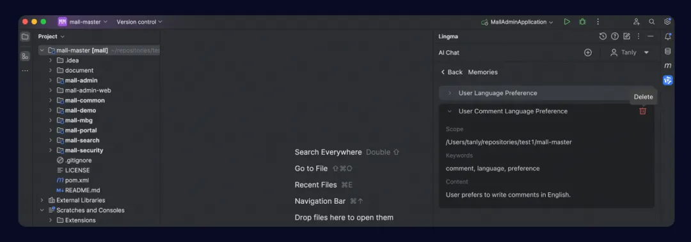

</details>

**⚙️ `~/.qoder/settings.json`**
```json
{
  "privacy": { "usageStatisticsEnabled": false },
  "aiCodeStatistics": { "enabled": false },
  "autoMemoryEnabled": false
}
```

<a id="qwen"></a>
### 🔴 必关 阿里千问 · Qwen Code & 千问
*Qwen Code CLI · chat.qwen.ai · 通义千问 & QwenWork* ｜ [官方文档 / Docs](https://github.com/QwenLM/qwen-code)

- **关闭路径**：chat.qwen.ai: 邮件 privacy@qwen.com 退训 `➔` Web/App 关长期记忆；清 QwenWork USER.md `➔` CLI 编辑 ~/.qwen/settings.json
- **模型训练**：⚠️ 国际/国内 Web 均无前端一键退训开关！涉密改用阿里云百炼标准按量 API(不训练)
- **记忆设置**：Qwen Code CLI 的 AutoMemory & AutoDream 默认 true！千问办公写 ~/.qwenworkcn/awareness/
- **⚠️ 避坑**：免费 Qwen OAuth 已于 2026.04 停服；CLI 切勿把 sk-sp- Coding Plan 混用于涉密代码

<details open><summary>📷 产品真实界面截图（github.com/QwenLM/qwen-code）</summary>

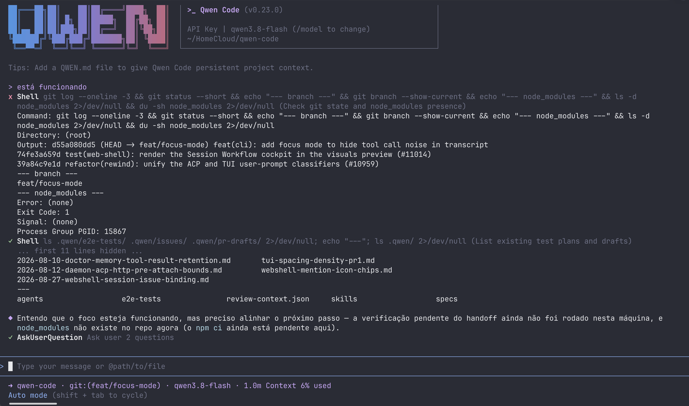

</details>

**⚙️ `~/.qwen/settings.json`**
```json
{
  "privacy": { "usageStatisticsEnabled": false },
  "telemetry": { "enabled": false, "logPrompts": false },
  "memory": { "enableManagedAutoMemory": false, "enableManagedAutoDream": false },
  "general": { "chatRecording": false }
}
```

<a id="zhipu"></a>
### 🔴 必关 智谱 / GLM & ZCode
*ZCode (Z.ai ADE) · 智谱清言 (ChatGLM) · BigModel* ｜ [官方文档 / Docs](https://zcode.z.ai/docs/v2/core-features/memory)

- **关闭路径**：智谱清言: 个人中心 → 数据管理 `➔` 关闭“数据用于优化体验/数据使用” `➔` ZCode: 保持工作区记忆 OFF + 代理拦遥测
- **模型训练**：智谱清言 C 端默认开 → 必关；Z.ai 整改后开发通道启 ZDR，国内 BigModel 须另签协议
- **记忆设置**：ZCode 工作区记忆默认 OFF；清言暂无跨会话自动记忆面板、无无痕模式
- **⚠️ 避坑**：ZCode 桌面端硬编码每 15 分钟上报 zcode.z.ai/api/v1/event/report 且无 UI 关闭项，须网络层拦截

**⚙️ `本地代理拦截规则 & ~/.zcode/AGENTS.md`**
```shell
# 代理精准阻断 ZCode 遥测（不影响模型推理）：
URL-REGEX,^https://zcode\.z\.ai/api/v1/event/report,REJECT
# 或在 OpenCode 中直接接入国际 Z.ai ZDR 端点：
export ZAI_API_BASE_URL="https://api.z.ai/api/coding/paas/v4" 
```

<a id="minimax"></a>
### 🔴 必关 MiniMax · mcode / Agent / 海螺
*MiniMax Code (mcode) · MiniMax Agent · 海螺 AI* ｜ [官方文档 / Docs](https://github.com/MiniMax-AI/minimax-code)

- **关闭路径**：Agent: Settings → Personalization 关 Memory & Proactive `➔` Memory summary → Manage 清空 `➔` mcode: ~/.minimax/config.yaml 锁 default
- **模型训练**：mcode 本地三通道遥测默认全关 ✅；⚠️ 海螺 AI/Agent/公开 API 无自助退训与 ZDR ❌
- **记忆设置**：MiniMax Agent 支持 Proactive Memory（关不删旧）→ 关闭并清空摘要，会话用 /memory
- **⚠️ 避坑**：核心源码与 PII 切勿直连公开 MiniMax 云端，须签企业 DPA 或私有化部署开源权重

<details open><summary>📷 产品真实界面截图（github.com/MiniMax-AI/minimax-code）</summary>

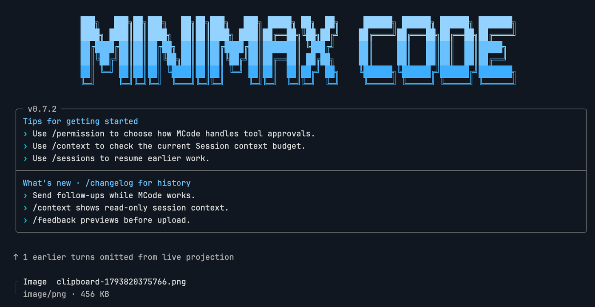

</details>

**⚙️ `~/.minimax/config.yaml`**
```yaml
permissionMode: default
telemetry: { enabled: false, metrics: false, diagnostics: false }
# Shell: export MCODE_DISABLE_TELEMETRY=1 DO_NOT_TRACK=1
```

<a id="kimi"></a>
### 🔴 必关 月之暗面 / Kimi 系列
*Kimi Code CLI & 扩展 · Kimi Web/App* ｜ [官方文档 / Docs](https://code.kimi.com/kimi-code/docs/configuration/config-overrides)

- **关闭路径**：发邮件 support@moonshot.cn 申请退训 `➔` 设置 → 个性化 → 关“通过会话产生记忆” `➔` 进“记忆空间”清空旧条目 `➔` 编辑 ~/.kimi-code/config.toml
- **模型训练**：⚠️ 个人版/Coding Plan 默认训练且无 UI 开关（须邮件人工登记，5–7日生效）；Business 不训
- **记忆设置**：自动整理写入“记忆空间”（关不删旧），无原生无痕对话 → 关记忆+清空记忆空间
- **⚠️ 避坑**：Kimi Code CLI 遥测默认 true 且默认开联网搜索！TOML 必关 telemetry 并禁用 WebSearch

<details open><summary>📷 产品真实界面截图（kimi.com）</summary>

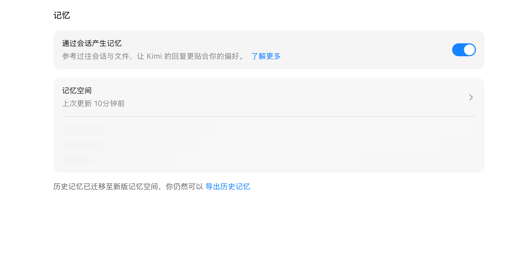

</details>

**⚙️ `~/.kimi-code/config.toml`**
```toml
default_permission_mode = "manual"
telemetry = false
[memory]
auto_memory_enabled = false
[tools]
disabled = ["WebSearch", "FetchURL"]
```

<a id="deepseek"></a>
### 🔴 必关 DeepSeek & Harness (dsh)
*DeepSeek Harness (dsh 开源) · chat.deepseek.com · API* ｜ [官方文档 / Docs](https://github.com/deepseek-ai/deepseek-harness)

- **关闭路径**：Web/App: 设置 → 数据管理 `➔` 关“数据用于优化体验 / Improve the model” `➔` dsh: cordis.patch.yml 设 DISABLED `➔` 高敏源码用本地自托管 Ollama
- **模型训练**：C 端默认开 → 必关；第一方 API 无退训/ZDR 开关；dsh 本地开源本体不训练 ✅
- **记忆设置**：C 端无跨会话长期记忆、无无痕模式；dsh 为插件化本地记忆，OTel 默认 FEEDBACK_ONLY
- **⚠️ 避坑**：api.deepseek.com 默认开磁盘 KV-Cache 且无 ZDR！强合规源码请用 dsh + 本地自托管权重

**⚙️ `~/.dsh/profiles/web/cordis.patch.yml`**
```yaml
- id: session-telemetry-otel
  name: '@deepseek-ai/dsh-session-telemetry-otel'
  config: { mode: DISABLED }
# Shell: export DSH_TELEMETRY_DISABLED=1 DSH_TELEMETRY_MODE=DISABLED
```

<a id="oss_clean"></a>
### 🟢 安全 纯净开源 Agent (Aider · Goose)
*Aider · Block Goose（实测零丑闻 · 显式授权遥测）* ｜ [官方文档 / Docs](https://block.github.io/goose/)

- **关闭路径**：Aider: ~/.aider.conf.yml 设 analytics-disable & gitignore `➔` Goose: 首次拒绝遥测 + 设 GOOSE_TELEMETRY_OFF=1 `➔` 配合本地 Ollama 或商用 ZDR API
- **模型训练**：两者纯本地 BYOK 零训练 ✅；Goose 首次启动显式询问授权而非偷跑；2026 全年无重大隐私或供应链丑闻
- **记忆设置**：无黑盒云端画像；Aider 明文写 .aider.chat.history.md 务必配 gitignore: true 防误提交
- **⚠️ 避坑**：仍须审计挂载的第三方 MCP Server 权限；Goose 同时设 GOOSE_TELEMETRY_OFF=1 与 GOOSE_TELEMETRY_ENABLED=false

**⚙️ `~/.aider.conf.yml & Goose Env`**
```yaml
# Aider (~/.aider.conf.yml):
analytics-disable: true
gitignore: true
# Block Goose (~/.zshrc & ~/.config/goose/config.yaml):
# export GOOSE_TELEMETRY_OFF=1 GOOSE_TELEMETRY_ENABLED=false
```

<a id="cline_roo_kilo"></a>
### 🟡 需调 Cline / Roo Code / Kilo Code ⚠️
*VS Code 开源三叉戟 · 2026 曾曝供应链与遥测争议* ｜ [官方文档 / Docs](https://docs.cline.bot)

- **关闭路径**：Cline: 避开旧版 npm 2.3.0，配 telemetryOptOut:true `➔` Roo Code: 禁登录 Roo Cloud + 升补丁防工作区 RCE `➔` Kilo Code: 关遥测并监控出网流量
- **模型训练**：客户端本体不训练 ✅；⚠️ 但 2026 均曝风险：Cline 2026.02 遭 Clinejection 供应链投毒(npm cline@2.3.0 被劫持8小时，扩展未受影响)；Roo 曾曝关开关仍上报 CloudTelemetryClient；Kilo 曾曝离线仍有异常外连
- **记忆设置**：无黑盒云端记忆；Roo Code 切勿登录 Roo Cloud 同步会话
- **⚠️ 避坑**：Cline 已弃用 .clineignore（改用 PreToolUse Hook）；Roo 曾曝 CVE-2025-58372 (.code-workspace 注入)，三者均须禁自动批准命令

<details open><summary>📷 产品真实界面截图（github.com/cline/cline）</summary>

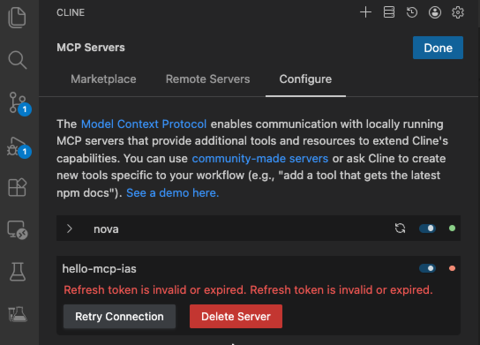

</details>

**⚙️ `Cline / Kilo 配置与环境变量`**
```json
// Cline (~/.cline/data/settings/global-settings.json): { "telemetryOptOut": true }
// Kilo CLI: export KILO_TELEMETRY_LEVEL=off  (高敏仓建议加本机出口防火墙白名单)
```

<a id="openclaw"></a>
### 🔴 必关 OpenClaw ⚠️ (2026 多起高危安全危机)
*原 Clawdbot/Moltbot · 曾曝 ClawBleed/投毒/大厂禁令* ｜ [官方文档 / Docs](https://openclaw.ai)

- **关闭路径**：仅在强隔离容器/虚拟机内运行 `➔` 强制升至 Trail of Bits 审计后新版 `➔` 严禁安装未经审计的 ClawHub 技能 `➔` 关公网暴露与自动更新检查
- **模型训练**：本体本地运行不训练，但 2026 爆发 AI 工具史上最严重安全危机：CVE-2026-25253 (ClawBleed 一键 WebSocket RCE)、ClawHavoc (ClawHub 超千个恶意技能窃密)、Claw Chain 逃逸及数万公网暴露实例，遭 Meta/Microsoft 内部封禁！
- **记忆设置**：具备宿主机持久记忆与全权限执行能力 → 绝不可直接在存有公司源码/密钥的宿主机裸跑
- **⚠️ 避坑**：即便已接受 Trail of Bits 审计并加固默认鉴权，高敏开发机仍强烈建议容器隔离 + 禁 ClawHub 第三方插件

**⚙️ `~/.openclaw/openclaw.json & 容器隔离`**
```json
// ~/.openclaw/openclaw.json（务必在无宿主机密钥的 Docker/VM 中运行，切勿暴露端口到公网）
{ "update": { "checkOnStart": false }, "telemetry": { "enabled": false }, "gateway": { "bind": "127.0.0.1", "requireAuth": true } }
```

<a id="comm_ide"></a>
### 🔴 必关 商业 IDE & 云端构建 (6 款)
*JetBrains AI/Junie · Zed · Amp · v0 · Lovable · Replit* ｜ [官方文档 / Docs](https://www.jetbrains.com/help/ai-assistant/data-sharing.html)

- **关闭路径**：JetBrains: System Settings → Data Sharing 全取消 `➔` v0 / Lovable / Replit 关 Model Training & 设 Private `➔` Zed 关遥测 · Amp 锁 visibility: private
- **模型训练**：Zed/Amp/JB 商业版默认零训练 ✅；⚠️ JB 免费版 & v0/Lovable/Replit 个人档默认开训 ❌
- **记忆设置**：JetBrains 用 .junie/guidelines.md；Replit 自动写 replit.md 切勿放密钥
- **⚠️ 避坑**：JetBrains 高敏仓放空文件 .noai 彻底禁 AI；Amp 不支持 .ampignore；Junie 禁开 Brave Mode

<details open><summary>📷 产品真实界面截图（jetbrains.com）</summary>

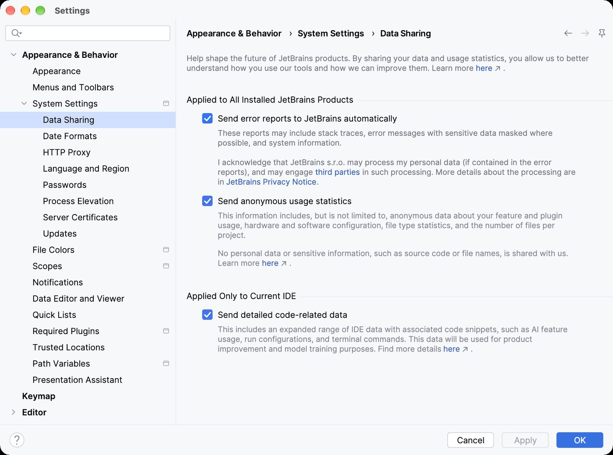

</details>

**⚙️ `~/.config/zed/settings.json & ~/.config/amp/settings.json`**
```json
// Zed: { "telemetry": { "diagnostics": false, "metrics": false } }
// Amp: { "amp.defaultVisibility": { "github.com/your-org/*": "private" } }
```

<a id="web_research"></a>
### 🔴 必关 研究与通用 Web AI (4 款)
*Perplexity · NotebookLM · Manus · Poe* ｜ [官方文档 / Docs](https://www.perplexity.ai/hub)

- **关闭路径**：Perplexity: Preferences → 关 AI Data Retention & 清 Memory `➔` NotebookLM: 默认零训(绝不点赞/踩) `➔` Manus: 退训+禁公开 · Poe: 只选全实心盾 Bot
- **模型训练**：NotebookLM 默认零训 ✅；Perplexity Free/Pro/Max 默认开训 ❌；Poe 半实心盾第三方可训
- **记忆设置**：Perplexity/Poe 关开关不删旧记忆须手动清；NotebookLM 按笔记本硬隔离
- **⚠️ 避坑**：NotebookLM 个人号点 Feedback 赞/踩会触发最长 3 年人工审核！Perplexity 有无痕+Sonar ZDR

## 🔧 一键防遥测环境变量脚本（macOS / Linux）
```bash
export DO_NOT_TRACK=1
export CLAUDE_CODE_DISABLE_NONESSENTIAL_TRAFFIC="1" DISABLE_TELEMETRY="1" CLAUDE_CODE_DISABLE_AUTO_MEMORY="1"
export GEMINI_TELEMETRY_ENABLED="false" GEMINI_TELEMETRY_LOG_PROMPTS="false"
export GROK_TELEMETRY_ENABLED=0 GROK_TRACE_UPLOAD=0 GH_TELEMETRY=0
export OPENCODE_DISABLE_AUTOUPDATE=1 OPENCODE_DISABLE_SHARE=1 OPENCODE_DISABLE_MODELS_FETCH=1
export PI_TELEMETRY=0 PI_OFFLINE=1 T3CODE_TELEMETRY_ENABLED=false T3CODE_OTEL_SDK_DISABLED=true OTEL_SDK_DISABLED=true ORCA_TELEMETRY_DISABLED=1
export CODEBUDDY_CODE_ENABLE_TELEMETRY=0 CODEBUDDY_ARTIFACT_ENABLED=false
export QWEN_USAGE_STATISTICS_ENABLED=false QWEN_TELEMETRY_ENABLED=false
export MCODE_DISABLE_TELEMETRY=1 KIMI_DISABLE_TELEMETRY=1 KIMI_DISABLE_AUTO_MEMORY=1
export DSH_TELEMETRY_DISABLED=1 DSH_TELEMETRY_MODE=DISABLED
export AIDER_ANALYTICS_DISABLE=true GOOSE_TELEMETRY_OFF=1 GOOSE_TELEMETRY_ENABLED=false KILO_TELEMETRY_LEVEL=off OPENCLAW_NO_AUTO_UPDATE=1
```

## 🔍 全网同类整理查重对照（为什么需要本项目）

| 已有贴文 / 开源项目 | 覆盖范围 | 局限性 | 含实拍图? |
| :--- | :--- | :--- | :---: |
| [EFF — Opt Out of AI Tools Made by Big Tech](https://www.eff.org/pages/i-want-opt-out-ai-tools-or-training-made-big-tech) | 欧美消费端（约4-5家大厂） | 缺 2026 Coding Agent、IDE、TOML/JSON 及国产工具 | 无 / No |
| [AIPolicyLog — AI Data Opt-Out Cheat Sheet](https://aipolicylog.com/guides/ai-data-opt-out-cheat-sheet/) | 欧美 Web Chat（约6-8家） | 仅英文网页聊天；无 IDE/CLI 配置、无国产工具、无截图 | 无 / No |
| [Redact.dev Blog (Single-Tool Opt-Out Guides)](https://redact.dev/blog/opt-out-github-ai-training) | 零散单篇（Copilot/Grok/Canva等） | 单品长文分散，缺跨平台速查矩阵、CLI 配置与国产工具 | 部分有 / Partial |
| [DeleteMe — AI Privacy Settings Guides](https://joindeleteme.com/ai-privacy-settings/cursor-ai-privacy-settings-guide/) | 零散单篇（Cursor/DeepSeek/Claude） | 单品指南各自独立；缺 2026 新 Agent CLI 与双语对照 | 部分有 / Partial |
| [Engadget / GhostVault / MEGA Blog](https://www.engadget.com/2268598/how-to-stop-ai-companies-training-your-data/) | 媒体科普（4-6家消费端聊天） | 偏文字新闻科普，无开发工具、无配置文件与环境变量 | 极少 / Few |
| [GitHub: hamarshehmhmd/optout (★0)](https://github.com/hamarshehmhmd/optout) | 极早期 CLI 扫描脚本（仅4工具） | 仅检测 Claude Code/Cursor/Copilot/VS Code，无图无文档 | 无 / No |
| [GitHub: pyamsoft/auto-ai-optout (★3)](https://github.com/pyamsoft/auto-ai-optout) | 浏览器扩展（少数网页） | 仅限浏览器内个别网页，覆盖不到 IDE、CLI 和本地 Agent | 无 / No |
| [中文社区零散帖（博客园 / binlin.wang）](https://blog.binlin.wang/posts/gpt-data-privacy.20260625) | 单产品笔记（GPT 或 Copilot） | 高度零散，无横向对比、无交互筛选、无中英双语版 | 单工具 / Single |
| **本项目 (AI Privacy Switches 2026)** | **26 家族 · 68 工具（欧美+国产+IDE+CLI+Web）** | **SVG全景图 + 23张实拍真图 + 双语 HTML/MD + TOML/JSON + 精简 Excel/PPT** | **✅ 23 张已核实** |

## 🤝 欢迎提交脱敏真实截图（PRs Welcome）

本项目坚持 **零假图原则**。目前 Cursor、Windsurf/Devin、Notion AI、Pi、智谱/ZCode、DeepSeek Web、Perplexity/Manus/Poe 共 7 张卡片因设置页在登录墙内暂缺公开实拍图，欢迎按 [CONTRIBUTING.md](./CONTRIBUTING.md) 提交脱敏后的 PNG 实拍图！